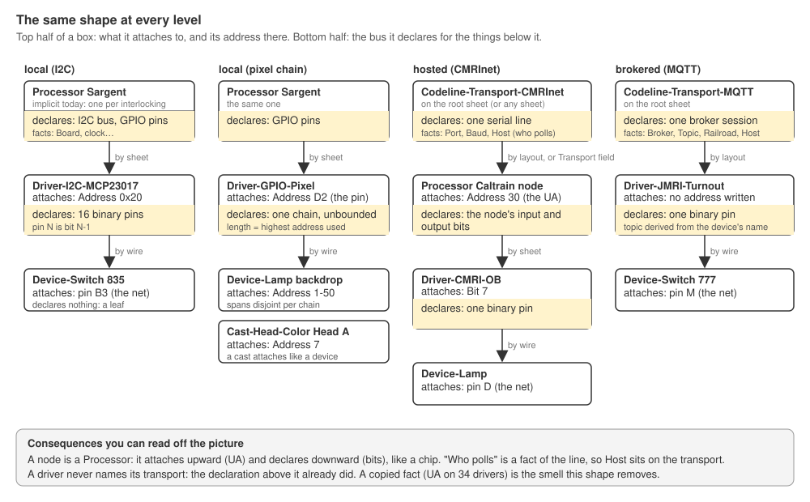
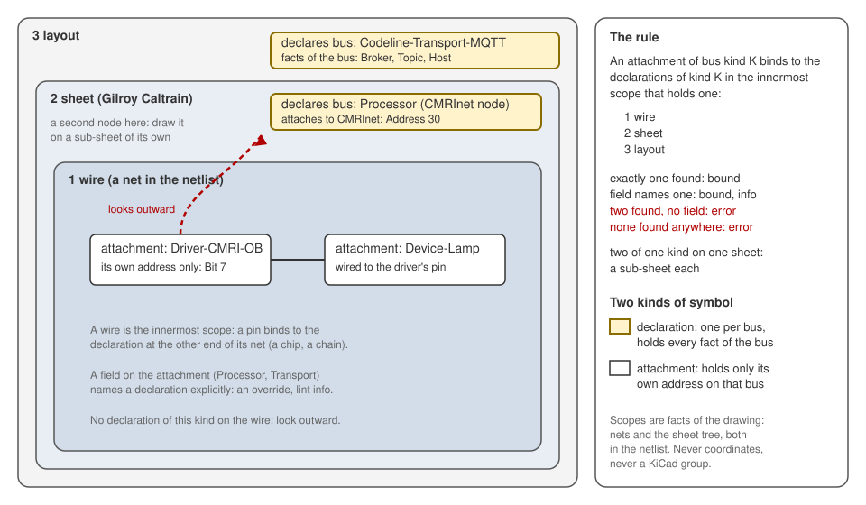
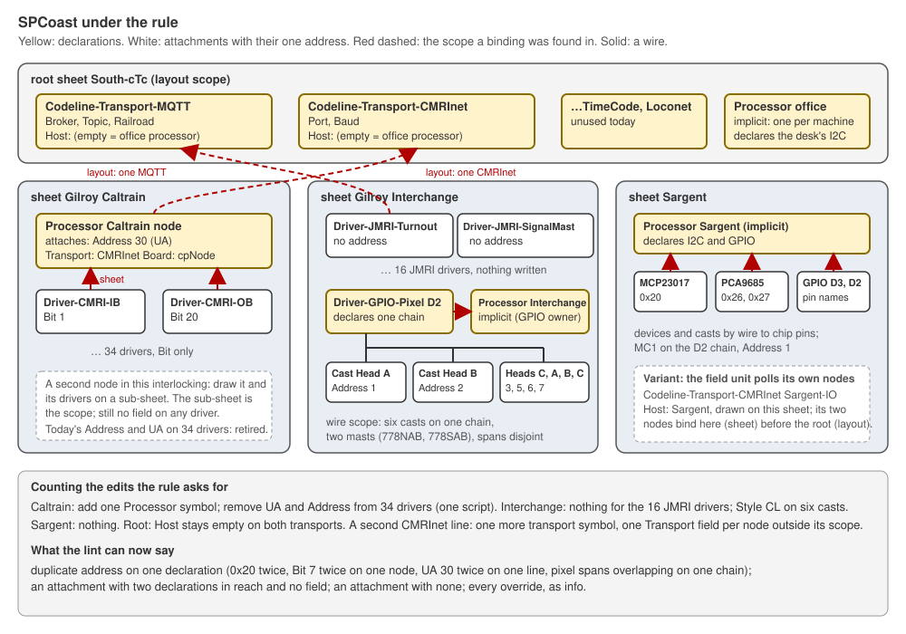

# 0005. Bus binding: the rules in play, and what they say about how a driver finds its bus

- Status: accepted by the owner 2026-10-19 (rev 4). Rev 1 asked thirteen decisions; rev 2 two. The owner's reviews the same day: the thirteen "should dissolve into 1 or 2 higher level decisions, out of which these all fall out as obvious consequences"; then, where a "No" is a status quo the standing rules already forbid, "there really is no decision to make, and this falls out from previous decisions"; and the record is still worth keeping, because its problem is that "there are quite a few interrelated design decisions, axioms and requirements in play, but no one place that ties them all together". Rev 4 applies the owner's last test, "if this ADR were the input for a stand-alone layout editor, what would change?": each rule in §2 now carries its stratum, and three places where the reasoning was mis-filed are fixed (S5, C10, R4).
- Decision: the owner confirmed on 2026-10-19 that the derivation in §4 follows from the rules in §2. §9 lists what now changes.
- Date: 2026-10-19
- Scope: the field and office I/O sheets of the unified SPCoast project. Interlocking logic is out of scope.
- Pictures: `0005/scopes.svg`, `0005/pattern.svg`, `0005/spcoast.svg`.

## 1. Problem

Every driver on an I/O sheet rides a bus: an I2C expander rides its processor's bus, a pixel lamp rides a chain, a CMRInet bit rides a node on a serial line, a JMRI driver rides an MQTT broker session. The model needs the bus for every driver, because the generated application has to reach the hardware through it.

The rules that settle how the drawing states this already exist. They are spread over `AGENTS.md`, three ADRs, two review notes, a memory of the 2026-09-28 principles and the owner's rulings of this week, and no one place ties them together. Each of this ADR's first two revisions asked the owner to decide things those rules had already decided. This revision collects the rules, derives the binding rule from them, and records what follows.

The symptom in the drawing today:

| Bus kind | How the drawing says which bus | Count today |
|---|---|---|
| I2C on a processor | not said; the compiler assumes one processor per interlocking | 3 chips on Sargent, 14 on the desk |
| GPIO and pixel chain | the wire from the chain pin to the consumer; the consumer's `Address` | 3 chains, 8 consumers |
| CMRInet node | `Address 30` on every driver (`UA` and the Value are rendered from it); nothing names the serial line | 34 drivers on Gilroy Caltrain |
| MQTT (JMRI) | not said; one transport symbol exists on the root sheet | 16 drivers on Gilroy Interchange |
| code line encoding | the encoding references its transport (ADR 0001) | 6 |

The copied fact is the problem that shows. The owner's words: "35 items on Caltrain's sheet that need to be hand or machine edited", "DRY-hell when we have two CMRI transports", "hand editing a bunch of symbols to add or modify symbol attributes is a royal PITA". A second serial line, or a field unit that polls its own nodes, cannot be drawn at all.

## 2. Rules in play

Each rule is cited where it was decided. §4 refers to them by number. Each also carries its stratum, found by asking whether the rule survives a change of drawing tool: a **model** rule says what a layout is and survives unchanged; a **representation** rule says how the model is encoded in KiCad (a net is a connection, a sheet is a container, a field is an attribute, Value is a rendering) and changes name but not content; an **operating** rule says how to change a drawing safely in the tool we have and vanishes with the tool. A specification for another editor takes the model rules verbatim, rewrites the representation rules as its own mapping table, and drops the operating rules.

- A1. *Model.* **A fact has one source.** `AGENTS.md`, design rules. A fact copied onto 34 symbols has 34 sources.
- A2. *Model.* **Facts, not symbols.** ADR 0001 D15: a rule that reads "is there a symbol on this sheet" stands for a fact that lives elsewhere; find the fact.
- A3. *Representation.* **Ground truth is the netlist and the sheet file, never coordinates.** `AGENTS.md`, KiCad conventions. The model rule underneath: connectivity and containment are facts the model stores, derived once by the tool that owns geometry, and every rule reads the facts. KiCad owns the derivation, so we consume its result.
- A4. *Representation.* **Membership is the sheet tree.** "Folder = membership" (logical-model principles, 2026-09-28); a symbol's interlocking is the sheet it sits on (ADR 0004 D12). The model rule underneath: a scope is a named container the designer can see and point to, nested to any depth. KiCad offers two such containers, the net and the sheet.
- A5. *Model.* **Identity never comes from a binding; an address is a setting of the binding.** `docs/review/layout-model-view-2026-10-16.md` §8, O2.
- A6. *Model.* **Model errors are inconsistent facts only.** "This target cannot build it" is a generator diagnostic (layout-model-view §8).
- A7. *Model.* **Encoding on transport; authored addresses.** ADR 0001.
- A8. *Model.* **A CMRInet node is a processor that hosts nothing**; a processor is derived, one per interlocking and one per machine, until a `Processor` symbol is drawn. `docs/review/processor-cases-2026-10-16.md`, case 7 and the defaults.
- A9. *Representation.* **One symbol per concept, keyed by fields, never by name.** ADR 0002 and `AGENTS.md`, symbol libraries. The model rule underneath: one object type per concept, typed by its attributes.
- A10. *Representation.* **Depend on named attributes; leave Value alone.** The owner, 2026-10-19. The model rule underneath: display text is rendered from attributes and nothing depends on it; an editor of our own has no Value at all. A driver's Value is a rendering of its fields (`${Address}`), which KiCad resolves case-insensitively and writes resolved into the netlist (`eeschema/sch_symbol.cpp`, `ResolveTextVar`; verified in the 2026-10-18 netlist). The libraries already do this for chips and CMRI drivers; the owner added `Address` to the two GPIO symbols today.
- A11. *Operating.* **A mass change is a script with a gate**, and KiCad's field reset (2026-10-17 and 18) wipes per-instance fields, so the fewer per-instance fields a rule needs, the less there is to lose. Railroad `AGENTS.md`; ADR 0006.

Requirements, from the problem:

- R1. One rule for every bus kind: local (I2C, GPIO, chain), hosted (CMRInet), brokered (MQTT), and the code line.
- R2. Two buses of one kind in one layout, without a field on every driver.
- R3. A field unit that runs a bus itself (polls its own CMRInet nodes, or bridges JMRI devices) is drawable.
- R4. Nothing per attachment of any kind (no field, no wire, no link) for the common case: each of those is a copy of the bus fact, one per attachment, and A1 forbids the copy whatever its form. An explicit field for the exception.
- R5. Every inconsistency is detectable by lint from the netlist and the sheet files.

## 3. Definition of done

- Gilroy Caltrain binds its 34 drivers with no bus field on any driver, and loses `Address` and `UA` on all of them by one script.
- A second CMRInet line and a field-polled line are each drawable with one new symbol and at most one field per node.
- Gilroy Interchange's 16 JMRI drivers and Sargent's chips need nothing written.
- The lint rules in §6 run from the existing readers.

## 4. What the rules say

Each step names the rules it follows from. None of them is a choice.

- S1. **A bus is declared once; an attachment carries only its own address.** (A1, A5.) The facts of a bus have one home, the declaration. A thing on the bus is an attachment, and its address is a setting of its binding, so it is the one bus fact the attachment holds.
- S2. **What declares.** (A2, A8, A9.) A `Processor` declares its I2C bus and GPIO pins (Board, clock). A `Driver-GPIO-Pixel` declares a chain. A `Processor` with `Transport` and `Address` declares a CMRInet node: it attaches upward to the line by its UA and declares downward for its drivers, which is case 7's processor that hosts nothing; a separate Node symbol would be a second symbol for one concept. A `Codeline-Transport-*` declares a serial line or a broker session (Port, Baud, Broker, Topic).
- S3. **`Host` is a field of the transport.** (A1.) Who polls is a fact of the line. On the node it would be one copy per node. Empty means the office processor of the machine the transport serves; a field unit that polls its own nodes names its processor there.
- S4. **What an attachment carries.** (A7, A10.) A chip its `Address`; a GPIO driver its `Address` (the board pin, `D3`); a pixel consumer its `Address` span (`7`, `1-50`, `3,5,7-9`); a CMRInet driver its `Bit`; a node its `Address` (the UA); a JMRI driver nothing (the topic derives from the served device's name); an encoding its `Address`. Nothing reads a driver's Value.
- S5. **Scopes are the wire, the sheet, the layout, innermost first.** (A3, A4.) An attachment of bus kind K binds to the declarations of kind K in the innermost scope that holds one: the net it is wired to, else its sheet, else the layout. Two declarations of one kind that would share a sheet are drawn on a sub-sheet each, which is A4 applied once more. The model requires of a scope that the designer can see it and point to it (A4); the net and the sheet meet that in KiCad. The KiCad group does not: the schematic editor draws a group only while it is selected or entered (`eeschema/sch_painter.cpp`, `SCH_PAINTER::draw(const SCH_GROUP*)`), so it is excluded here, and no SPCoast sheet uses one. In an editor of our own, a visible named region is the natural scope and the sub-sheet rule goes away.
- S6. **Resolution.** (A6.) Exactly one candidate binds. A field on the attachment that names a declaration by Value binds to it and is reported as an override. Two candidates and no field is an error; no candidate anywhere is an error. Both are inconsistent facts; "this board has no pin D2" is not, and stays a generator diagnostic.
- S7. **The edits.** (A11.) Adding a declaration and retiring the copied fields is one script with a gate; every rule above lowers the per-instance field count, so there is less for the next field reset to take.

The shape S1 and S2 describe nests: a node attaches upward by UA and declares downward for its drivers; a chip attaches upward by I2C address and declares downward for its pins. `0005/pattern.svg` draws it four times, once per bus kind.

S5 and S6 in one picture:

## 5. Alternatives the rules exclude

Each was a candidate in rev 1 and rev 2; each fails a rule above, so none is a choice against §4.

- **A field on every attachment** (`Transport`, `Host`, `UA` on each driver): 34 sources for one fact (A1); 70 hand edits on Caltrain, wiped by the next field reset (A11); fails R2 and R4.
- **A pin and a wire for every bus** (a node symbol with 48 pins, a processor with an I2C pin): a wire per attachment is a copy per attachment, like a field (A1, R4); cross-sheet wires are also cumbersome (processor-cases §3, learned for `Terminal`), and a brokered bus has no wire to draw (R1). The cost argument would weaken in an editor that draws logical links; the copy argument would not.
- **A manifest beside the drawing**: a second source of truth beside the drawing (A1), exactly what the unify plan removed ("no separate manifest listing names, DRY", 2026-09-28).
- **The Value as the record** (`UA30.OUT.7`): Caltrain's Value is in fact a rendering of `Address` and `Bit`, so as a display it is fine; as a source it is forbidden (A10), and it is still one copy per driver (A1).
- **A KiCad group as a scope**: fails the visibility requirement a scope carries (A4, S5). The requirement stands for any tool; KiCad's groups fail it.

## 6. Consequences

Each line below was a "decision" in rev 1. Under §4 they are what the rule says when applied to one case.

- C1. **No I2C bus symbol.** The processor is the declaration. Until a `Processor` symbol is drawn, the processor the compiler derives today (A8) is the one candidate in the sheet scope. A processor with two I2C buses would need a declaration per bus; no sheet has one, so nothing is added.
- C2. **A CMRInet node is a `Processor` symbol** with `Transport` (the line's Value) and `Address` (the UA). S2.
- C3. **`Host` lives on the transport symbol**, never on a driver or a node. S3.
- C4. **A transport symbol may sit on any sheet.** Its scope is where it is placed: the root for the layout, an interlocking sheet for that sheet alone. A second line of one kind in one scope is resolved by the override field on the node (one field per node) or by a sub-sheet.
- C5. **Two nodes in one interlocking are two sub-sheets**, one `Processor` each; still no field on a driver. S5.
- C6. **Pixel chains.** The wire is the scope; the consumer carries its span. Spans on one chain are disjoint. No span is derived from position; a consumer without `Address` is an error.
- C7. **Several heads on one chain** is C6 applied to casts: each `Cast-Head-Color` attaches with its `Address`; Gilroy Interchange as drawn is the shape.
- C8. **Overrides are visible.** `Processor` on a chip, `Transport` on a node, `Host` on a transport: each is reported as lint info, so a sheet that drifted into hand bookkeeping shows. Many infos on one sheet mean: redraw with a sub-sheet. Lint info is also the only place KiCad shows the resolved binding at all; an editor of our own would show it on the canvas.
- C9. **Copied facts retire.** `Address` and `UA` on the 34 Caltrain drivers (their Value rendering becomes `${Bit}` with the direction, since `Address` is gone); the `Station` field on `Codeline-Transport-MQTT` (an encoding fact, A7). One script, one gate (ADR 0006).
- C10. **Lint rules**, in two kinds. Model rules, errors for inconsistent facts (A6):
  - two attachments with one address on one declaration: I2C `Address` per processor, GPIO `Address` per processor, pixel span overlap per chain, `Bit` per node and direction, UA per line, encoding `Address` per transport;
  - two candidate declarations in a scope and no field; no candidate in any scope.
  Attribute validity, which a typed editor could not produce and KiCad can, so lint checks it here:
  - a pixel consumer without `Address`; a span that is not `n`, `a-b` or a comma list of those, or with `a > b`.
  Info: every override. Nothing reads a driver's Value (A10). Generator diagnostics, never model errors: "this board has no pin D2".
- C11. **Reader library.** One resolver (wire, sheet, layout, field) serves processors, nodes, transports and chains; it is the same walk the compiler already does for the interlocking of a symbol (A4). No new record is read.

`0005/spcoast.svg` applies the rule to the project as drawn and counts the edits: one new symbol on Caltrain and one script, nothing on Interchange's JMRI drivers, nothing on Sargent.

## 7. Recipes

The arcs a tutorial or FAQ will tell. Each one is §4 applied; none adds a rule.

| # | The designer wants | Draws | Writes | Gets | Lint says when wrong |
|---|---|---|---|---|---|
| R1 | a plant on one processor with I2C chips (Sargent) | devices, chips, wires | `Address` on each chip | processor `Sargent` with three chips; the unit hosted there | duplicate `Address` |
| R2 | a second processor in a second bungalow | a sub-sheet per bungalow, a `Processor` on each with its chips | `Host` on `Interlocking` | two processors, one unit, remote I/O (processor-cases case 3) | a chip in reach of two processors and no field |
| R3 | a lamp on a GPIO pin (HBA) | `Driver-GPIO-Digital`, wire | `Address D3` | the processor's pin | two GPIO drivers with one `Address` |
| R4 | one lamp on a pixel chain (MC1) | `Driver-GPIO-Pixel`, wire | `Address D2` on the driver; `Address 1` on the lamp | a chain of length 1 | consumer without `Address` |
| R5 | a signal bridge on one chain (Interchange) | one `Mast` per trackplan mast, one `Cast-Head-Color` per head, all wired to the one pin | `Head`, Style `CL`, `Address` per cast | each mast its heads, each head its pixel, the chain its length | overlapping spans; a `Head` letter the mast's Value does not list |
| R6 | layout lighting in segments | three `Device-Lamp` on one chain | `1-50`, `51-150`, `151-250` | three segments | overlap |
| R7 | a cpNode polled by the office (Caltrain) | one `Processor` on the sheet | `Transport CMRInet`, `Address 30`, `Board cpNode` on it; `Bit` on each driver | 34 drivers bound to node 30 on the office's line | duplicate `Bit` and direction; a driver with no node in reach |
| R8 | two nodes in one interlocking | a sub-sheet per node, one `Processor` on each | as R7 | two nodes | two nodes on one sheet and a driver with no field |
| R9 | a second serial line | a second `Codeline-Transport-CMRInet` on the root, or on the sheet it serves | `Transport` on each node not in the new line's scope | two lines | a node with two lines in reach and no field |
| R10 | a field unit that polls its own nodes | `Codeline-Transport-CMRInet` on the field sheet with its nodes | `Host` = the field processor | the nodes are remote I/O of that unit; the office never sees the line | `Host` naming no processor |
| R11 | JMRI devices over MQTT (Interchange) | `Driver-JMRI-*` wired to devices and `Mast` anchors | nothing; `Address` only when a JMRI system name must differ | topics from device names and the transport's Topic | an override, as info |
| R12 | the desk | `Driver-I2C-MAX7313` per column | `Address` | the machine's processor | duplicate `Address` |
| R13 | the convention is wrong for one thing | nothing new | the one override field | a binding plus one info | many infos on one sheet: redraw with a sub-sheet |

## 8. Out of scope here, asked separately

Three small rulings came up in the same discussion and do not follow from §4. They belong to the symbol contract (ADR 0002's successor) and are listed so they are not lost:

- `Driver-JMRI-Light` (ON binary, INTENSITY level, two units) for a lamp JMRI drives; `Driver-JMRI-Sensor` when JMRI only displays it; colour stays on the `Device-Lamp`.
- Two `Mast` anchors with one Value in one interlocking are one device (Interchange draws 778NAB, 778SAB, 778NC and 778SC twice); lint info.
- Style on a colour head is `CL` (Interchange's `what?`).

## 9. What changes when this is confirmed

- Symbols: `Processor` (Role STRUCTURE, no pins; fields `Board`, `Transport`, `Address`, empty defaults) added to `Railroad-HardwareIO`; `Codeline-Transport-*` gain `Host` (empty default); `Codeline-Transport-MQTT` loses `Station`; `Driver-CMRI-IB/OB` lose `Address` and `UA`, and their Value rendering follows. Done today by the owner: `Address` on `Driver-GPIO-Digital` and `Driver-GPIO-Pixel`, Value `${Address}`.
- Sheets, by script with a gate (ADR 0006): Caltrain gains one `Processor` and loses 68 field values; the pixel drivers on Gilroy Interchange and Luchessa take `Address` from their Value (Sargent's two are done).
- Readers: the scope resolver in the reader library; the lint rules of C10.
- Docs: §7 seeds the tutorials and FAQ; the glossary gains declaration, attachment, scope, node, host; processor-cases §5 items 1 and 2 close (the transport between a host and its nodes is the transport symbol; `Host` is a field on it).
