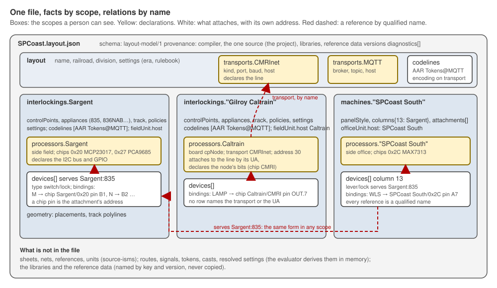

# 0008. The Layout Data Model File: one file, facts by scope, relations by name

- Status: proposed 2026-10-19. Milestone D (the KiCad project to Data Model File compiler) needs a target; the layout model view of 2026-10-16 deferred the serialised form (O5). The owner decided the first question the same day: one file holds the entire layout. This ADR records that and asks the rest.
- Decisions requested, each with a default: D2 the format (JSON with a JSON Schema); D3 the shape (facts nested by scope: layout, then one dictionary per interlocking and per machine); D4 where scopes become names (in the compiler); D5 identity and references (every reference is a qualified railroad name, in every scope; device rows have no identity); D6 version, provenance, incompleteness and reference data; D7 a canonical serialisation. §4 gives each with its alternatives and what a "No" means.
- Builds on: `docs/review/layout-model-view-2026-10-16.md` (the sections, O1 to O16), ADR 0005 (declarations, attachments, scopes), ADR 0001 (encoding on transport, authored addresses, code lines on the root sheet), `docs/review/processor-cases-2026-10-16.md`, the glossary §2, the owner's rulings of 2026-10-19 (§2).
- Pictures: `0008/shape.svg`.
- Scope: the file the compiler writes and the readers read. Not in scope: the evaluated model's form (still in memory, O4, O5), generator options, the schema text itself (written when this is accepted), the detail of `geometry` (view §4.7, against the picture generator).

## 1. Problem

Milestone D turns one KiCad project into one Data Model File, and milestone E reads that file into FieldUnit's generators and emulator. The model's content is decided: the view of 2026-10-16 names its sections and the owner answered sixteen questions on it; ADR 0005 settled how anything on a sheet finds its bus. What is not decided is the file: its format, its shape, what the compiler resolves before writing and what a reader resolves after, how one entry names another, how the file says what it is and where it came from, and what a reader does with a file that is incomplete. FieldUnit's serializer schema is obsolete (O16) and FieldUnit "has no idea about what we've done", so it cannot be asked for the schema. A future Studio is hoped to use this file as its native format, so the choices made for a derived artifact today are made for a hand-edited document tomorrow.

## 2. Rules in play

Tagged as in ADR 0005: *model* rules survive a change of tool, *representation* rules say how a source encodes the model, *operating* rules say how we work.

- A1. *Model.* **The model records what a person states and nothing a computer can compute from it**; the evaluator derives the rest in memory and nothing evaluated is persisted. View §1, O4, O5.
- A2. *Model.* **Source-independent, target-independent, hand-authorable.** Nothing in it says KiCad, sheet, net, reference or unit; nothing says MQTT only or ESP32 only; a small file written by hand is a valid input and the fixture form. View §1, O2, O3.
- A3. *Model.* **Identity is the qualified railroad name only.** No UUIDs, no ordinals; names are case-preserved and compared case-folded; renaming is renaming. O2.
- A4. *Model.* **A relation is a name in a field, never containment, unless the thing cannot exist alone** (a head on its mast, a column on its machine). A field that is absent is absent. View §4.
- A5. *Model.* **A bus is declared once and an attachment carries only its own address; an attachment finds its declaration by scope.** ADR 0005 S1 to S6. Chips name their processor, field units name their host, processor and field unit and control point are independent (O9).
- A6. *Model.* **The libraries and the reference data are not the model.** The model names a type, a chip or a rulebook table by key and never copies it; the versions compiled against are recorded. O7, I21.
- A7. *Model.* **Errors are inconsistent facts; absence is information.** Two levels, error and info (O13); a missing join or an unbound pin is info.
- A8. *Model.* **Encoding on transport, authored addresses, code lines on the root sheet and field stations as encoding instances on the interlocking sheets.** ADR 0001 D1, D4, D13, D15.
- A9. *Representation.* **The compiler resolves source-isms and nothing railroad.** The test: would Studio ask the user for it? If yes the compiler writes it; if a computer derives it the evaluator does. View §6. The sheet hierarchy gives a symbol its interlocking (ADR 0004 D12) and, since ADR 0005, its bus.
- A10. *Operating.* **FieldUnit is informational**: an example of what works, not a source of requirements or compatibility; we invent the schema and make it work iteratively, and do not change what works because we can. The owner, 2026-10-19.
- A11. *Operating.* **One KiCad project is the source; Studio is hoped to replace it and to use this file natively.** One file holds the whole layout: no multi-writer exists with KiCad or Studio, the file's structure is its own manifest, and one file is simplest for the day-to-day user to back up, carry and open. The owner, 2026-10-19 (D1 below).
- A12. *Operating.* **Reference data is created as the compiler first needs it, as a simpleton version; incomplete models are allowed** and their gaps are found by the readers, stubbed where useful by the emulator's optimistic mocks. The owner, 2026-10-19.

Requirements that follow:

- R1. One file, readable without the source, the libraries or the reference data; those are named, not needed, to read it.
- R2. Every scope of ADR 0005 that a person can see in the drawing has a place in the file; every relation is a qualified name that means the same thing wherever it appears.
- R3. A file for one interlocking, written by hand, is a valid file.
- R4. The compiler's diagnostics travel in the file; a reader adds its own and never edits the compiler's.
- R5. A diff of two files says what changed in railroad terms, so the serialisation is canonical.
- R6. A reader can tell which schema the file follows and which sources, libraries and reference data versions produced it.

## 3. Definition of done

- The SPCoast project compiles to one file that validates against the schema, with Sargent, Gilroy Caltrain, Gilroy Interchange, Watsonville and the desk present and every recipe of ADR 0005 §7 readable from it.
- A hand-written file holding only Sargent validates and evaluates to the same rows as the compiled one.
- Reading a file and writing it back is byte-identical.
- FieldUnit's reader (milestone E) consumes the file with no knowledge of KiCad.

## 4. Decisions

### D1. One file holds the entire layout (decided by the owner, recorded)

The alternative was a directory of files, one per scope. Its benefits were multi-writer safety and per-file diffs; neither exists here, and the directory costs the user every day. What the directory would have given moves inside the file at no cost: a dictionary per scope, a source hash per dictionary, the structure as the manifest.

### D2. Format: JSON with a JSON Schema

| Option | For | Against |
|---|---|---|
| **JSON** (default) | the plant schema and both readers already exist in JSON; FieldUnit parses JSON on the microcontroller and on the Mac; every language and Studio toolkit reads it; a JSON Schema validates it and documents it in one file | no comments; verbose for a hand-written fixture |
| YAML | comments and less punctuation for hand authoring | a second parser everywhere; no microcontroller parser; indentation errors are silent; a YAML face over the same schema can be added later without touching the model |
| XML | schema by XSD | nothing JSON lacks, at twice the size and a parser nobody here has |
| s-expressions | the KiCad habit | a source-ism in the model (A2) |

Hand-written fixtures are JSON too; an optional `description` string on any entity carries a note. A "No" picks YAML and accepts the second parser and the later microcontroller gap.

### D3. Shape: facts nested by scope

The top level is the layout, one dictionary per interlocking and one per machine, plus the file's own sections:

```
schema, layout{settings, transports{}, codelines{}}, interlockings{name}, machines{name}, provenance, diagnostics[]
```

and each interlocking or machine dictionary holds what its scope declares: `source`, `settings`, the appliances and track (interlocking) or the columns (machine), `codelines[]` (the encoding instances with their authored address, A8), `processors{}` declared in that scope (a CMRInet node is a processor with `transport` and `address`, ADR 0005 S2), `fieldUnit` or `officeUnit` naming its host, `devices[]` with their bindings, and `geometry`.

| Option | For | Against |
|---|---|---|
| **Nested by scope** (default) | the scope ladder of ADR 0005 (layout, then the interlocking that the sheet stands for) is a file fact; "one dictionary per interlocking" is the owner's reading of the file; a per-interlocking source hash has a home; a hand-written fixture for one interlocking is one dictionary (R3); a diff names the interlocking (R5) | a reader that wants every device walks the scopes (one loop); a processor that serves two interlockings is declared in one of them and named from the other |
| Flat sections (the view's text: `processors{}`, `fieldUnits{}`, `devices[]` at the top, qualified names inside) | every device in one list; matches the 2026-10-16 text | the scope that declared a thing is not a fact of the file; the source hash has no home below the layout; a one-interlocking fixture is scattered over five sections |

A "No" keeps the flat sections and adds a `scope` field to every processor and device, which is the same fact written on every row.

### D4. Scopes become names in the compiler

A chip's `processor`, a node's `transport`, a consumer's chain, a device binding's chip pin: the compiler resolves each by wire, sheet and layout (ADR 0005 S5) and writes the named relation. The override field on a symbol produces the same relation plus a diagnostic `info` (ADR 0005 C8). The reader sees names only.

| Option | For | Against |
|---|---|---|
| **Resolve in the compiler** (default) | the sheet is a representation fact (ADR 0005 A4) and Studio's canvas region will be another; both answer the question "which bus?" by what the user placed where, which is exactly what A9 says the compiler writes; the model stays A4-shaped: relations by name, not containment; a hand-written file names relations directly, as O9 already says | a sub-sheet drawn to separate two nodes leaves no trace; the compiler's resolver is the one place the ladder is coded |
| Persist the containers | the reader resolves, so the model shows the designer's grouping | every reader must know every source's container semantics; a sub-sheet in the model is a source-ism (A2) |

A "No" puts nested containers under each interlocking and makes every reader carry the resolver.

### D5. Identity and references

- A dictionary key is the entity's own name within its scope. Its qualified name is the scope's name, a colon, and the key: `Sargent:835`, `SPCoast South:13`. Entities of the layout scope (interlockings, machines, transports, code lines, processors) have no prefix: `Sargent`, `CMRInet`. A name may not contain a colon.
- **A reference is always the qualified name, in every scope**, including a reference from inside the scope that declares the entity: a device in Sargent serves `Sargent:835`, not `835`. One form, so a reader needs no scope context to read a reference, `grep` finds every reference to a thing, and a diagnostic can quote one without saying where it was found. The cost is a few bytes per row and a larger diff when an interlocking is renamed, which a tool does anyway.
- Processors are named layout-wide (processor-cases §1) and declared in the scope that drew them. A chip is `processor/address` or, where one address holds two uses, `processor/address/use` (the PCA9685 as PWM and servo, I3).
- A device row has no identity (view §7 item 2). Nothing may reference a row. A diagnostic locates a row by its scope, its index in that scope's list, and its natural key: `serves` or `shows`, the type key, and `column` where present. The index is a locator in one file, never an identity across files (A3).

The alternative considered and withdrawn (2026-10-19): a bare name inside its own scope, qualified only across scopes. It is terser and a rename touches less, but every reader then carries a resolver that depends on where a field sits, the canonical form needs a rule for shortening, and a machine's devices have no interlocking scope to resolve in, so they would need a rule of their own. A "No" on row identity gives rows ids, which A3 forbids unless they are names, and a device has none.

### D6. Version, provenance, incompleteness, reference data

- `schema`: the string `layout-model/1`. The schema file is `schemas/layout-model/v1.json` in this repo until the chain moves into FieldUnit as its own PR (O15); the old `schemas/interlocking-plant/v1.json` is retired in that move (O16).
- `provenance`: the compiler's name and version; each source with path, hash and `git describe`; each library and its version; each reference data set and its version (A6). Each interlocking and machine dictionary carries `source` with the path and hash of the sheet it came from, so a diff can say which sheet changed.
- `diagnostics[]`: the compiler's, with level, text, the entities concerned and a `sourceRef` for forensics (view §4.9). A reader never edits them; it reports its own beside them (R4).
- Incompleteness: absent is absent (A4). A device without a binding, an interlocking without a field unit, a processor without a board are valid files with `info` diagnostics. The emulator's mocks stand in for what is absent (A12).
- Reference data: chip definitions by IC, aspect and indication tables by rulebook, driver type keys, encodings. The file names them by key and the versions in `provenance`; it never copies a row. Each set is created in its simpleton form when the compiler first needs it (A12), in its own place with its own small document, not in this file.

A "No" on any item is a "No" to the rule it cites.

### D7. Canonical serialisation

Keys in schema order, dictionaries keyed by name in case-folded name order, lists in the order the source gave them (devices by sheet position is a representation fact and is not promised), two-space indent, UTF-8, one trailing newline. The reader library writes exactly this form, so read-then-write is byte-identical (§3) and a git diff shows railroad changes only (R5).

A "No" leaves ordering to the writer and gives up R5.

## 5. The shape, drawn



## 6. Sargent and the Caltrain node, excerpted

Illustrative, not the schema. Names and values are the drawing's as of 2026-10-19; the device rows follow the view §3.1.

```json
{
  "schema": "layout-model/1",
  "layout": {
    "name": "SPCoast", "railroad": "SPCoast", "division": "South",
    "settings": { "era": "", "rulebook": "" },
    "transports": {
      "CMRInet": { "kind": "CMRI", "params": { "port": "/dev/cu.modemXXXX", "baud": "28800" }, "host": "" },
      "MQTT":    { "kind": "MQTT", "params": { "broker": "192.168.1.21:1883", "topic": "ctc/SPCoast/codeline/" }, "host": "" }
    },
    "codelines": { "AAR Tokens@MQTT": { "encoding": "AAR", "transport": "MQTT" } }
  },
  "interlockings": {
    "Sargent": {
      "source": { "path": "SPCoast/Sargent.kicad_sch", "sha256": "…" },
      "controlPoints": { "Sargent": { "milepost": 83.5 } },
      "appliances": {
        "835":    { "appliance": "switch", "style": "lock", "controlPoint": "Sargent:Sargent", "osCircuit": "Sargent:835T1" },
        "836NAB": { "appliance": "mast", "style": "double", "heads": { "A": { "style": "CPL" }, "B": { "style": "CPL" } } }
      },
      "codelines": [ { "codeline": "AAR Tokens@MQTT" } ],
      "processors": { "Sargent": { "side": "field", "chips": { "0x20": { "ic": "MCP23017" }, "0x27": { "ic": "PCA9685", "use": "pwm" } } } },
      "fieldUnit": { "host": "Sargent" },
      "devices": [
        { "type": { "appliance": "switch", "style": ["powered", "lock", "dual"] }, "serves": "Sargent:835",
          "bindings": [ { "function": "M", "chip": "Sargent/0x20", "pin": "B1" }, { "function": "N", "chip": "Sargent/0x20", "pin": "B2" } ] },
        { "type": { "appliance": "lamp" }, "serves": "Sargent:HBA", "address": "1",
          "bindings": [ { "function": "LAMP", "chip": "Sargent/0x27", "pin": "B1" } ] }
      ]
    },
    "Gilroy Caltrain": {
      "source": { "path": "SPCoast/GilroyCalTrain.kicad_sch", "sha256": "…" },
      "processors": { "Caltrain": { "side": "field", "board": "cpNode", "transport": "CMRInet", "address": "30",
                                    "chips": { "CMRI": { "ic": "CMRI" } } } },
      "devices": [
        { "type": { "appliance": "lamp" }, "serves": "Gilroy Caltrain:…", "bindings": [ { "function": "LAMP", "chip": "Caltrain/CMRI", "pin": "OUT.7" } ] }
      ]
    }
  },
  "machines": {
    "SPCoast South": {
      "source": { "path": "SPCoast/South-cTc.kicad_sch", "sha256": "…" },
      "panelStyle": "US&S 506 lever panel",
      "columns": { "13": { "interlocking": "Sargent" } },
      "attachments": [ { "interlocking": "Sargent", "columns": [13], "codeline": "AAR Tokens@MQTT" } ],
      "processors": { "SPCoast South": { "side": "office", "chips": { "0x2C": { "ic": "MAX7313" } } } },
      "officeUnit": { "host": "SPCoast South" },
      "devices": [
        { "type": { "appliance": "lever", "style": "lock" }, "serves": "Sargent:835", "column": "SPCoast South:13",
          "bindings": [ { "function": "WLS", "chip": "SPCoast South/0x2C", "pin": "A7" } ] }
      ]
    }
  },
  "provenance": { "compiler": "kicad2layout 0.1", "libraries": { "Railroad-HardwareIO": "…" }, "referenceData": { "chips": "…" } },
  "diagnostics": [ { "level": "info", "text": "Sargent: HBA carries Address 1 on a wire-capability pin", "about": ["Sargent:HBA"] } ]
}
```

Read off the excerpt: the Caltrain node is a processor that attaches to the layout's CMRInet transport by its address and declares the bits its drivers use; no driver row names the transport or the UA (ADR 0005 S1). Every reference is a qualified name, whether it stays in its scope (`Sargent:835` from a Sargent device, `Sargent:835T1` as 835's OS circuit) or crosses one (the lever in `SPCoast South:13` serves `Sargent:835`); the layout's own entities (`CMRInet`, `Sargent`) carry no prefix (D5). Nothing says sheet, net or reference (A2).

## 7. Consequences

- C1. Milestone D's compiler writes this file and nothing else; its contract is the schema plus D7's canonical form. Its gates are §3.
- C2. The reader library (milestone E's "reader") reads the file, evaluates in memory (A1) and reports; FieldUnit's generators and emulator consume the reader's result, not the file's text.
- C3. The scope resolver of ADR 0005 C11 lives in the compiler (D4); the duplicate-address and two-candidates rules of ADR 0005 C10 are compiler diagnostics where they need the source, and reader diagnostics where the file alone shows them.
- C4. `schemas/layout-model/v1.json` is written when this is accepted, from §4 and the view §4, with `geometry` left as an open object until the picture generator fixes it (view §4.7).
- C5. The view §7 items 1 (section names) and 2 (row identity) close here: the names are those of §4.3 and §6, read against the glossary §2.4 (`fieldUnit`, `officeUnit`, `processors`, `machines`, `codelines`, `transports`); rows have no identity.
- C6. The old compilers, `schemas/interlocking-plant/v1.json` and the generated Luchessa JSON stay as reference until §3 passes, then go in one commit (layout-model-plan §0).

## 8. Out of scope here

- The evaluated model's serialisation, still deferred (O5); it is an in-memory result keyed to the file's hash.
- The reference data sets' own shape: each gets its simpleton version and document when the compiler first needs it (A12).
- `geometry` in detail (view §4.7).
- Generator options, including which processor hosts what in the emulator (processor-cases case 6).
