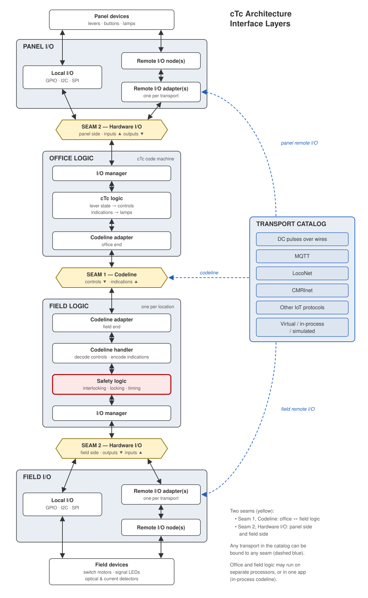

# 0008. The Layout Data Model File

- Status: accepted, rev 4, 2026-10-24 (the owner: "ADR Approved"). Rewritten on ADR 0009 (explicit seams) and the owner's rulings of 2026-10-23 and 2026-10-24. The schema is a new major, `schemas/layout-model/v3.0.0.json`, and the example (§6) is the compiler's output on the SPCoast project, never typed; both are part of what is ratified.
- Decision: **ratified** 2026-10-24, the architecture of the on-disk representation: §4 and the schema `schemas/layout-model/v3.0.0.json` it describes.
- Amended 2026-10-27 (the owner's ruling D10 on `docs/review/three-maps-mapping-2026-10-27.md`): §4.5, a row may carry a
  stable opaque `id` (track rows: joints, ends, policy signs), by default the KiCad per-instance UUID of its symbol. A
  row still has no name; the id is identity, never meaning.
- Terms (2026-10-26, after ADR 0011): "compiler" in this record means what ADR 0011 splits into the KiCad importer,
  which reads the drawing, and the reference derivation, which computes `derived`; "seam reader" is the first piece of
  the KiCad importer. The record is not reworded. See FieldUnit `docs/GLOSSARY.md` §2.6.
- Builds on: 
   - `docs/review/layout-model-view-2026-10-16.md` (the Data Model's content: sections, O1 to O16), 
   - ADR 0001 (encoding on transport, authored addresses), 
   - ADR 0004 (the project hierarchy), 
   - ADR 0005 (declarations, attachments, scopes), as amended by ADR 0009,
   - **ADR 0009** (explicit seams: the net kinds, every symbol's pins, processors, transports and encodings, the CMRInet Node, head devices, derived stations, the relation table), the drawing contract this file is compiled from,
   - the owner's rulings of 2026-10-23: the `PanelColumn` is the logical column and model board lamps are `ModelLamp` devices in no column; layout-wide facts live on a `Railroad` symbol; a field may reference another symbol's field with the macro `<ROLE:KIND:Field>`; `Name` is the identity key everywhere,
   - the owner's rulings of 2026-10-24 on the adversarial review: every key is a functionally named attribute with content `${Value}` and `Value` is never read, devices and trackplan appliances included; a JMRI driver is keyed by its `Kind` and the device it serves; every Mast is a device row; `anchors` are drawn instances and a FieldUnit reaches its code line's transport through the code line; the OfficeUnit's `Columns` is derived,
   - `docs/review/processor-cases-2026-10-16.md`, 
   - the glossary §2,
   - FieldUnit `docs/adr/0005-appliance-driver-architecture.md` and its picture `0005-ctc-interface-layers.svg`: the two seams and the transport catalog, the definitive architecture this file is shaped on.
- Overview: `0008/shape.svg`.

## 1. Problem

The abstract actors and relationships captured in the KiCad schematic artifact represent a Layout Data Model. Milestone D compiles that model into a defined structure saved to the filesystem for interchange to various consumers: code generators, documentation producers, validators, simulators and emulators. This on-disk structure is currently undefined.

The Data Model itself is defined above, with names and relationships. What is undefined is the structure that carries it between the compiler and its consumers.

## 2. Rules

- **R1. Fidelity.** The structure must robustly capture the existing Data Model, with all its nuances, decisions and constraints.
- **R2. Boundary.** The KiCad compiler reads KiCad (tokens...) and creates a Data Model (grammer and parse tree), which it then saves to a filesystem representation. This constructed Data Model may not expose KiCad implementation details. The test for any entry: would Studio (a TBD replacement for KiCad-as-editor) need it?
- **R3. Reusable.** The structure must be usable as "the source file" for a future Studio layout design editor, and as-yet undefined tools must be able to consume it.  This representation and its schema become a stable public interface.

### ToC for Data Model content:

| Content | Defined in |
|---|---|
| Sections and entities: layout, transports, code lines, I/O encodings, processors, CMRInet Nodes, drivers, interlockings, houses, office units, columns, devices, bindings, geometry | view 2026-10-16 §3, §4, read against §4.3 of this ADR |
| Code lines as an encoding on a transport; field stations derived | ADR 0001 D1, D15; ADR 0009 §3.8 (D4 and D13 superseded, 0009 C2) |
| Interlocking membership and hierarchy, FieldUnits, mileposts, heads | ADR 0004 D12, D13, D7, D6 |
| Bus declarations, attachments, scopes, addresses | ADR 0005 S1 to S7, C1 to C11, as amended by ADR 0009 C1: a CMRInet Node is a driver on the line that provides a bus, not a processor |
| Processors run logic and anchor transports; transports are mechanisms, encodings ride a transport instance; stations are derived; one entity on several sheets; the keys the compiler reads; the relation table | ADR 0009 §3.3, §3.4, §3.5, §3.8, §3.9, §3.10, §3.12 |
| Identity by qualified railroad name; relations by name, not containment; errors as inconsistent facts, absence as information | view O2, O9, O13; glossary §2 |
| Processors, FieldUnits and control points as independent entities | processor-cases §1, §5 |
| The interface layers: Seam 1 Codeline between office and field logic; Seam 2 Hardware I/O on the panel side and the field side, local or remote; the transport catalog, any transport bindable to any seam | FieldUnit ADR 0005, `0005-ctc-interface-layers.svg` |

## 3. Definition of done

- **DoD1. Lossless round trip.** KiCad schematic → **[Data Model] → compiler output → on-disk representation → reader input → [Data Model]** → generators. The two bracketed models are equal. Proven by: compile SPCoast, write, read, compare the models; then write again and compare the bytes. The first leg, schematic → model, drops source-isms on purpose (R2) and is not part of the round trip.
- **DoD2. Coverage.** The Data Model in the file captures the relationships, actors and dependencies articulated in the ADRs. Proven by: every relation of ADR 0009 §3.12 and every section of the view §4 is readable from the compiled SPCoast file, with all seven interlockings and the desk present; a replica KiCad project that contains only the Sargent Interlocking (R3) evaluates to the same structure as the Sargent Interlocking from the SPCoast layout project.
- **DoD3. Schema.** The on-disk representation has a schema that defines its intended structure.  The compiler output validates correctly against it. Proven by: Validate the SPCoast project's compiled output, adversarial review of the schema and the validation mechanism.

## 4. Architecture

Each subsection names the rule that drives it, weighs the alternatives, and states the choice. Together they define the on-disk representation.

### 4.1 One file holds the entire layout

R3 asks for the file a Studio user opens, carries and backs up. A directory of files, one per scope, was weighed and withdrawn: its benefits are multi-writer safety and per-file diffs, and neither exists here: KiCad can't support multiple writers, and we don't construct KiCad schematics **from** this data model; its cost is a manifest and a filesystem layer the user can not treat atomically. 

### 4.2 JSON, defined by a JSON Schema

DoD3 asks for a schema; R3 demands a well defined, simple format and R2 forbids using a KiCad-shaped format.

| Option | For | Against |
|---|---|---|
| **JSON with JSON Schema** (chosen) | one schema document validates and documents the structure; every language, the microcontroller and the Mac already parse it; the existing POC plant schema and both readers are JSON | no comments; punctuation-heavy for a hand-written file |
| YAML | comments and less punctuation for hand authoring, parsers available, can be added on top od JSON without touching the model | indentation errors are silent |
| XML with XSD | a mature schema language, parsers available | twice the size of JSON  |
| s-expressions | the KiCad habit | the format itself is a KiCad implementation detail (R2) |

### 4.3 Facts nested by scope

R1 says the scope that declares a bus is a fact of the model (ADR 0005 S5: an attachment finds its declaration by wire, sheet, layout), and R3 says a one-interlocking file must be a natural thing to write.

```
schema, layout{name, railroad, region, era, rulebook, transports{}, codelines{}, ioEncodings{}, processors{}}, interlockings{name}, officeUnits{name}, provenance
```

The top level is the layout and the file's own head. The layout's own facts, its name, the prototype railroad and region, the era and the rulebook, are the `Railroad` symbol's (owner's ruling 2026-10-23). The layout scope holds the entities whose names are layout-wide (ADR 0009 §3.9): the transports, each with the processors that anchor it and, on a CMRInet line, its CMRInet Nodes keyed by UA; the code lines and the I/O encodings, each an encoding on a transport instance; and the processors, each with its drivers keyed by address. Each interlocking holds only railroad things: its one `codeline`; `fieldUnit.processor`; `houses{}` by control point name with milepost and maintainer call; the appliances and track (open until the trackplan piece of the compiler lands); `devices[]`, one row per device instance, with its bindings as routes; `geometry`. Each office unit holds its `style`, its `processor`, its `columns{}` by number, each naming its house or, where no `CP Name` is drawn yet, its interlocking, and its `devices[]`. Stations are derived (ADR 0009 §3.8) and absent.

| Option | For | Against |
|---|---|---|
| **Nested by scope** (chosen) | the declaring scope is a file fact; a one-interlocking file is one dictionary (R3); a diff names the interlocking | a reader that wants every device walks the scopes |
| Flat sections (`processors{}`, `fieldUnits{}`, `devices[]`) | every device in one list | DRY issues: the declaring scope must be written on every row as a `scope` field; each interlocking is scattered over five sections |

### 4.4 The compiler resolves scopes to names

R2 draws the boundary. The sheets and netlist in a KiCad project are how the drawing says "which bus"; Studio's canvas will say it another way. The KiCad compiler internally resolves each relation by wire and by its fallback, sheet hierarchy or field (ADR 0009 §3.12), and writes the named relation: a driver's bus owner, a CMRInet Node's `transport`, a FieldUnit's or OfficeUnit's `processor`, a binding's route. The two forms must agree, or the compiler reports an error and writes nothing; a fallback used alone is an `info` in its log (ADR 0005 C8).

The Data Model holds names only. The same boundary applies to macros: a field that reads `ctc/<STRUCTURE:RAILROAD:Name>/codeline/` in the drawing is expanded by the compiler against the one symbol of that Role and Kind in scope, and the file carries `ctc/SPCoast/codeline/`. The drawing keeps one source for the railroad's name; every reader stays a reader.

| Option | For | Against |
|---|---|---|
| **Resolve in the compiler** (chosen) | the model stays relations-by-name (view O9); relations are recorded once; the scope ladder is coded once | a sub-sheet drawn only to separate two nodes leaves no trace in the Data Model |
| Persist the containers and let readers resolve | the data model shows the designer's grouping | a sub-sheet shows up in the model as a KiCad implementation detail (R2); every reader of every source must carry every source's container semantics |

### 4.5 Names and references

R1 says identity is the qualified railroad name only (view O2): no UUIDs, no ordinals or index IDs, case preserved and compared case-folded. ADR 0009 §3.10 says which drawn field is the name: `Name` on every seam entity, `CP Name` on a house, `Column` on a column, `Address` on a driver or a CMRInet Node; `Value` is drawing and is never read: every symbol the compiler names carries a functionally named attribute (the owner, 2026-10-24: a key describes its content, and the symbol attribute's name reflects that; `Value` is generic). How KiCad fills it is KiCad's business: `Name = ${Value}` on most symbols, the reverse (`Value = ${CP Name}`, `Value = ${Address}`) on the House and the drivers. A symbol without its attribute has no name and is reported `missing` (the owner, 2026-10-25). The Data Model encodes identity so:

- A dictionary key is the entity's own name within its scope. Its qualified name is the scope's name, a colon, and the key: `Sargent:835`, `Luchessa:Carnadero`. Entities of the layout scope (interlockings, office units, transports, code lines, I/O encodings, processors) have no prefix: `Sargent`, `MQTT`, `JohnCTC`. A name may not contain a colon or a slash.
- A processor is a layout-scope entity: one namespace for the whole layout, because one processor can serve several FieldUnits and an OfficeUnit (ADR 0009 §3.3; SPCoastApp runs Gilroy Caltrain's logic and anchors the CMRInet line). Its name is its `Name`. Several placed `Processor` symbols with one name are one processor (ADR 0009 §3.9); two that declare different attributes are an error. The compiler invents no processor: a FieldUnit's or OfficeUnit's processor is the one its `Processor` wire reaches, or the one on its sheet (ADR 0009 §3.12), or absent and reported.
- A transport is a layout-scope entity declared once and placed once per processor that runs an encoding on it; those processors are its `anchors`. A code line or I/O encoding names its `transport` and the `processor` whose instance it rides, so two encodings on one broker from two processors are two entries. A FieldUnit reaches its code line's transport through the code line; that is derived, not written, and the compiler reports it at info. `anchors` lists drawn instances and nothing else: an MQTT instance per field processor would duplicate what the code line already says (the owner, 2026-10-24, on review finding 5), and ADR 0009 §3.12's check "an anchor per connecting processor" is redefined to this (C11).
- A CMRInet Node's identity is its transport plus its UA (ADR 0009 §3.5): `transports.CMRInet.nodes."30"`, one entity however many sheets place it (§3.9). Written as a bus owner it is `CMRInet/30`.
- A driver is keyed by its address on its bus: `processors.Sargent.drivers."0x20"`; a CMRInet Node's bits by `IB.n` and `OB.n`, numbered from 1, the direction read from the bit's pin type. `Sargent/0x20` and `Corporal/0x20` are two MCP23017s at one I2C address, and no collision exists because the key carries the owner. An encoded driver, a JMRI object, carries no address of its own (ADR 0005 S4 and R11): its key is its object class and the name of the device it serves, `Gilroy/TURNOUT.777`, the class stated by the symbol's `Kind` (TURNOUT, SENSOR, SIGNALMAST, LIGHT) and written as `kind`; two symbols with one key, a Turnout's command and its feedback, are one driver (ADR 0009 §3.9); a drawn `Address` overrides the derived key, reported at info. A driver that is neither addressed nor encoded has no key and is not written; the compiler reports it.
- A **route** is a device pin's binding. Three segments, `processor/address/pin`, name a processor's bus: `Sargent/0x20/B1`. Four, `transport/UA/IB.n|OB.n/pin`, name a CMRInet Node's bus: `CMRInet/30/OB.7/D`. The segment count tells the owner's kind, since processors and transports are separate namespaces. A binding carries `invert: true` when the device's `Invert` field names its pin, the instance polarity override of ADR 0003 D6.
- Appliance names are `Name` too: a device's `serves`, a mast's name, a trackplan head's letter and a maintainer call are their symbols' `Name` fields, `${Value}` since 2026-10-24 (the owner, on review finding 4: no exception; the trackplan convention of `AGENTS.md` became the attribute). A Mast is a device like any other and has its own row, with its `IND` binding when a driver takes the whole mast.
- Every other field a person states on an entity is written as drawn under `settings`: `Topic`, `Broker`, `Baud`, `Color`, `hold_ms`. Which keys apply to which entity is reference data (§4.7); the file never renames or drops one.
- A **row** is one element of a `devices[]` list: one device instance (view §3.1). The word names the list element and nothing else. A row has no identity (view §7 item 2). Nothing references a row, so no `id` key exists and the schema rejects one. A reader that reports on a row names it by its scope and its natural key (`serves` or `shows`, the type, `column` or `head` where present).
- **A reference is always the qualified name, in every scope**, including from inside the scope that declares the entity: a Sargent device serves `Sargent:835`, not `835`; a board lamp on the desk shows `Watsonville:837T1`.

| Option | For | Against |
|---|---|---|
| **Always qualified** (chosen) | one form, so a reader needs no scope context and `grep` finds every reference; a diagnostic quotes a name without saying where it found it; an office unit's devices, which have no interlocking scope, need no special rule | a few bytes per row; renaming an interlocking touches every reference to it, which is a tool's job anyway |
| Bare within the declaring scope, qualified across scopes (withdrawn 2026-10-19) | terser; a rename touches less | every reader carries a resolver that depends on where a field sits; the canonical form needs a shortening rule; office devices need a rule of their own |
| Row ids for devices | a report can point at a row | an id that is not a name is an identity the model forbids (O2), and a device has no name |
| Processors declared under the interlocking that drew them (rev 2) | the file shows which sheet holds the symbol | that is a KiCad fact (R2); the name is layout-wide, so the dictionary must be too |
| A CMRInet Node as a processor with `transport` and `address` (rev 3) | one dictionary for everything that holds drivers | a CMRInet Node runs no logic and anchors nothing; it is a driver on the line that provides a bus (ADR 0009 §3.5, C1) |
| Bindings as `processor/address/use` chip references (rev 3) | short | a CMRInet Node's bus had no owner form; `use` doubled an address the drawing states once as two drivers at two addresses |

### 4.6 The file's head: schema and provenance

DoD3 asks the file to say which schema it follows; R1 asks it to say which versions of the libraries and reference data it was compiled against (view I21), since it names those by key and never copies them; R2 limits what it may say about where it came from.

- `schema`: the string `layout-model/v3.0.0`. The schema file is semantically versioned `schemas/layout-model/v3.0.0.json` in this repo until the chain moves into FieldUnit as its own PR (view O15), when the old `schemas/interlocking-plant/v1.json` is retired (O16). A reader picks the schema by this string.
- `provenance`: a property of the file about the whole layout and nothing below it.
   - `sourceType`: `KiCad`;
   - the compiler's name and version;
   - the source: the KiCad project, its path relative to its repository and that repository's `git describe`. The netlist is an export of the project, never the source (the owner, 2026-10-19);
   - each reference data set the compiler used and its version (today the encoding-to-transport pairing and the driver encodings);
   - each symbol library and its version, when the compiler reads one.
- No `diagnostics[]`. A source document with compiler errors never generates a Data Model File. The compiler's observations about the drawing (an override field used, a sub-sheet that separated two nodes, a symbol it ignored) are forensics about the source, which R2 keeps out; the compiler prints them, sheet and reference included, to its own log.

### 4.7 Incompleteness and reference data

R1 says absence is information, not an error (view O13), incomplete models are allowed, their gaps are found by the readers and stubbed where useful by the emulator's mocks, and reference data is created in its simpleton form as the compiler first needs it.

- A field that is absent is absent (view §4): a device without a binding, an interlocking without a field unit, a processor without a board are valid - but incomplete - files. The reader reports each absence as `info` when it evaluates (§4.6); the file does not.
- Reference data (driver definitions by IC, boards, transport and encoding kinds and their pairing, the encodings a driver IC needs, aspect and indication tables by rulebook) is named by key in the file and by version in `provenance`; no row is copied. Each set lives in its own place with its own small document, not in this file; the two the compiler uses today are its own constants, versioned by date.

The alternative, copying the referenced rows into the file so it reads stand-alone, was rejected: it makes the file a second source of every table (the one-source rule of `AGENTS.md`), and a version in `provenance` gives a reader the same guarantee.

### 4.8 Canonical serialisation

DoD1 asks for a byte-identical rewrite, and a git diff of the file should show railroad changes only. The writer used by the compiler and the reader library, must sort things in the same way: natural-sorted alpha-numerical case folded, whitespace deduplicated. This includes keys, dictionaries by name, lists, etc. In addition, the json file rendering needs to be the same: Two-space indent, UTF-8 unescaped, one trailing newline.

Sorting every list means that no list's order carries meaning. That is deliberate: implicit ordering is not deterministic, so every ordering needs to be explicit; we use an `address`. `name` or a token as a key. 

Tested via a writer (`tools/layout_model.dumps` and a script (`tests/test_layout_model_file.py`) to prove that a shuffled model writes the same bytes.

### 4.9 Processors: where logic runs and what anchors connections

R2 forbids hidden connections, and rev 3 had two: a `host` the drawing did not contain, invented by the compiler or named through a field, and a node that was a processor. ADR 0009 closes both, and the file follows it.

- **A processor is drawn, and a FieldUnit or OfficeUnit is wired to it.** `Processor` is a symbol with a `Name` and a `Board`; an Interlocking's or OfficeUnit's `Processor` wire says where its logic runs (§3.3). `fieldUnit.processor` and `officeUnits.<name>.processor` carry that and nothing else. The compiler invents no processor; a FieldUnit the drawing leaves unwired has no processor, and the reader reports the absence.
- **A transport is a mechanism, anchored once per processor that runs an encoding on it.** Each placed `Transport-*` symbol is wired to the processor that runs the code for it, and the symbol may be placed once per such processor (§3.4). `transports.<name>.anchors` lists them. A FieldUnit's processor reaches its code line's transport through the code line; the file does not list it as an anchor, and the drawing places none there: the code line already says it (the owner, 2026-10-24). An encoding rides a particular instance, so `codelines.<name>` and `ioEncodings.<name>` carry `transport` and `processor` both: the AAR tokens ride MQTT at JohnCTC, the JMRI objects ride MQTT at Gilroy.
- **Remote I/O is an encoding or a CMRInet Node, not a processor.** JMRI drivers sit on their processor's own bus, keyed by object class and served device (§4.5), with the JMRI encoding on that processor's MQTT instance as the fact (§3.6), and the compiler checks that the encoding is there; a CMRInet Node is a driver on the line that provides a bus for its bits (§3.5), written under its transport by UA with its declared bytes and the bits in use. The FieldUnit whose I/O is all remote runs on whatever processor its wire names; today Gilroy Caltrain runs on SPCoastApp, the processor that also anchors the CMRInet line, and the file says exactly that.
- **Layout-wide facts have a symbol.** The layout's name, prototype railroad, region, era and rulebook are the `Railroad` symbol's fields on the root sheet, one per project, and land in `layout` (owner's ruling 2026-10-23). A field elsewhere may reference them with `<ROLE:KIND:Field>`, resolved to the one symbol of that Role and Kind in scope and expanded by the compiler (§4.4). The grammar is the libraries' own keys, so the compiler needs no table; two such symbols in scope is an error, and the fix is a wire, never a second mechanism.
- **The drawing is the deployment.** The file carries the drawing as it stands: today every interlocking has a field processor and the OfficeUnit runs on JohnCTC. A view that elides devices, drivers and processors yields the emulated layout of an earlier day (the owner, 2026-10-23), and that view is a consumer's to build, not a second deployment in the drawing.

## 5. The Data Model shape

The physical abstraction first: the cTc interface layers of FieldUnit ADR 0005, the definitive architecture this file is shaped on.



How the file lands on those layers, artifact by artifact:

| FieldUnit ADR 0005 artifact | In the file |
|---|---|
| Transport catalog (DC pulses, MQTT, LocoNet, CMRInet, virtual/in-process) | `layout.transports{}`: this layout's mechanisms, each of a kind in the reference data, declared once, anchored on the processors that connect to it |
| Seam 1, Codeline: controls down, indications up | `layout.codelines{}`: an encoding on a transport instance. Field end: each interlocking's `codeline`. Office end: the office unit's columns, whose houses derive the field stations (ADR 0009 §3.8); nothing is written per field station |
| Seam 2, Hardware I/O, panel side and field side: Local I/O (GPIO, I2C, SPI) | `layout.processors{}.drivers`, keyed by address on the processor's bus; a device's binding is a route onto one of them |
| Seam 2: Remote I/O over a transport | an I/O encoding, `layout.ioEncodings{}`, on the processor's own transport instance, with its drivers on the processor's bus (JMRI); or a CMRInet Node, `layout.transports.<line>.nodes{}` by UA, declaring its bytes and providing a bus for its bits, with routes `line/UA/OB.n/D` |
| Office logic, the CTC machine | `officeUnits{}` with `processor` |
| Panel devices: levers, buttons, lamps | the office unit's `devices[]` rows: a column device carries its `column`; a model board lamp carries none and `shows` its indications |
| Field logic, one per location: codeline handler, safety logic | `interlockings{}` with `fieldUnit.processor` |
| Field devices: motors, LEDs, detectors | the interlocking's `devices[]` rows; a head device `serves` its mast and names its `head` |
| Codeline adapters, I/O managers | runtime parts of a FieldUnit or OfficeUnit, not facts a person states: no key |

Which seam a transport serves is not written: a transport a code line rides serves Seam 1, one an I/O encoding or a CMRInet Node rides serves Seam 2, and one transport may do both, as MQTT does. The reader derives it (R1).

Then the file's shape, drawn on the same layers:


One JSON file, a collection of facts organized by scope, relations linked by name, drawn on the cTc interface layers of FieldUnit ADR 0005: the office band is an office unit, the field band holds the interlockings, Seam 1 is the code lines between them, Seam 2 is each band's I/O row, and the transport catalog stands beside them. Yellow is a layout-scope entity; white is a row or a reference to one. Box titles are file paths.

- **Red dashed**: a reference by name, a fact written in the file. A row's `serves`, a FieldUnit's `processor`, a route's owner, a code line's `transport` and `processor` (the Seam 1 binding), a CMRInet Node under its line (the Seam 2 binding). The lever's `serves Sargent:835` runs from the office band to the field band in the same form it has anywhere.
- **Blue**: code line membership, the two facts the control path from a lever to its appliance is derived from: the interlocking's `codeline` (field end) and the office unit's column naming the house or interlocking (office end). The file never writes that path, nor the field stations.

What is not in the file: sheets, nets, references, KiCad symbol units (source-isms); macros (expanded); diagnostics (an error means no file; absence is read from the file); field stations, paths between lever and appliance, signals, tokens, head aspects, resolved settings, the seam a transport serves (the evaluator derives them in memory); the libraries and the reference data (named by key and version, never copied); any order in a list (every intended order is an explicit address or key).

## 6. The example, compiled

`schemas/layout-model/examples/spcoast.layout.json` is the compiler's output on the SPCoast project at Railroad `d51f78e`, written by `schemas/layout-model/examples/make_spcoast_layout.py` from the project's current netlist export, never typed. It validates against `schemas/layout-model/v3.0.0.json` and is in canonical form; two compiles are byte-identical; `tests/test_layout_compiler.py` proves the relation table of ADR 0009 §3.12 on the same netlist on every run and `tests/test_layout_model_file.py` the canonical form. At 5,457 lines it is not reproduced here. Read off it:

- `layout`: name SPCoast, railroad Southern Pacific, region Coast Line, era 1960+, rulebook GCOR, from the `Railroad` symbol.
- `layout.transports`: TimeCode anchored on JohnCTC; MQTT anchored on JohnCTC and on Gilroy, the one broker placed twice; CMRInet anchored on SPCoastApp, with CMRInet Node `30` of type C, 2 input and 3 output bytes, and its 14 `IB.n` and 20 `OB.n` bits, each a driver with its IC.
- `layout.codelines`: `AAR Tokens`, encoding AAR on MQTT at JohnCTC, `settings.Topic` `ctc/SPCoast/codeline/` expanded from the macro; `US&S 506` on TimeCode at JohnCTC. `layout.ioEncodings`: `JMRI` on MQTT at Gilroy; `CMRInet` on CMRInet at SPCoastApp.
- `layout.processors`: eight, with their boards and 52 drivers by key; `Sargent/0x20` and `Corporal/0x20` coexist. Gilroy's sixteen JMRI driver symbols are fourteen drivers keyed by object class and served device, each with its `kind`: `TURNOUT.777` and `TURNOUT.781` (command and feedback, one Turnout each), six `SENSOR.*`, four `SIGNALMAST.*`, `LIGHT.MC1` and `LIGHT.MC2`.
- `interlockings`: seven. Luchessa's `codeline` is `US&S 506` and its houses are Luchessa, Gilroy and Carnadero; every other interlocking is on `AAR Tokens`. Gilroy Caltrain's `fieldUnit.processor` is SPCoastApp and its heads route through `CMRInet/30/OB.n/D`; every other FieldUnit runs on the processor of its name, Gilroy Interchange on `Gilroy`. 193 field device rows, 38 of them masts; Gilroy Interchange's masts route `IND` to `Gilroy/SIGNALMAST.<mast>/IND` and its maintainer-call lamps to `Gilroy/LIGHT.MC1/ON`.
- `officeUnits."SPCoast South"`: style US&S, processor JohnCTC, fourteen columns, of which 5, 6 and 7 name the Luchessa houses and the rest name their interlocking until a `CP Name` is drawn; 75 panel device rows, the model board lamps without a column, each showing qualified indications such as `Watsonville:837T1` and carrying its `Color`; the lock levers' `WLK` bindings carry `invert: true`.
- `provenance`: source type KiCad, the compiler and its version, the project `SPCoast/SPCoast.kicad_pro` with the Railroad repository's `git describe`, and the two reference data sets by version.

What the compiler reported while writing it, none an error: 11 columns without `CP Name`; six FieldUnits whose processor anchors no instance of their code line's transport, reached through the code line. No key is read from `Value`. Every relation that both a wire and a fallback resolve agrees; none disagrees.

## 7. Decision

Ratify §4 and the schema `schemas/layout-model/v3.0.0.json` as the on-disk representation of the Layout Data Model, the public interface: one JSON file, facts nested by scope with the layout's own facts, transports, code lines, I/O encodings, processors and CMRInet Nodes at the layout, scopes and macros resolved to names by the compiler, bindings as routes, stations derived and absent, rows without identity, a head of schema and layout-level provenance, no diagnostics, absence as information, reference data by key, canonical serialisation. Milestone D writes it; milestone E reads it; §3 gates both.

## 8. Record

How the choices were made, in order:

- 2026-10-16. The layout model view fixed the Data Model's content and deferred its serialised form (O5). The owner answered its sixteen questions.
- 2026-10-19. The owner set milestones D and E and their operating rules: FieldUnit is informational, the schema is ours to invent iteratively, reference data in simpleton form as encountered, incomplete models allowed, Watsonville in scope.
- 2026-10-19. One file versus a directory: argued both ways, the owner chose one file (§4.1).
- 2026-10-19. References bare within a scope, qualified across: the owner asked for the implications (ambiguity, whether qualified works everywhere, code complexity against terseness); always-qualified was recommended and agreed (§4.5). The CMRInet node as a processor with chip `CMRI` and pins `OUT.n`/`IN.n`: "worth trying; regroup if it adds complexity."
- 2026-10-19. Rev 1 carried a `source` entry per interlocking. The owner struck it: it exposes a KiCad sheet name in a generalised model, the source is a layout property since all interlockings come from the one project, and nothing can use it (§4.6).
- 2026-10-20. The author applied the same rule to the diagnostics' `sourceRef` and dropped it (§4.6).
- 2026-10-20. The owner reframed the ADR: a problem that names the undefined thing, three rules, a definition of done that connects to the problem, and the intermediate choices run down by the author so that one decision remains. Rev 2. The owner's edits: R2 in compiler terms (tokens, grammar, parse tree), R3 as a stable public interface, DoD2 proven by a replica project, DoD3 by adversarial review, the schema semantically versioned as `v2.0.0`, provenance with a source type, an error produces no file.
- 2026-10-20. The owner's clarifications on rev 2, folded in as rev 3: processors are layout-scope entities with a worked Luchessa and Corporal example, since "declared in the scope that drew them" was a KiCad fact and the namespace was unexplained (§4.3, §4.5); "row" is kept and defined as one element of `devices[]`, rather than a new generic word (§4.5); `diagnostics[]` is dropped, since an error produces no file and absence is readable from the file (§4.6); the example is the real file, generated and validated under test, because an example that does not show the schema is no use for evaluating it (§6). Sorted lists carry no order on purpose: intended order is always explicit, as the pixel chains taught (§4.8).
- 2026-10-20. The owner: the picture showed code lines and transports as siblings with no binding between them, and FieldUnit ADR 0005's interface layers (two seams, a transport catalog) are the definitive architecture. The picture is redrawn on those layers with both seam bindings drawn, the artifact-to-file mapping table is in §4.3, and the prose uses Local I/O and Remote I/O node. No key changed.
- 2026-10-20. The owner: virtual field units ran "on a host" never drawn, over a virtual code line never defined, and an all-CMRI or all-JMRI field unit has no field processor either; a hidden connection in a document that forbids them. §4.9 closes it with three existing patterns (a host is a processor; no invented processor; the line's host runs the all-remote unit) and the owner's Day 0 to Day N evolution of the drawing. The example gains `Plant Host`, `CMRI Host`, `JMRI Host` and the `JMRI` node, and Gilroy Caltrain's host is corrected. No key changed.

- 2026-10-21 to 23. ADR 0009 redrew the project so that every seam relation is a wire with a named fallback, and ruled the node a driver, the processor the anchor of transports, stations derived, `Name` the key (accepted 2026-10-23). Its C4 asked for this rev 4.
- 2026-10-23. The owner's rulings while the seam reader was built: the `PanelColumn` is the logical column tied to a control point and the panel I/O hardware is not, so model board lamps are `ModelLamp` devices in no column (Railroad `1dce092`); layout-wide facts need a place that is neither a transport nor an office unit, so a `Railroad` symbol on the root sheet carries name, railroad, region, era and rulebook (`d52017c`); a topic root is layout data, not reference data, so a field may reference another symbol's field with `<ROLE:KIND:Field>`, keyed by the libraries' own keys so the compiler needs no table (`21536f1`); `Name` on processors and transports, and on the OfficeUnit and the encodings to follow. The seam reader, `tools/layout_compiler`, found the Interchange heads drawn CPL and bound CL, the §3.7 error, fixed in the drawing (`1dd4190`); its output is §6.

- 2026-10-23. An independent adversarial review of rev 4 (`docs/review/adr-0008-rev4-review-2026-10-23.md`, 27 findings). Applied the same day: the instance polarity override `Invert` written as `binding.invert` (finding 1, a blocker: a dropped fact); every stated field written as drawn under `settings`, `Color` included, one key and one casing (2, 20); the implicit scope rule returned to the sheet, as §3.12 says (6); the code line transport's fallback anchor is the OfficeUnit's processor (7); a CMRInet Node placed twice is one entity (8); an encoded driver needs its I/O encoding on its processor (9); the source is the project, never the netlist (10); provenance names the reference data the compiler used (11); routes told apart by segment count, two schema patterns (15); `style` always a list (19); `ic` on CMRInet Nodes and bits (22); `officeUnit.region` dropped (18); the counts and words of §2, §4.6, §6 and the README corrected (12, 13, 14, 16, 17, 23, 26, 27); `Value` as the appliance name recorded as the one exception (4). Left for the owner, with defaults, in the report's §3: `anchors` and the §3.12 check (5), the OfficeUnit's `Columns` (2), the JMRI drivers (3), `Name` on the OfficeUnit and encodings (16), the glossary delta (19), appliance names from `Value` (4).
- 2026-10-24. The owner ruled on the six: `anchors` are the drawn instances and the code line implies the FieldUnit's reach (redefine, not duplicate); `Columns` struck from the library; a JMRI driver needs no address, it is keyed by what it serves, and its object class rides the classifier the libraries already use, `Kind`, rather than a new field; `Driver-JMRI-Light` added now and Gilroy Interchange's two maintainer-call lamps corrected from Sensor to Light; `Name` on the OfficeUnit, the encodings and every device; the glossary delta applied (FieldUnit `docs/glossary-seams-2026-10-24`). On finding 4 the owner refused the exception: "the data model keys should be chosen to be functional descriptions of their use/content, and the kicad symbol attribute names should reflect that choice; Value is generic", so every Trackplan appliance gained `Name = ${Value}` as well, and the compiler reads no Value anywhere. A Mast had no row, which the owner called a flaw in any case: every Mast is a row. Railroad `6882aa6`, `d51f78e`, by scripts with gates; ERC 0 throughout; 184 tests.
- 2026-10-25. ADR 0010 C2 added `geometry` and `glyphs` under a draft schema 3.1.0 because `layout` rejects unknown keys. The owner: a schema that forbids unknown keys is short-sighted for schema evolution; better to ignore them and report that they were found and ignored. Settled as strict writer, lenient reader, in C8: the compiler's output validates exactly, the reader library of milestone E skips what it does not know at info. The schema files are unchanged by this; a new key is still a minor version (C4), so the draft 3.1.0 stands until the trackplan piece ships it once. The key of a symbol is per symbol (`Name`, `Address`, `Kind` with the served device, the column number); whether every key should be spelled `Name` is open; what is settled is that it is never `Value`. The owner gave `Milepost` its `Name = ${Value}` the same day and placed mileposts at the start of the region (Lick).

- 2026-10-25. The owner's rulings on the ADR 0009 rev 3 proposal (`docs/review/adr-0009-rev3-amendments-2026-10-25.md`): the compiler's Value fallback is removed, and §4.5's sentence "Where a symbol still lacks the attribute the compiler reads the Value and reports `identity.value`" is struck; a symbol without its key attribute is reported `missing` and not written. §4.5's "whose content is `${Value}`" was false of the House, the drivers, the PanelColumn and the CMRInet bits (the adversarial review of that proposal, finding 1) and now says that how KiCad fills a key is KiCad's business. The key is listed per symbol in ADR 0009 §3.10 ("good enough for now"). The CMRInet IC token is `CMRI`, as every library has it; RIO1 changed in the drawing (Railroad `27496ce`).

## 9. Consequences

- C1. Milestone D's compiler writes this file and nothing else; its contract is the schema plus §4.8. Its gates are §3.
- C2. The reader library reads the file, evaluates in memory (view O4) and reports; FieldUnit's generators and emulator consume the reader's result, not the file's text.
- C3. The scope resolver of ADR 0005 C11 lives in the compiler (§4.4). The duplicate-address and two-candidates rules of ADR 0005 C10 are compiler errors: no file is written. The reader reports absences as `info` from the file alone.
- C4. `schemas/layout-model/v3.0.0.json`, `tools/layout_model` (validate by the file's version, canonical write), `tools/layout_compiler` (the seam reader, the first piece of milestone D) and the gates exist now and are ratified with this ADR. `appliances`, `track` and `geometry` are open objects until the trackplan piece of the compiler fixes them (view §4.7); fixing them is a minor version. `v2.0.0.json` and its typed example retire in the commit that follows ratification.
- C5. The view §7 items 1 (section names) and 2 (row identity) close here: the names are those of §4.3 and §6, read against the glossary §2.4; rows have no identity.
- C6. The old compilers, `schemas/interlocking-plant/v1.json` and the generated Luchessa JSON stay as reference until §3 passes, then go in one commit (layout-model-plan §0).
- C7. The compiler keeps its own log for errors and forensics (sheet, reference, KiCad symbol unit); the file never carries them.
- C8. The schema is the public interface (R3): a change to the Data Model that changes the file is a schema version, with a migration for files already written, never a quiet edit. The writer is strict: the compiler validates its output against the exact schema it names, and the schema rejects unknown keys, which is the compiler's own gate against a wrong key. A reader is lenient: it reads a file written under a newer minor version by ignoring the keys it does not know and reporting each one at info, so a 3.0.0 reader reads a 3.1.0 file and says what it skipped. A major version is still a migration (owner, 2026-10-25).
- C9. The compiler invents no processor; a FieldUnit's or OfficeUnit's processor is what its wire or its sheet names, and the reader reports one without a processor (§4.9).
- C10. The compiler expands macros `<ROLE:KIND:Field>` against the one symbol of that Role and Kind in scope; the file carries values. Two in scope is a compiler error (§4.4, §4.9).
- C11. ADR 0009 §3.10 gains Kind `RAILROAD` under `STRUCTURE`, the macro rule, model board lamps as PANEL devices of Style `board` without a `Column` pin, `Name` as the key on every symbol the compiler names (processors, transports, office units, encodings, devices and trackplan appliances; `Value` never read), `Kind` on an encoded driver as its object class and `Kind.name` of the served device as its key, a Mast as a device with a row, and `anchors` as the drawn transport instances with §3.12's check "an anchor per connecting processor" redefined to "a FieldUnit reaches its code line's transport through the code line"; §3.5 gains the bit numbering base (from 1) and the direction read from the bit's pin type; §3.12's head row reads "`IND` wire to a Mast device" with no second form; §3.2 says IC `CMRI` where the drawing and the vocabulary say `CMRInet`. These are amendments for its next revision, not changes to its decision.

## 10. Out of scope

- The evaluated model's serialisation, still deferred (view O5); it is an in-memory result keyed to the file's hash.
- The reference data sets' own shape: each gets its simpleton version and document when the compiler first needs it.
- `geometry` in detail (view §4.7).
- Generator options, including which processor runs what in the emulator (processor-cases case 6), and the Day 0 view that elides hardware (§4.9).
- The all-explicit and all-implicit copies of the project (ADR 0009 C7); this file is compiled from the "both" copy.
- The trackplan: appliances, track circuits, policies and the control point membership derived from signals; with it, the retirement of the `CP` field from the Trackplan library.
