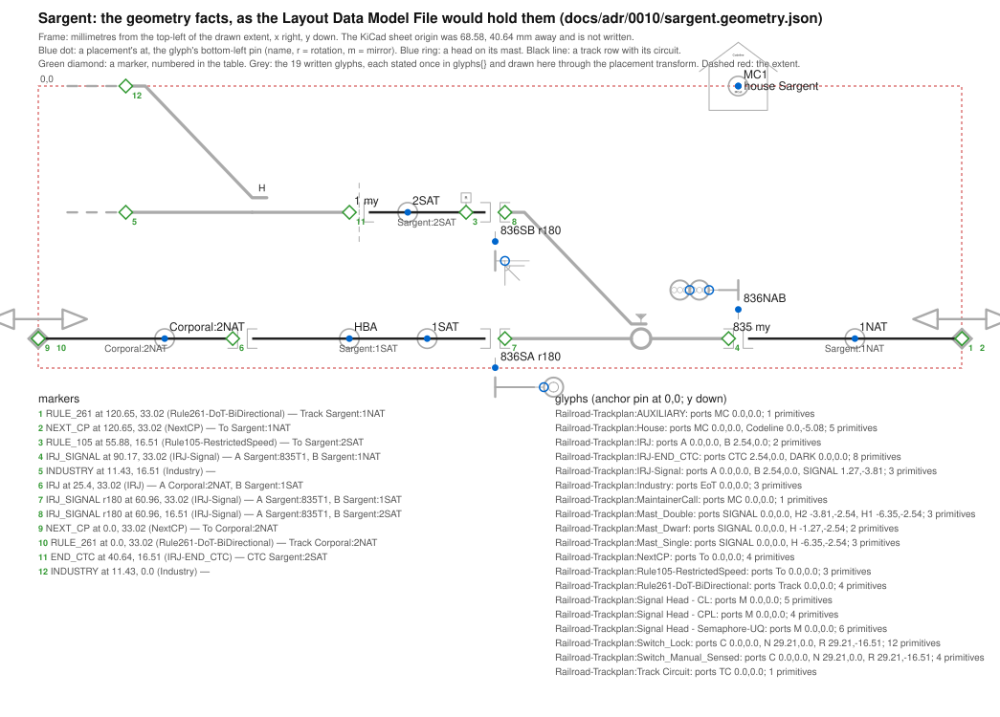
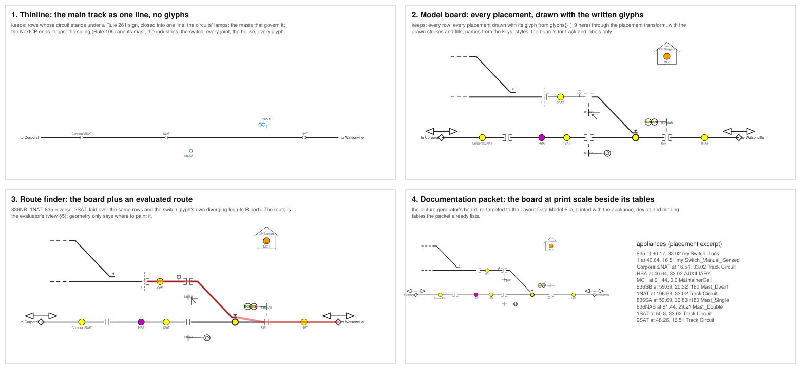

# 0010. Geometry: the drawing as a design fact, and the four views that read it

- Status: proposed, rev 2, 2026-10-24 (rev 1 the same day; rev 2 after the owner's Industry symbol, §7). One ask: ratify §4 and the schema fragment `0010/geometry.schema.json` as the `geometry` object of the Layout Data Model File, schema `layout-model/v3.1.0`.
- Builds on: `docs/review/layout-model-view-2026-10-16.md` §4.7 and O12 (the rule this ADR details), ADR 0008 rev 4 (§4.3, §4.4, §4.5, §4.6, §4.8, C4, C8, §10), ADR 0009 §3.10 (the trackplan Roles and Kinds), ADR 0004 D7 (mileposts) and D12 (scope by sheet), ADR 0003 D1 (N/W is LEFT), `AGENTS.md` ("never infer connectivity from coordinates"), the owner's four views of 2026-10-24, and `docs/review/handoff-0010-geometry-2026-10-24.md`.
- Pictures: `0010/sargent-geometry.svg` (the facts), `0010/four-views.svg` (what each view keeps and drops). Both, and the worked example `0010/sargent.geometry.json`, are generated from the Sargent trackplan sheet at Railroad `37a0dcd` by `0010/make_pictures.py`, never typed. The script exports the netlist it needs with kicad-cli and deletes it; a saved netlist is never read.
- Runs in parallel with the trackplan semantics segment (`handoff-compiler-semantics-2026-10-24.md`); the two meet at the circuit names and at schema 3.1.0 (§4.10).

## Decisions requested

Each line is a choice §4 derives from the rules in §2. The six are the handoff's six; two of them (the frame's round trip, and the keys) turned out to be already decided by ADR 0008 and are written as derivations. The ask is to ratify the set.

1. **A geometry fact** is a placement of a named thing, a drawn run of track, or a placement of a track symbol that has no railroad name; nothing a view styles and nothing a view derives (§4.1).
2. **The frame** is the interlocking's own: millimetres from the top-left of its drawn extent, x right, y down; translation-normalised only; the sheet's origin is not written anywhere (§4.2, §4.3).
3. **Order along the subdivision** is derived by the reader from the houses' mileposts and the NextCP ends; the file writes no strip and no order (§4.7).
4. **Where it lives**: `interlockings.<name>.geometry` with four maps and two lists; named things by name, unnamed track symbols as rows joined to track by circuit name; `officeUnits.<name>.geometry` stays empty in 3.1.0 (§4.5, §4.6, §4.8).
5. **The gates** are the four views as readers of the file; the re-targeted picture generator is the first, the thinline the second; a key no view reads is not written (§3).
6. **Version** 3.1.0, one minor version shared with the trackplan semantics piece (§4.10).

## 1. Problem

The Layout Data Model File has a `geometry` key on every interlocking and office unit, typed as an open object with nothing inside (schema v3.0.0; ADR 0008 §4.3, C4, §10). The compiler writes nothing there. The design rule exists (view §4.7: the drawing is a design fact, recorded as placements and polylines in a normalised frame, never used for connectivity) and was deferred until a consumer worked it out (O12).

The owner, 2026-10-24: "Way back, we ALSO put great effort into capturing the geographic layout of the trackplan and appliances such that the graphical trackplan could be recreated and manipulated into" a thinline mainline-only view, a model board schematic view, a route finder debug and analysis view, and a documentation packet printed and web view. None of the four can be built from the file today. The old picture generator (`tools/plant_graph/layout.py`, `picture.py`) builds two of them from the archived drawings through the old compiler, and is evidence of what a view needs, not a reference for how the file should look (`AGENTS.md`).

What is undefined: the shape of `geometry`, the frame its numbers are in, how a view joins a placement to the thing it means, and which views prove it.

## 2. Rules

The few that drive the design, each tagged by stratum (ADR 0005 §2: *model* survives a change of drawing tool, *representation* is how KiCad encodes it, *operating* is how to change a drawing safely in KiCad). The rest are cited where used.

- **R1.** *Model.* **The drawing is a design fact.** View O12, §4.7: the trackplan sheet is drawn to look like the railroad, and Studio's canvas will be drawn the same way. Where the designer put each thing is stated, not computed, and the file records what a person states (view §1).
- **R2.** *Model.* **Geometry never carries connectivity.** `AGENTS.md`: the netlist and ERC are ground truth; never infer connectivity from coordinates. ADR 0005 A3 names the model rule underneath: connectivity is a fact the model stores, derived once by the tool that owns it. So a reader may join a line to an appliance only by a name the file writes, never by a coincidence of coordinates, and the compiler's semantics never read a coordinate.
- **R3.** *Representation.* **The KiCad boundary.** ADR 0008 R2: nothing of KiCad crosses into the file; the test for any entry is "would Studio need it?". A sheet origin, a page size, a grid, a `lib_id`, a reference are KiCad facts.
- **R4.** *Model.* **Identity is the railroad name; relations are names; nothing else is an identity.** View O2; ADR 0008 §4.5: no ordinals, no ids; a list element nothing references is a row with no identity.
- **R5.** *Model.* **One source per fact; absence is information.** `AGENTS.md` design rules; view O13; ADR 0008 §4.7. A fact no reader needs is not written; a fact the library states (a glyph's shape) is named, not copied.
- **R6.** *Representation.* **Canonical form sorts every list.** ADR 0008 §4.8: "no list's order carries meaning; every intended order is an explicit address or key." A polyline is an ordered thing and must be encoded so.
- **R7.** *Model.* **Mileposts order the subdivision.** ADR 0004 D7: a milepost anchors a position; two anchors give an interlocking its direction, cross-checked against mast letters (ADR 0003 D1: N and W normalise to LEFT); across interlockings they order the subdivision.

Requirements, from the four views: each must be buildable from the file alone, with its own glyphs and styles, and the thinline must be able to drop everything that is not main track.

## 3. Definition of done

- **DoD1. The four views read the file.** The picture generator re-targeted to the file (no KiCad, no archived drawing) renders Sargent and Luchessa: its model board and its route board are the model board and the route finder. The thinline renders the subdivision strip from the seven interlockings. The documentation packet prints the board beside the tables it already lists. Each is a reader of the file and a gate of this section, in the manner of ADR 0008 §3.
- **DoD2. Stable under a sheet move.** Translate every coordinate on a trackplan sheet by any vector and recompile: the file is byte-identical (R3; ADR 0008 DoD1's canonical form).
- **DoD3. No connectivity from geometry.** Compile with the placement reader switched off: every object but `geometry` is byte-identical. Compile with every coordinate on the sheet replaced by zero: every object but `geometry` is byte-identical (R2).
- **DoD4. Every key has a consumer.** Each key of the fragment names, in §4, the view that reads it; a key no view reads is removed before 3.1.0 ships (R5).

## 4. Architecture

Each subsection names the rule it follows, weighs the alternatives, and states the choice.

### 4.1 What a geometry fact is

R1 says the designer's placements are facts; R5 says only what a reader needs is written; R2 says connectivity is not geometry. Per interlocking the file records:

- the **placement** of every named trackplan thing: each appliance (switch, derail, mast with its heads, track circuit marker, lamp, maintainer call), each house, each milepost anchor;
- each **run of track** the designer drew, as an ordered polyline, with the circuit it belongs to;
- the **placement** of every track symbol that has no railroad name (a joint, a signal joint, END CTC, NextCP, a policy sign), with the circuit at each of its track pins.

Not written: colour, line weight, font, a glyph's shape (the view's; §4.9); the mainline, a route, the subdivision strip (derived; §4.7); free text and title blocks (drawing only: a symbol with no Role is drawing only, ADR 0009 §3.10); the `Interlocking` symbol's own placement (a declaration, not a thing on the railroad); the track inside a glyph (a switch's three legs are the glyph's; a joint touching a switch port directly draws no run).

| Option | For | Against |
|---|---|---|
| **Placements, runs, unnamed track symbols** (chosen) | every view in §5 is drawn from it; nothing styled, nothing derived | a view must bring its own glyphs |
| Placements only, no runs | smaller | the model board cannot draw the siding between two joints; the designer drew that line |
| Runs with every KiCad vertex (junctions kept) | closer to the file | a junction is where a lamp's pin touched the line, a KiCad artifact (R3); the designer drew one line |
| A rendered picture per interlocking (SVG from `kicad-cli`) | exact | a picture is not a fact a view can reduce (the thinline cannot drop a siding from pixels); KiCad's look (R3) |

### 4.2 The frame

R3 forbids KiCad's page coordinates; R1 says the proportions the designer drew are the fact. The frame is the interlocking's own: the origin is the top-left corner of the drawn extent (the least x and the least y over every placement and run of the interlocking), the unit is the millimetre of the drawing, x grows to the right and y grows down the page, two decimals (KiCad's own precision; the origin is on the drawing's grid, so no number is rounded). Only the translation is normalised: the scale is the designer's and differs between interlockings (Luchessa draws a mile as 101.6 mm; Sargent draws no scale).

| Option | For | Against |
|---|---|---|
| **Translate to the extent's top-left, mm, y down** (chosen) | passes DoD2; every screen canvas, SVG and KiCad agree on y down; Studio has mm | a physical board drawing in CAD flips y once |
| KiCad sheet mm as they stand | nothing to compute | a sheet move changes the file; the page origin is KiCad's (R3) |
| Grid units (1.27 mm) | integers | the grid is KiCad's (R3); Studio has none |
| Width normalised to 1 (the old generator's "width units") | views scale nothing | the designer's millimetres are the fact (R1); an aspect ratio hidden in a second number |
| Miles, from the milepost anchors | geographic | derived (R5), and five of seven interlockings draw no second anchor; the reader can compute it where two exist (§4.7) |
| y up | CAD habit | every view in §5 is a screen or a page |

**The sheet's own origin is not written anywhere.** The handoff asked whether to record it in `provenance` for a round trip to KiCad. ADR 0008 §4.1 states that no KiCad schematic is constructed from this file, §4.6 limits `provenance` to the layout as a whole, and the owner struck a per-interlocking `source` on 2026-10-19 because it exposed a sheet. The No is already decided; this is a derivation, not a decision.

### 4.3 Orientation

A placement carries `at`, `rotation` (90, 180 or 270; absent means 0) and `mirror` (`x` or `y`; absent means none), as drawn. Their meaning belongs to the model, not to KiCad: a glyph's local frame has x right and y up; `mirror: x` turns top for bottom, `mirror: y` turns left for right; then the glyph turns counter-clockwise by `rotation` as seen on the page; then its origin lands on `at`. The picture script applies exactly this transform to the Trackplan library's pin offsets and lands every switch port on the wire that reaches it, for the 0° and 180° placements the drawing has; the compiler piece adds a 90° fixture before it ships.

The old generator reduced orientation to a coordinate-free heading and hand per switch (`SchematicHeading`, `TurnoutHand`). Those are a view's reading of `rotation` and `mirror` for one Kind of glyph; written per Kind they would be eleven rules in the file instead of one transform. Rejected as file content; kept as what the model board does with it.

### 4.4 A run of track is one string

R6 sorts every JSON list, so a polyline cannot be a list of points and a point cannot be a two-element list. A run is written in SVG `points` syntax, `"27.94,33.02 58.42,33.02"`, and a point as `{"x": 27.94, "y": 33.02}`. A view hands the string to `<polyline points>` unchanged.

| Option | For | Against |
|---|---|---|
| **SVG points string** (chosen) | one scalar, order kept, the standard every view already parses | a string carries numbers |
| A list of points | natural JSON | sorted by the canonical form: the line's order is lost (R6) |
| A map keyed by ordinal | survives sorting | an ordinal is an identity the model forbids (R4) |
| Amend ADR 0008 §4.8 for geometry | lists stay lists | a ratified rule, and C8 says no quiet edit; every reader would need a second canonical form |

### 4.5 Keys: named things by name, unnamed things as rows

R4 says the key is the railroad name. `appliances{}` and `houses{}` under `geometry` use exactly the keys `interlockings.<name>.appliances{}` and `houses{}` use, so a view joins a placement to its meaning by name (ADR 0008 §4.5). A head cannot exist alone (view §4), so a head's placement nests under its mast by letter. A milepost anchor's name is its milepost (ADR 0004 D7: "its Value is the milepost"), so `mileposts{}` is keyed by it.

A joint, END CTC, NextCP and a policy sign have no railroad name and nothing references them, so each is a **row** in `markers[]`, with no identity (ADR 0008 §4.5: rows have no identity), carrying its `kind` as the libraries spell it (ADR 0009 §3.10) and its placement. A view joins a marker to meaning by the **circuit at each of its track pins**, written by pin name: the signal joint at Sargent's east end has `A: Sargent:835T1, B: Sargent:1NAT`; the NextCP has `To: Sargent:1NAT`; the Rule 261 sign has `Track: Corporal:2NAT`. These are relations by name from the netlist, so the view infers nothing from coordinates (R2), and they are what `track` will say about the same circuit from the other side.

The handoff asked how a run without a named circuit is keyed. It is not: a run is a row too. A run of dark track carries no `circuit`, and when it ends at a switch it names the port (§4.6); nothing else need identify it.

| Option | For | Against |
|---|---|---|
| **Named by name; unnamed as rows joined by circuit** (chosen) | one identity rule (R4); no new key invented; `track` and `geometry` meet at the circuit name | a reader that wants "the joint between 1SAT and 835T1" filters rows |
| Key joints by the circuit pair (`1SAT|835T1`) | addressable | a name with a separator the schema forbids; a loop that rejoins one circuit twice collides; nothing references a joint |
| Give joints a `Name` in the drawing | the owner's rule for anything the compiler must name | the compiler need not name them: `track` states a circuit's bounds as relations between circuits, not as joint objects |
| Coordinates as the join (a joint is "the marker at the polyline's end") | nothing to write | R2, verbatim |

### 4.6 Where a run ends

R2 again: the route finder must paint the reverse leg of a switch and not its normal leg, and may not find the leg by where the line ends. A run that ends at a switch's track port names it, `from` or `to` in the run's own point order: `to: "Luchessa:783.R"`. Whether a wire or a joint meets a port is the designer's choice and both are drawn: on the SPCoast project three runs end at a port, all at Luchessa (783's reverse leg, both legs of 799); every other port is met by a joint, a derail or an Industry symbol directly, and then there is no run. A run that ends at a joint or a marker names nothing: the circuit's bounds are `track`'s business, and the marker row already says which circuits meet there. A run that both begins and ends at joints, the common case, carries only its circuit and its points.

### 4.7 Order along the subdivision is derived

R7 and R5. The file already writes each house's `milepost` (every house today; ADR 0004 D7's open question, what becomes of the house's field, is answered by use: it stays, it is where the house is). `track` will carry each NextCP's destination. A reader orders interlockings by their least house milepost, joins them end to end at their NextCP runs, and turns an interlocking whose milepost anchors descend to the right (D7: two anchors give the direction, cross-checked against mast letters). On the SPCoast project every sheet draws mileposts rising to the right and the desk sheet places the seven in the same order; the reader needs neither fact, and the file writes neither. The thinline is this strip with everything but main track dropped (§5).

| Option | For | Against |
|---|---|---|
| **Derived from house mileposts and NextCP** (chosen) | nothing new in the file; two facts already stated | a layout with no mileposts has no strip, and the reader says so |
| A written `subdivision[]` order | one lookup | derived (R5), and a sorted list carries no order (R6) |
| The desk sheet's placement of the interlocking sheets | it is the order | a KiCad fact (R3), and the column numbers already say it for the desk |

### 4.8 The office unit's geometry stays empty in 3.1.0

The handoff's default wrote each column's and panel device's placement. The panel sheets are wiring diagrams: on `Sargent-Panel` every device sits in one vertical list at x = 80.01 mm, in drafting order. That is not where anything sits on the desk. A column's place on the desk is its column number, an explicit address the file already carries; where the lock lever sits on a US&S column is the style's, reference data (ADR 0008 §4.7), and Studio would never ask. The R2 test of ADR 0008 fails for every one of those placements. `officeUnits.<name>.geometry` stays an open object; it is filled when a desk face or a model board is drawn as a drawing, and that drawing is a later segment. Until then the model board view places a lamp by the circuit it `shows`, which has a placement in the interlocking's geometry.

### 4.9 Glyphs are the reader's

R5: the Trackplan library states each glyph once, and `provenance.libraries` names the library and its version (ADR 0008 §4.6). The file does not copy a glyph's shape or its port offsets into every placement. The thinline draws no switch at all; the model board draws its own; the documentation packet that wants the drawing's own look exports the sheet with `kicad-cli`, which is the drawing. The alternative, writing each placement's transformed ports (`C`, `N`, `R` on the page), was weighed: it spares a view the transform, at the cost of copying library facts per instance and of giving every run two ways to meet a switch.

### 4.10 Where it lives, and the version

`interlockings.<name>.geometry` holds `appliances{}`, `houses{}`, `mileposts{}`, `track[]`, `markers[]`; the fragment `0010/geometry.schema.json` is the `$defs/geometry` of schema 3.1.0, with `additionalProperties: false` throughout. An interlocking whose trackplan spans two sheets has no single frame; the compiler reports an error and writes no geometry for it (every interlocking today draws one trackplan sheet). Fixing `geometry` is a minor version (ADR 0008 C4); the trackplan semantics piece fixes `appliances` and `track` in the same minor version, and the two ship as one `layout-model/v3.1.0`: geometry's rows name circuits, and the circuit names, including a switch's OS circuit, are that piece's to define. The picture script carries a stated approximation of the OS rule for its own use only.

## 5. Pictures and the worked example

`0010/sargent.geometry.json`, 254 lines, validated against the fragment and in canonical form, is Sargent's `geometry` object as the compiler would write it. Read off it:

- `appliances`: eleven placements. `835` at 78.74, 33.02 with `mirror: y`, so its points face east; `836NAB` with heads `A` and `B` nested; `836SA` and `836SB` turned 180, standing on the far side of their track; `Corporal:2NAT`, the approach circuit of the next interlocking, placed here as a reference by qualified name; `MC1` at the house.
- `houses.Sargent` at 91.44, 0.0, the top of the extent.
- `track`: four rows, one circuit each, each one straight run between two joints. The OS circuit `835T1` has no run: its three legs are inside the switch glyph, and each joint touches a port directly. The hand-thrown switch beyond END CTC has no run either: an Industry symbol stands on each of its N and R ports.
- `markers`: twelve rows. Three signal joints, each naming the OS circuit on `A` and the circuit it bounds on `B`; one plain joint between `Corporal:2NAT` and `1SAT`; END CTC with `CTC: Sargent:2SAT` and no `DARK` circuit; two NextCP ends; two Industry ends (`kind: INDUSTRY`, track exists past this point but is not drawn) on the hand-thrown switch's ports, naming no circuit because dark track has none; two Rule 261 signs and one Rule 105 sign, each naming the circuit its pin stands on.
- `mileposts`: absent. Sargent draws none; Luchessa will write `78.3` and `79.3`.

What each view keeps and drops, from that object alone:

| View | Reads | Keeps | Drops |
|---|---|---|---|
| Thinline | `track` rows whose circuit stands under a Rule 261 or 251 sign (`markers` by circuit), `appliances` masts whose signal joint bounds such a circuit, the NextCP rows, `houses.milepost` for the strip | one closed line per interlocking, the circuits' lamps, the masts that govern main track, the ends | the siding and its mast, the industries, the switch, every joint, the house |
| Model board | everything | every row, switch legs and joint ticks at their placements, a lamp at each circuit's placement, masts with heads, the house | nothing; it styles everything |
| Route finder | the model board plus the evaluator's route (view §5) | the board, with the route's circuits and the switch's chosen leg painted over the same rows and ports (`from`, `to`) | nothing |
| Documentation packet | the model board | the board at print scale beside the tables the packet already lists | nothing |

The first consumer, `tools/render_plant_picture.py`, produces today's `board-svg` and `route-board-svg` from the archived drawings; re-targeted to the file it is the model board and the route finder, and its overview and swim-lane pictures become the documentation packet's. It must drop the old compiler, the netlist and the library to do so (DoD1).

## 6. Decision

Ratify §4 and `0010/geometry.schema.json` as the `geometry` object of schema `layout-model/v3.1.0`: a placement for every named thing by its name, a run of track as a row with its circuit and its ports, an unnamed track symbol as a row joined by circuit, the interlocking's own frame in millimetres with its sheet origin forgotten, orientation as drawn with the model's own transform, polylines as strings under the canonical form, order along the subdivision derived from mileposts and NextCP, the office unit's geometry empty until a desk or board drawing exists, glyphs the reader's, one minor version shared with the trackplan semantics piece, and the four views as its gates.

## 7. Record

- 2026-10-16. The view fixed the rule (§4.7) and the owner made geometry a design section to be written against the Sargent picture as its first consumer (O12). ADR 0008 kept it an open object through four revisions and listed it out of scope (§10).
- 2026-10-24. The owner asked whether the geographic layout had been missed, naming the four views. The closing session of the ADR 0008 segment wrote the handoff with six decisions and defaults.
- 2026-10-24, this session. Read the Sargent, Luchessa and Corporal trackplan sheets with jBOM's loader and the production netlist. Findings that shaped §4: the canonical form sorts every list, so a polyline cannot be a list (§4.4); the OS circuit's legs are inside the switch glyph and the joints touch its ports with no wire, so geometry's runs are the designer's lines between symbols and nothing more (§4.1, §5); the panel sheets place devices in one column at one x, so their placements are drafting, not design (§4.8); the hand-thrown switch beyond END CTC has stubs drawn into dark track, which the netlist reports as unconnected single-pin nets and the file writes as runs without a circuit (§4.6); every sheet draws mileposts rising to the right, which the reader need not assume (§4.7). The round-trip question and the key question dissolved into ADR 0008 §4.1, §4.6 and §4.5 (§4.2, §4.5). The handoff's office-unit default was overturned by the R2 test (§4.8).
- 2026-10-24, rev 2. Settled with the owner: no label placement is written, the label is the symbol's attribute and the file already carries it; a view that draws its own glyph needs only the library's origin and port offsets, which §4.3 and the netlist supply. The owner replaced the stubs drawn into dark track at Sargent, Corporal and Luchessa with a new Trackplan symbol, Industry (Role `TRACK`, Kind `INDUSTRY`, one pin: "track exists past this point, but is not drawn"), and gave Luchessa's industry spur an END CTC (Railroad `37a0dcd`; ADR 0009 §3.10's TRACK list gains `INDUSTRY`). The example and pictures were regenerated: Sargent's two dark runs became two `INDUSTRY` marker rows with no circuit, and no run on the project now ends anywhere but at a symbol, so the compiler piece can report a run that ends at no port as an error. §4.6's port rule stays, for the three runs at Luchessa that meet a switch port directly. The owner's rule on netlists: never read a saved one without checking that it is stale; export a fresh one, use it, delete it. The picture script does so.

## 8. Consequences

- C1. Schema `layout-model/v3.1.0` adds `$defs/geometry` as the fragment states it, shared with the trackplan semantics piece's `appliances` and `track`; one version, one example regenerated, one migration note (ADR 0008 C8). ADR 0008 C4's "open objects" closes for `geometry`.
- C2. The compiler piece, after ratification: a placement reader over the `.kicad_sch` files through `tools/kicad_services` (`SchematicPlacementReader` reads symbols today; wires and junctions are added beside it, and the generic part is a kicad-primitives ticket under ADR 0007), scoped to an interlocking by sheet (ADR 0004 D12), normalised per §4.2, joined to circuits through the netlist and never the reverse. Tests: DoD2 and DoD3 on the SPCoast project.
- C3. The first view: `render_plant_picture.py` reading the file, with `tools/plant_graph` retired behind it (ADR 0008 C6's "then go in one commit" extends to the old generator once the model board and route finder read the file). The thinline is the second gate; the documentation packet and the route finder's route overlay follow as readers.
- C4. ADR 0004 D7's open item on the house's `Milepost` field is answered by use: it stays as the house's place; the Milepost track symbols are optional anchors that give an interlocking a scale and a direction, written under `mileposts{}` where drawn.
- C5. `AGENTS.md` gains, under the KiCad conventions: an interlocking's trackplan is one sheet, and its placements are read for geometry only.
- C6. The trackplan semantics piece and this one agree that `track` describes joints, ends and signs as facts of the circuits they bound, by circuit name, so `markers[]` joins to it without a key of its own. If that piece gives those things names instead, `markers[]` becomes a map by those names in the same version.
- C7. `officeUnits.<name>.geometry` stays open (an object with nothing inside) until a desk face or a model board is drawn; that drawing is a later segment with its own ADR amendment.

## 9. Out of scope

- The views' own styles, glyphs and layout algorithms, including the longitudinal solver of `tools/plant_graph/layout.py`; each view decides what to do with the facts.
- The evaluated model's routes, signals and limits (view §5); the route finder reads them from the evaluator in memory.
- A desk face or model board drawing for the office unit (C7), and physical board dimensions.
- An interlocking drawn over several trackplan sheets (§4.10 reports it).
- Studio's canvas; this ADR says what it must be able to state, not how.
