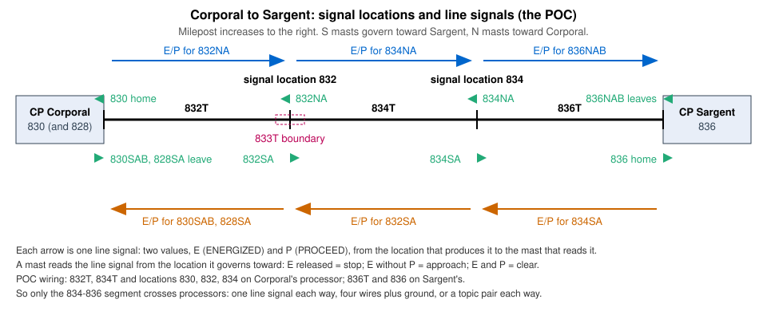

# 0013. Between control points: blocks, automatic signals, the interlocking–block seam and traffic

- Status: **accepted by the owner 2026-11-02** (rev 4: three-part structure with the functional interlocking–block seam in §13, Gherkin safety invariants before the 3-column reference-data profile table in §14, and vital vs. non-vital carrier markings in §18).[^rev]
- Amends: ADR 0009 §3.10 (a mast states Kind; TRACK Kind `IRJ_SIGNALS`; track circuit Style `boundary`; done in the
  same change), ADR 0009 §3.12's row "track leaves an interlocking" (interlocking track only; merged in #58), ADR 0012
  §5 (the blocks library's scope) and §5.5 (the proxy retires, §23), FieldUnit `docs/GLOSSARY.md` §4 ("powered switch or derail").
- Builds on: `docs/review/abs-apb-research-2026-10-30.md` (`[ABSAPB]`) with the owner's answers of 2026-10-30,
  `docs/review/traffic-locking-research-2026-10-31.md` (`[TLRES]`) and
  `docs/review/adr-0013-adversarial-review-2026-10-31.md`. The POC drawing: Railroad
  `2a1696e` (Corporal and Sargent sheets of the SPCoast project).

## Decisions (ratified 2026-10-30 to 2026-11-02)

1. **Three parts, one ADR, bounded at the interlocking–block seam.** Part 1 states the normative model facts and
   domain-library derivations owned by Subdivision. Part 2 states the between-interlockings prototype behavior, safety
   invariants, and reference-data profiles (Rank 1 of the order of authority between plants, bounded by the functional
   seam of §13 so it never reaches inside an interlocking). Part 3 records non-normative deployment variations, carrier
   vitality markings, and context for consumers. If the model is missing or misstating something, codegen cannot fix
   it (§13).
2. **A station-to-station block** is a piece of the track graph cut at every `CONTROLLED` and `ABSOLUTE` signal joint
   that holds no powered switch or derail and lies under a block signal rule (`RULE_251`, `RULE_261`, or `ABSOLUTE`
   ends). Hand-throw, spring, and electrically locked hand-throw switches may lie in a block. It belongs to the layout,
   not to an interlocking, and the `blocks` library computes it on demand (§4).
3. **ABS, APB or CTC is derived, never stated.** APB is derived from `ABSOLUTE` ends alone; a `RULE_261` sign on
   `ABSOLUTE` ends is reported at warning (§4).
4. **A mast states what it is:** `Kind` `CONTROLLED`, `ABSOLUTE` or `PERMISSIVE`. A mast with none is missing. Grade
   and restricting plates are POLICY symbols on the mast's net (§5).
5. **A joint with a mast on each side** is the `IRJ-Signals` symbol: pins A, B, `SIGNAL_A` (its mast governs into A)
   and `SIGNAL_B` (into B). Nothing is read from rotation (§6).
6. **Block track is drawn** from one control point to the next and replaces NEXT_CP inside CTC. The block's one office
   indication is a virtual track circuit whose members are the block's circuits (§7).
7. **A `RULE_251` sign's `LEFT` or `RIGHT`** is the lever direction of the signals that govern with the current of
   traffic. A `RULE_251` sign inside interlocking limits states the current of traffic on that track, and nothing more
   (§8).
8. **Names by signal location:** automatic masts and the circuits between them are numbered for their signal
   location (§9).
9. **A boundary track circuit** (Style `boundary`) is a detector at a joint. The model states which circuits it
   counts toward (§10), and consumers OR its occupancy into them (§19.1).
10. **Facts the model carries for consumers:** blocks with their ends, signal locations, member circuits, and the
    processor that reads each circuit; the processor that runs each signal location; each station's code line kind,
    capacity in steps (reference data), and indications already used; drawn line wires; and the transports each
    processor reaches (§11). Where things live follows ADR 0012's split: `derive.py` raises no transport or carrier
    errors (§12).
11. **Three layers and reference-data profiles:** operations (a railroad's rules and era, parameterized in reference
    data and checked against the four railroad-independent safety invariants of §14.1), the model (railroad-neutral,
    Part 1) and the layout (the owner's hardware and carrier vitality, Part 3) (§14).
12. **Between-interlockings relay model and functional seam (Part 2):** at each end of a block, the interlocking and the
    block meet at a functional seam (§13): outbound `requested`, `cleared`, `in_time`, and `home_proceed`; inbound
    `segment_clear` (`H`), `next_proceed` (`D`), and `traffic_free` (`F`). Between neighbouring signal locations, one
    **HD line** per direction carries `H` and `D`, with directional stick relay `SR` for following moves (`[CBQ1946
    pp. 613–616]`, `[RS1927Spray pp. 269–270]`, `[AAR56 pp. 51–54]`; `AAR Dwg 8000, 8066 via [ABSAPB], [TLRES]`)
    (§15, §16).

# Part 1. Model facts (normative)

What comes from KiCad or Studio into the Layout Data Model File, as `given`, `relations` or `derived` (ADR 0011), and
what the domain libraries compute from it on demand (ADR 0012 §5).

## 1. Problem

The Layout Data Model File describes each interlocking well and the track between them hardly at all:

- No entity holds the track between two control points. A NEXT_CP names a neighbour, but nothing says which circuits
  lie between or which signals govern them.
- Nothing says which signals are automatic.
- A double location, two masts back to back at one joint, is an import error (`joint.masts`).
- Traffic locking and the tumble-down need facts from the far end of the block. The model does not say which
  processor has those facts, or how a consumer can get them.

## 2. Picture and example



The POC between Corporal and Sargent shows every case in too little track. It is an example, not a plan for real
signal placement:

| Signal location | Masts | Circuits |
|---|---|---|
| Corporal (control point) | 830SAB and 828SA leave toward Sargent; the 830 home faces the block | 832T on the block side |
| 832 (`IRJ-Signals` B11007) | 832SA toward Sargent, 832NA toward Corporal, both `PERMISSIVE` | 832T, 834T; boundary 833T at the joint |
| 834 (`IRJ-Signals` B1) | 834SA, 834NA, both `PERMISSIVE` | 834T, 836T |
| Sargent (control point) | 836NAB leaves toward Corporal; the 836 home faces the block | 836T |

834T runs from Corporal's sheet to Sargent's through the hierarchical label `ToSargentMT`. The model board shows the
block as `Corporal:831T`, a virtual circuit with members 832T, 834T and 836T.

## 3. Rules in play

Tags: **model**, **representation** (how KiCad draws it), **operating** (a railroad's rule), **layout** (the owner's
hardware).

| # | Rule | Source | Tag |
|---|---|---|---|
| R1 | Order of authority Rank 1 (the relay model and AAR/AREMA practice) has two homes by scope: `FieldUnit/docs/GLOSSARY.md` §10.6 inside an interlocking, and ADR 0013 Part 2 between interlockings. The functional seam (§13) is the boundary between them; neither restates the other. | AGENTS.md | model |
| R2 | A rule that reads a symbol stands for a fact that lives elsewhere. Find the fact. | ADR 0001 D15 | model |
| R3 | Each fact has one source. | AGENTS.md | model |
| R4 | Where a relationship has an explicit form, it is stated or it is missing. | ADR 0012 §4 | model |
| R5 | Domain libraries write nothing into the file. | ADR 0012 §5 | model |
| R6 | A control point is a place with controlled absolute signals. Interlocking limits are the track between opposing home signals: cut the track graph at every controlled signal, and each piece with a powered switch or derail is an interlocking. | GLOSSARY §4 | model |
| R7 | A block is one or more track circuits treated as one occupancy for one purpose. | GLOSSARY §7 | model |
| R8 | A station-to-station block reaches the office as one indication (design rule; prototype evidence `[RS1942]`, `[RS1947 p. 92]` via `[ABSAPB]`). | ADR 0013 D6 | model |
| R9 | On SP CTC the signal levers set the traffic; there is no separate traffic lever. Other railroads used traffic levers or traffic relays (§14.2). | `[RS1942]` via `[ABSAPB]`; `[CBQ1946]` | operating |
| R10 | Automatic signals give no authority. On SP they stand clear in both directions while the block is idle; on CB&Q they stand clear only in the last established direction (§14.2). | `[PRR56]`; `[RS1942]` via `[ABSAPB]`; `[CBQ1946 p. 614]` | operating |
| R11 | Prototype practice varied by railroad and era. Reference data (§14.2) captures the railroad/era profile, the model derives the general structure, and the drawing states local exceptions. | ADR 0012 §6 | model |
| R12 | A token goes on the code line only when something consumes it. | owner 2026-10-27 | model |
| R13 | Identity never comes from a binding. Which processor runs a thing comes from its wiring. | owner 2026-10-16 to 18 | model |
| R14 | Desk and field I/O are asserted low. | owner 2026-10-07 | layout |
| R15 | Selective compression: the layout may trade vital field isolation for fewer wires when marked explicitly as non-vital (§18.1). | owner 2026-10-31 | model |
| R16 | Occupancy of the block, or an opposing cleared signal, prevents a change of traffic. | `[CFR236 §236.405]`; `[ICC1939 Item 382]` | operating |
| R17 | If the model is missing or misstating something, codegen cannot fix it. | owner 2026-11-01 | model |
| R18 | The `OfficeUnit` is non-vital and never blocks a control; vital locking is enforced in the field. | GLOSSARY §2.3, §5 | model |

## 4. The station-to-station block (decisions 2, 3)

Cut the track graph at every `CONTROLLED` and `ABSOLUTE` signal joint. Each piece that holds no powered switch or
derail and lies under a block signal rule (`RULE_251`, `RULE_261`, or `ABSOLUTE` ends) is one station-to-station block.
A powered switch is one the dispatcher throws from the desk: `Style` `powered` or `dual` (GLOSSARY: powered switch,
dual-control switch). A `CP Name` on a switch says which control point serves it and makes nothing powered: a
hand-throw switch (`manual`, `manual_sensed`), a spring switch, and an electrically locked hand-throw switch (`lock`)
may lie in a block whatever `CP Name` they state.[^powered] A block holds:

- its track circuits, in order;
- its signal locations and their masts, in order;
- at each end, the control point's leaving signals into it (or `ABSOLUTE` head-block signals) and its home signal facing it;
- its rule and, under `RULE_251`, its current of traffic (§8).

A piece under `RULE_105` or `RULE_93` alone is a siding or station track. A piece that reaches an END_CTC leads to
unsignalled track. Neither is a station-to-station block.

The block belongs to no interlocking. The `blocks` library computes it on demand (R5). Its track is drawn across sheets
(§7.1), so no pairing is needed.

**ABS, APB or CTC is derived, never stated.** It is a property of the block, read from facts already drawn: the
masts' Kinds at its ends and between, and its sign.

| Ends | Intermediate masts | Sign | The block is |
|---|---|---|---|
| `CONTROLLED` | none, or all `PERMISSIVE` | `RULE_261` | CTC, with automatic intermediate signals where drawn (Corporal to Sargent) |
| `ABSOLUTE` head blocks | none, or all `PERMISSIVE` | none (or any; `RULE_261` warns) | APB |
| any | none, or all `PERMISSIVE` | `RULE_251` | ABS, one current of traffic |

The APB row is derived from the `ABSOLUTE` ends alone. The policy sign states movement authority, not the signal
circuit method. Standard Code Rule 261 (`[PRR56]`) gives signal-indication authority in both directions, whereas an
automatic signal gives no authority (R10). Therefore, a `RULE_261` sign on `ABSOLUTE` ends is reported at warning
(allowing a deliberate exception where special rules let APB signals authorize moves, without failing validation).

## 5. What a mast is (decision 4)

A mast states `Kind`: `CONTROLLED` (the dispatcher controls it; it belongs in a control point), `ABSOLUTE` (automatic
and absolute, an APB head block) or `PERMISSIVE` (automatic and permissive, with a number plate). Kind is a model fact.
What it means to a crew is in Part 2 (§15.5).

- **Representation.** The library has symbols whose Kind is fixed, with graphics that suggest it: Signal Mast Single
  `CONTROLLED`, `ABSOLUTE` and `PERMISSIVE`, and Signal Mast Double and Dwarf `CONTROLLED`. A fixed Kind is part of
  the symbol's identity, like `Rule251-Left`'s Direction, not a per-instance default. A mast with no Kind is missing.
- **Plates.** The number plate symbol is gone: `PERMISSIVE` means the plate. `Plate-G` (Kind `RULE_290_G`, heavy
  freight only) and `Plate-R` (Kind `RULE_290_R`, all trains) are POLICY symbols. Their pin `To` sits on the mast's
  `SIGNAL` net, and each requires a `PERMISSIVE` mast. The Kind names the resulting indication, Rule 290 `[AAR56
  p. 53]`; the plate itself modifies a Rule 291 signal `[AAR56 p. 54]`. No Milepost field: the milepost is already in
  the mast's name.
- **Check, never a source.** A mast that is not `CONTROLLED` whose route passes a powered switch or derail is reported
  at warning. Spring switches and hand-throw switches in ABS and APB territory are not powered. The check sets
  nothing. It belongs with the rule checks in `tools/layout_model`.
- **CP Name** is the operations level only: which control point a controlled mast belongs to. Automatic masts state
  none. Which processor drives a mast's lamps comes from the wiring (R13).

Rejected: "a signal is controlled exactly when it states a CP Name". That decided control by inference from a field
that already does another job.

## 6. A joint with a mast on each side (decision 5)

`IRJ-Signals` is Role `TRACK`, Kind `IRJ_SIGNALS`, with pins A (1), B (2), `SIGNAL_A` (3) and `SIGNAL_B` (4). The
mast on `SIGNAL_A` governs into side A. The mast on `SIGNAL_B` governs into side B.

- Masts are drawn on the engineer's side of the approaching train, to the right of the track. On a schematic that is
  plain by inspection, and nothing is inferred from rotation or from which mast is "first". There is no side field.
- `IRJ-Signal` keeps its one `SIGNAL` pin. ADR 0012 §8's `approach` and `governed` sides stand for it unchanged.
- For a double joint, each mast's `approach` and `governed` sides are derived from its pin. The approach and
  governed names are relative to a mast, not to the joint.

A **signal location** is a block boundary: one joint with its masts, and the track circuits on each side. A control
point is a signal location with one side toward the block.

## 7. Block track and the block's indication (decision 6)

### 7.1 Drawn, not paired

The block's track is drawn from one control point to the next, across sheets where needed. A hierarchical label
continues the run. Pairing comes from netlist connectivity. Inside CTC a NEXT_CP is no longer needed. It stays for an
interlocking whose neighbour is not drawn.

Consequence for ADR 0009 §3.12's row "track leaves an interlocking only at a NEXT_CP or an END_CTC" (merged in #58): it
covers interlocking track only. Block track belongs to the layout. Dark track beyond an END_CTC is outside both.

### 7.2 The block's one indication

R8: the block reaches the office as one indication. It is a virtual track circuit (`Track Circuit_Virtual`, Style
`virtual`) whose `Members` are the block's circuits: `831T` = [832T, 834T, 836T]. A consumer qualifies it with the
station that sends it, `Corporal:831T` on the model board. By R12 that consumer makes Corporal send `831TK`. The
model states the members and the station named. Check: the qualifying station is at one end of the block. A layout
without a consumer for the block's virtual circuit sends nothing for it.

When a member of `Corporal:831T` (`836T`) is wired to the neighbouring interlocking's processor (Sargent), `831T` is a
cross-interlocking consumer of `Sargent:836TK` (ADR 0011). By R12, that causes Sargent to include `836TK` in its
codeline indications (where the code line has capacity, §18.1), so Corporal can compute `831TK` without inferring
occupancy from `H` and `D` (which `834SA`'s `SR` masks while a southbound train occupies `836T`).

## 8. The current of traffic under `RULE_251` (decision 7)

| Sign | Kind | `Direction` |
|---|---|---|
| `Rule251-DoT-Left`, `Rule251-DoT-Right` | `RULE_251` | `LEFT`, `RIGHT` |
| `Rule261-DoT-BiDirectional` | `RULE_261` | `BOTH` |
| `Rule105-RestrictedSpeed`, `Rule93-Yard Limits` | `RULE_105`, `RULE_93` | `BOTH` |

`BOTH` adds nothing to its Kind. The 251 sign's `LEFT` or `RIGHT` is the lever direction of the signals that govern
with the current of traffic (GLOSSARY §7; ADR 0003 D1 maps `N`/`W` to `LEFT` and `S`/`E` to `RIGHT`). SPCoast agrees:
`Christopher:1NAT` and `Corporal:1SAT` both state `RIGHT`, and trains with the current arrive at a `RIGHT` signal at
Corporal. The `blocks` library checks that the signs of one block agree with each other and with its masts. Under
`RULE_261` the direction of traffic is set at run time (§16) and is not a static model fact.

**A `RULE_251` sign inside interlocking limits** states the current of traffic on that track, and nothing more
(owner, 2026-10-31). Watsonville's arrival and departure tracks are switch 837's two legs, between the home joints of
838NCD and 838NAB and the switch. Each leg carries a 251 sign with its direction of travel (Railroad `31954c5`). Such
a sign makes no block, because its piece holds a powered switch (§4), and it marks neither a block limit nor the end
of CTC. The same agreement check applies: the sign's direction against the signals that govern on that track.

## 9. Names by signal location (decision 8)

- An automatic mast is numbered for its signal location, the milepost in tenths, with its direction letter and head
  letter as for any mast (`grammar.MAST_NAME`): 832SA and 832NA at location 832. No CP Name.
- A circuit between two signal locations is named for the location at its higher-milepost end, whose mast governs
  over it: 832T between 830 and 832. ADR 0003 already numbers a circuit outside interlocking limits for the signal
  that governs over it. No CP Name: block track belongs to the layout.
- A virtual circuit for a block (`831T`) takes any number not used by a signal location. It is the block's name in
  every consumer. A block with no virtual circuit drawn has no name.
- A controlled mast's lever is the number in its name, and its lever direction comes from its direction letter
  (ADR 0003 D1).

Milepost numbers are unique on the layout, so none of these names needs an interlocking qualifier. The names do not
change when the hardware is split differently.

## 10. Boundary track circuits (decision 9)

Current detection does not see cars with plastic wheels. A detector at the joint, an IR beam for example, keeps the
block a train is leaving occupied until the last car has passed the masts. (MSS, the Modular Signal System, places
its detectors at block boundaries for the same reason.)

- The symbol `Track Circuit IR Boundary` is `Appliance track_circuit`, Style `boundary`, with pins A and B on the two
  nets at a joint. Its name says the technology. The model reads only the Style.
- It has one detected output, wired to a driver pin like any track circuit.
- The derivation states which circuits it counts toward: the circuit on each of its pins. It never splits a circuit
  or ends a block.
- A detector wired straight into the two circuits' inputs in the field is not drawn at all.
- It is named like any circuit (833T in the POC). Its input belongs on the processor that runs its signal location.

## 11. Facts the model carries for consumers (decision 10)

| Fact | Form | Source |
|---|---|---|
| A block's end control points, signal locations in order, member circuits in order | derived, on demand | `blocks` library (§4) |
| The processor that reads each circuit | relation | the circuit's binding route `processor/address/pin` (ADR 0008), joined on demand |
| The processor that runs each signal location | relation | the bindings of its masts' heads (R13), joined on demand |
| Each station's code line kind | given and relation | the code line's `Kind`; the interlocking's `codeline` (`codeline.encoding`) |
| What a station is (house or interlocking) | reference data | `reference.STATION` |
| Each station's capacity: controls and office indications per field station, in steps | reference data | `reference.CODE_LINE_CAPACITY` (by code line type; set by the physical machine) |
| Steps a station already uses | computed on demand | its appliances (`tools/railroad/codeline.py`) times their steps (`reference.CODE_LINE_STEPS`) |
| The indications a station already sends | computed on demand | `tools/railroad/codeline.py` (`stations`) |
| Drawn line wires (`Device-HD-Out` / `Device-HD-In`) | relation | device bindings `processor/address/pin` (§18.1, gap 3) |
| Whether a cross-processor carrier is `vital` or `non_vital` (R15) | derived from carrier kind | §18.1 |
| The transports each processor reaches | derived | ADR 0008 §4.9: `layout.processors.<p>.derived.transports` (what it anchors plus its FieldUnits' code line transports) |

## 12. Derived, and where each result lives

| Result | Where |
|---|---|
| A mast's Kind | `given`, stated |
| ABS, APB or CTC for a block | `blocks` library, on demand |
| Station-to-station blocks, their circuits, signal locations, rule and current | `blocks` library, on demand |
| HD links: producer, consumer, and the processor each runs on | `blocks` library, on demand |
| The circuits a boundary circuit counts toward | derivation, from the pins |
| Next and approach signals, home and leaving roles | `routes` library, on demand (ADR 0012 §5.3) |
| A virtual circuit's token on the code line | `codeline` library, by R12 |

# Part 2. Between-interlockings prototype behavior, seam, invariants and profiles (reference authority)

Order of authority Rank 1 (`R1`): how the prototype relay circuits and operating rules work **between**
interlockings, bounded by the functional seam (§13) where a station-to-station block meets the interlocking at each
end. Logic **inside** an interlocking plant belongs to `FieldUnit/docs/GLOSSARY.md` §10.6.

## 13. The functional seam between an interlocking and a station-to-station block (decision 1, 12)

If the model is missing or misstating something, codegen cannot fix it (R17). Consumers read only facts that Part 1
states (§20) plus reference data; they never read KiCad or invent missing topology.

A station-to-station block meets each end interlocking at that interlocking's outer home signal joint. All interaction
between the interlocking and the block crosses this seam through seven functional ports (four outbound from the
interlocking into the block; three inbound from the block into the interlocking):

| Direction | Functional seam port | Meaning | Prototype relay realization |
|---|---|---|---|
| **Interlocking $\to$ Block** (outbound) | `requested` | A leaving signal at this end has an active direction request into the block | `RGZ` / `HSR` (`[CBQ1946 p. 614]`; `GLOSSARY.md` §10.5) |
| **Interlocking $\to$ Block** (outbound) | `cleared` | A leaving signal at this end is cleared into the block (indicates Approach or better) | `HR` front / `!RGPR` (`[CBQ1946 p. 614]`; `[RS1945]` via `[ABSAPB]`) |
| **Interlocking $\to$ Block** (outbound) | `in_time` | A leaving signal into the block is running approach or time locking | `ASR` back / `TER` (`[RS1942]` DT-10 via `[ABSAPB]`; `GLOSSARY.md` §10.5) |
| **Interlocking $\to$ Block** (outbound) | `home_proceed` | The home signal facing the block indicates Approach or better | `HR` front (`GLOSSARY.md` §10.6); `AGGPR` (`[CBQ1946 p. 615]`, opened) |
| **Block $\to$ Interlocking** (inbound) | `segment_clear` | The entrance circuit and ahead/stick conditions permit the leaving signal to show at least Approach | `H` (feeds leaving signal `HR`, `[CBQ1946 p. 615]`) |
| **Block $\to$ Interlocking** (inbound) | `next_proceed` | The next signal in the block indicates Approach or better, permitting the leaving signal to upgrade to Clear | `D` (feeds leaving signal `DR`, `[CBQ1946 p. 615]`; `GLOSSARY.md` §10.6) |
| **Block $\to$ Interlocking** (inbound) | `traffic_free` | The block and far end are free of opposing traffic (never bypassed by an intermediate directional stick) | `F` / `FR` / `FSR` (`[CBQ1946 p. 614]`; `[ERIE1942]`, `[NW1949]` via `[TLRES]`; equals `segment_clear` under `SP_1942`) |

A leaving signal into the block requires `segment_clear` and `traffic_free` in its home (`HR`) condition, and uses
`next_proceed` in its proceed (`DR`) condition. How the interlocking evaluates its internal routes and locking is
`FieldUnit`'s domain (`FieldUnit/docs/GLOSSARY.md` §10.6).

## 14. Safety invariants and reference-data profiles (decision 11)

### 14.1 Four railroad-independent safety invariants

Every between-interlockings profile in reference data must satisfy four railroad-independent invariants (`I3` is the
transient receding-stick case of `I1`). When gap 2 closes, these become executable Gherkin scenarios in the conformance
suite (ADR 0012 §3) run against every shipped profile over a declared fixture block:

```gherkin
Feature: Between-interlockings block safety invariants
  Every signaling profile for a station-to-station block must preserve opposing
  exclusion, traffic retention, receding stick release, and following separation.

  Background:
    Given a Rule 261 single-track block between control points "West" and "East"
    And track circuits "1T" and "2T" in order from "West" to "East"
    And intermediate signal location "2" between "1T" and "2T" with masts "2E" (toward "East") and "2W" (toward "West")

  Scenario: I1 Opposing exclusion
    When "West" has a leaving signal "cleared" into the block
    Then no opposing leaving signal at "East" has both "segment_clear" and "traffic_free" asserted

  Scenario: I2 Traffic retention while occupied or in time
    Given traffic is established from "West" toward "East"
    And any track circuit of the block is occupied, or a leaving signal at "West" is "cleared" or "in_time"
    Then "traffic_free" at "East" remains released

  Scenario: I3 Receding directional stick release (transient case of I1)
    Given a westbound train has passed intermediate "2W" and set "2W"'s SR
    And "West" has "requested" eastbound while "1T" is still occupied
    When the westbound train clears "1T" into "West"
    Then either "2W"'s SR releases before "West" clears eastbound, or "traffic_free" at "East" remains released

  Scenario: I4 Following separation and approach aspect
    Given an intermediate or leaving signal governing toward the next signal ahead
    Then "segment_clear" is released whenever any track circuit of its governed segment is occupied
    And "next_proceed" is released whenever the next signal ahead indicates Stop, Stop and Proceed, or Restricting
```

### 14.2 Three layers and the reference-data profile table

| Layer | What it holds | Who chooses |
|---|---|---|
| Operations | The rule (`RULE_251`, `RULE_261`); the `blockRules` profile below | The layout owner, by `Railroad`, `Era`, and `Rulebook` (ADR 0012 §6) |
| Model | Blocks, signal locations, seam ports, directed `HD` links, and which processor reads or drives each | Railroad-neutral, derived (Part 1) |
| Layout | How `H`, `D`, `F` and occupancy cross between processors, and whether the carrier is `vital` or `non_vital` | The layout owner's hardware drawing (§18) |

Prototype railroads differed along six axes, to be captured in `reference.py` under `blockRules` (gap 2):

| Axis (`blockRules`) | `SP_1942` (SP CTC, 1942–1985) | `CBQ_1946` (CB&Q CTC, 1946) | `ERIE_NW_1942` (Erie 1942 / N&W 1949) |
|---|---|---|---|
| `trafficMechanism` | `"hd_chain"` (`traffic_free` = `segment_clear`; two wires per direction, `[RS1942]`, `[RS1947 p. 92]` via `[ABSAPB]`) | `"field_fr"` (field `4RFR` + un-bypassed traffic term, `[CBQ1946 pp. 614–616]`, opened) | `"traffic_line"` (separate two-wire traffic-locking line `F` between CPs, `[ERIE1942 pp. 189–191]`, `[NW1949 p. 433]` via `[TLRES]`) |
| `tumbleDownTrigger` | `"cleared"` (`cleared` cuts outbound `H`, `[RS1942]`, `[RS1947]` via `[ABSAPB]`) | `"requested"` (`requested` picks `4RFR` and cuts outbound `H`, `[CBQ1946 p. 614]`, opened) | `"requested"` (traffic lever/control checks opposing signals at Stop, `[NW1949 p. 433]` via `[TLRES]`) |
| `trafficRelease` | `"block_clear"` (`!cleared && !in_time` and all block circuits clear, `[RS1942]` via `[ABSAPB]`) | `"request_normal_and_block_clear"` (`!requested && !in_time` and all block circuits clear, `[CBQ1946 p. 616]`, opened) | `"request_normal_and_block_clear"` (lever restored and track unoccupied, `[AAR8064]` via `[TLRES]`) |
| `idleDirection` | `"none"` (both `HD` lines energized at rest, `[RS1942]`, `[RS1945]` via `[ABSAPB]`) | `"last"` (retains last established direction, `[CBQ1946 p. 616]`, opened) | `"none"` (normally de-energized traffic circuit, `[ERIE1942]` via `[TLRES]`) |
| `intermediatesAtRest` | `"clear"` (clear both ways while idle, `[RS1942]` via `[ABSAPB]`) | `"established_only"` (clear in last direction, stop opposing, `[CBQ1946 p. 614]`, opened) | `"clear"` (single-track ABS intermediates, `[RS1932]` via `[ABSAPB]`; `ERIE1942` `(unverified)`) |
| `sameLocationOpposingCut` | `false` (`[RS1947]` via `[ABSAPB]` says "signals check each other at stop", circuit detail `(unverified)`; cutting `HR` over the opposing `HR` back contact races when `intermediatesAtRest: "clear"`, `FieldUnit` ADR 0008 finding 2) | `true` (opposing `HR` and `SR` back contacts, `[CBQ1946 p. 613]`, opened; requires `intermediatesAtRest: "established_only"`) | `(unverified)` |
| **Invariants (`FieldUnit` ADR 0008 `test_automatic_signal.cpp`; Python suite gap 2)** | **Holds in-plant for `I1`–`I4`** (under `"cleared"`, while `1T` is occupied outbound `H` is released by `1T`; on the scan `1T` clears into `West`, `West`'s outbound `H` picks up before `West`'s leaving `HR` picks up and latches `cleared`, releasing `2W`'s `SR`; across a 1-scan delayed wire/codeline carrier, a 1-scan propagation window exists until the cut reaches `East`, §18.3 item 4, `FieldUnit` ADR 0008 finding 1) | **Holds for `I1`–`I4`** (under `"requested"`, `traffic_free` is carried by `field_fr` and is never bypassed by a stale `SR`) | **Holds by trace for `I1`–`I4`** (`traffic_line` carries `traffic_free` end-to-end without `SR` bypass) |

Two combinations are invalid and will be rejected by the conformance suite once gap 2 closes:
1. `tumbleDownTrigger: "requested"` paired with `trafficMechanism: "hd_chain"` violates scenarios **I1** and **I3** (a
   `requested` control while `1T` is occupied holds outbound `H` released after `1T` clears, leaving `2W`'s `SR` set to
   feed `segment_clear` to the far end).
2. `sameLocationOpposingCut: true` paired with `intermediatesAtRest: "clear"` oscillates at rest (two masts at one
   location that each break `HR` over the other's `HR` back contact while `H` arrives from both directions pick up
   together, cut each other, drop together, and repeat on every scan; `FieldUnit` ADR 0008 finding 2).

## 15. The HD line and the directional stick relay (`SR`) 

### 15.1 What an HD line carries

Between neighbouring signal locations there is one **HD line** for each direction. **An HD line is named for a mast,
and goes to the previous signal in that mast's direction of travel.** It tells that previous signal how far it may let
the next train go, so following traffic does not run into the train ahead. In the picture (§2), `834NA` goes to
Sargent's `836NAB`, and `836SA` (Sargent's home) goes to `834SA`. On the prototype this is a chain of two-wire
polarized line circuits fed again at each signal location (`[CBQ1946 pp. 613–615]`, opened; `AAR Dwg 8000, 8066` and
`[RS1947 p. 92]` via `[ABSAPB]`, `[TLRES]`). Logically it carries two values:

- **`H` (`segment_clear`)** feeds the receiving signal's home relay (`HR`): the producer's conditions for permission
  into the segment are all true (§15.3, §15.4).
- **`D` (`next_proceed`)** feeds the receiving signal's proceed-indication relay (`DR`): the producer's mast in that
  direction indicates Approach or better (something more favorable than Stop, Stop and Proceed, or Restricting, so its
  own `HR` is picked up) (`[CBQ1946 p. 615]`, `6RAGGPR`, opened; `GLOSSARY.md` §10.6). `D` is read only while `H` is
  asserted.

### 15.2 How a mast reads the HD line from the location ahead

| `H` (`segment_clear`) | `D` (`next_proceed`) | The mast may show |
|---|---|---|
| released | ignored | Stop (or Stop and Proceed on a `PERMISSIVE` mast) |
| asserted | released | Approach |
| asserted | asserted | Clear |

Each indication is further limited by the mast's own route conditions (`GLOSSARY.md` §10.6).

### 15.3 What an intermediate signal location produces

At a signal location `L` between neighbours `U` and `W`, take the mast `M` at `L` that governs toward `W`. Its HD line
goes back to `U`, where the previous signal in `M`'s direction of travel stands:

- **`H`** is asserted when the track circuits between `U` and `L` are clear, AND either `H` from `W` is asserted or
  `M`'s directional stick relay (`SR`) is picked up.
- **`D`** is asserted when `M` indicates Approach or better (more favorable than Stop, Stop and Proceed, or
  Restricting; under `sameLocationOpposingCut: true`, `M`'s `HR` also checks the opposing mast's `HR` and `SR` at `L`
  dropped, `[CBQ1946 p. 613]`).
- **`M`'s `SR` (directional stick relay; `ESR`/`WSR` in `GLOSSARY.md` §10.5)** picks up when a train passes `M` in
  `M`'s governing direction (the circuit beyond `M` becomes occupied while `M` is cleared to proceed, before `M`'s
  slow-release `HR` drops) and sticks through its own front contact and `M`'s `HR` back contact until `H` from `W` is
  asserted again (`[CBQ1946 pp. 615–616]`, `[RS1927Spray pp. 269–270]`, opened).

The same rule runs symmetrically for the opposing mast at `L`. At location 832, with `M` = `832SA`:

| Output | `H` asserted when | `D` asserted when |
|---|---|---|
| to Corporal (read by `830SAB`, `828SA` as `segment_clear`, `next_proceed`) | `832T` clear AND (`H` from 834 asserted OR `832SA`'s `SR` set) | `832SA` Approach or better |
| to 834 (read by `834NA`) | `834T` clear AND (`H` from Corporal asserted OR `832NA`'s `SR` set) | `832NA` Approach or better |

The first term (`H` from ahead) chains: a break passes from location to location from one end of the block to the
other. That is the **tumble-down**. The second term (`M`'s `SR`) enables following moves: it masks the break ahead
when that break was caused by a train moving away in `M`'s direction.

### 15.4 What a control point produces and consumes at the seam

At Corporal's seam with the Corporal–Sargent block (§13):

| Seam port | Rule (parameterized by `blockRules`, §14.2) |
|---|---|
| **`H` out** (HD line `830NAB`, to `832NA`) | `832T` clear AND `!in_time` AND (`!cleared` under `tumbleDownTrigger: "cleared"`, or `!requested` under `tumbleDownTrigger: "requested"`) |
| **`D` out** (on `830NAB`, to `832NA`) | `home_proceed` (`830NAB` indicates Approach or better) |
| **`F` out** (when `trafficMechanism` $\ne$ `"hd_chain"`) | `!requested` AND `!cleared` AND `!in_time`, relayed end-to-end without `SR` ORing (held until `trafficRelease` is satisfied) |
| **`segment_clear` (`H` in)** (from `832SA`) | Required by leaving signals `830SAB` and `828SA` for Approach or better |
| **`next_proceed` (`D` in)** (from `832SA`) | Required by leaving signals `830SAB` and `828SA` to upgrade from Approach to Clear |
| **`traffic_free` (`F` in)** | Required by leaving signals `830SAB` and `828SA`; equals `segment_clear` under `"hd_chain"`, or the un-bypassed `F` input under `"field_fr"` / `"traffic_line"` |

### 15.5 What a mast's `Kind` means to a crew

| Kind | Most restrictive rulebook indication | What the crew does at its most restrictive aspect |
|---|---|---|
| `CONTROLLED` | Stop (Rule 292) | Stop and stay |
| `ABSOLUTE` | Stop (Rule 292) | Stop and stay |
| `PERMISSIVE` | Stop and Proceed (Rule 291; Rule 290 with `Plate-G` or `Plate-R`) | Stop, then proceed at restricted speed (or proceed at restricted speed without stopping under a grade/restricting plate) |

`Kind` never changes what lamps or blade positions the signal displays at its most restrictive aspect `[AAR56 p. 51]`.
The number plate is a physical marker on the mast that changes the rulebook indication of the red aspect from Rule 292
to Rule 291.

## 16. One train, traced across the seam

Southbound train `T1` leaves Corporal for Sargent:

| `T1` position | `832 → 834 H` | `834 → Sargent H` (`segment_clear`) | `832 → Corporal H` (`segment_clear`) | Operational effect |
|---|---|---|---|---|
| At Corporal; `830SAB` cleared (`tumbleDownTrigger` active) | released (`H` from Corporal released; no `832NA` `SR`) | released | asserted | Tumble-down: `832NA`, `834NA` go to Stop; Sargent's `segment_clear` and `traffic_free` are released; `830SAB` clears. |
| In `832T` (`830SAB` returns to Stop) | released (`832T` occupied) | released | released (`832T` occupied) | `830SAB` is at Stop; Sargent's `836NAB` stays held at Stop. |
| In `834T` (`832T` clear) | released (`834T` occupied) | released | asserted (`832SA`'s `SR` picked up), `D` released | Corporal has `segment_clear` and `traffic_free` to clear `830SAB` to Approach for a following move; Sargent stays locked out. |
| In `836T` (`834T` clear) | asserted once Corporal's outbound `H` condition is restored | released (`836T` occupied) | asserted (`834SA`'s `SR` picked up), `D` asserted | `832SA` clears to Approach (`834SA` is at Stop, so `D` from 834 is released and `832SA`'s own `D` to Corporal is asserted); Sargent stays locked out by `836T` occupancy until `T1` clears `836T`. |
| Clear of `836T` (into Sargent; `trafficRelease` satisfied) | asserted | asserted | asserted | Block idle; intermediates return to their `intermediatesAtRest` state, and either CP may clear a leaving signal. |

# Part 3. Deployment variations, carrier vitality, and consumer context (non-normative for `derive.py`)

How the layout's hardware and code line carry the seam and `HD` facts across processors, what is drawn for each
deployment variation, and whether each carrier is **vital** or a **non-vital `R15` compression**.

## 17. Selective compressions (R15)

1. **Two-value `HD` compression on diverging routes:**
   - With two values (`H` and `D`), a home signal showing `DIVERGING_CLEAR` or `DIVERGING_APPROACH` asserts
     `home_proceed` (`D`), so the approach signal in rear shows `CLEAR` rather than `APPROACH_MEDIUM`. That matches
     standard three-aspect signaling and avoids a third aspect value unless four-aspect coding is needed later.
2. **Boundary track circuit make-before-break (§10, §19.1):**
   - ORing a `boundary` detector (`833T`) into the circuits on both sides of the joint (`832T` and `834T`) guarantees
     that a train passing the masts occupies the governed circuit ahead before it releases the approach circuit behind.

## 18. Four deployment variations, carrier vitality, and the POC 834–836 split

### 18.1 Four deployment variations, what is drawn, and carrier vitality

Across all four variations, **the trackplan drawing is identical**: the block track is drawn from one control point to
the next (with a hierarchical label where it crosses sheets, §7.1), with its `IRJ-Signals` / `IRJ-Signal` joints, its
`PERMISSIVE` (or `ABSOLUTE`) masts and heads, its track circuits (`832T`, `834T`, `836T`), any `boundary` detector
(`833T`), its `RULE_251` or `RULE_261` sign, and the block's `virtual` track circuit (`831T`) where the model board
displays the block.

Because `H` (`segment_clear`), `D` (`next_proceed`), and `F` (`traffic_free`) are vital field terms while the code line
is non-vital (`GLOSSARY.md` §5, `R18`), each variation explicitly marks the **vitality** of its carrier:

| Variation | Carrier vitality | What is drawn on the sheets | How state crosses the block |
|---|---|---|---|
| **A. AAR codeline only between distributed `FieldUnit`s (preferred model-railroad form)** | **`non_vital` (`R15` codeline-repeat compression)** | Each interlocking connects to the shared AAR `Codeline` encoding and to its own field `Processor`. Each block track circuit and intermediate head device connects to a driver on whichever field `Processor` physically serves it. **No extra `HD` line symbols, topics, or cross-processor wires are drawn.** | **Codeline indication eavesdropping.** Each `FieldUnit` subscribes to the neighbouring station's codeline `Indication` messages on the shared code line. Because the far station's leaving/home signal indications (`NGK`, `SGK`, `TEK`) and remote block circuit indications (`TK`, included automatically by R12 when consumed by the neighbour's block or virtual circuit) are broadcast as codeline indications, each processor evaluates its `HD` chain, `SR` sticks, and virtual block circuit (`831T`) locally without a separate `HD` lineset. Marked `non_vital` because codeline indications are non-vital and subject to code-line latency. **Fail-safe:** any unreceived, disconnected, or stale neighbour indication (`LOST_COMMS` timeout, `GLOSSARY.md` §7) must read as restrictive (remote circuits occupied; `segment_clear`, `next_proceed`, and `traffic_free` released) so the compression never fails open. |
| **B. Physical `H`/`D`(`/F`) wire pairs (or dedicated field-to-field link) between distributed `FieldUnit`s** | **`vital`** | Each interlocking has its own field `Processor`. At the segment that crosses between two processors, `Device-HD-Out` on the producer sheet and `Device-HD-In` on the consumer sheet (`Role = DEVICE`, `Appliance = mast`, `Style = hd_out` / `hd_in`, `Name = ${Value}`, pins `~{H}` and `~{D}`, plus `~{F}` when `trafficMechanism` $\ne$ `"hd_chain"`) wire to `IODRIVER` pins on each processor (gap 3). Each mast's governed track circuit is wired to the processor that runs that mast's signal location. | **Wired `HD` cascade (or retained `<root>/hdline/<mast>` topic with last-will `(H)`).** Each processor evaluates its local `HD` segments and drives the active-low open-drain `H` and `D` (and optional `F`) lines across the boundary. A broken wire, unpowered producer, or processor in reset reads as released (`Stop`, `R14`). |
| **C. Unified field logic system (CMRInet Host, JMRI, or `spcoast_virtual_plant`)** | **`vital`** | Every interlocking's `Processor` pin connects to the **same** `Processor` entity (e.g., the CMRInet Host), and all field I/O drivers (`Driver-CMRInet-Node` `IB`/`OB`, JMRI drivers) attach to that processor's bus. **No cross-processor wires or extra topics are drawn.** | **In-memory.** The `blocks` library (§11) resolves every circuit and signal location in the block to the same processor, so all `HD` links, `SR` sticks, and virtual circuits (`831T`) are evaluated directly in vital memory. |
| **D. US&S 506 code line with a 1- or 2-circuit ABS/APB link** | **`non_vital` (`R15` codeline-repeat) for 1–2 circuits; `vital` when wired via B** | Both interlockings connect to a `USS506` (7 indication steps per station) or `USS506C` (35 steps) `Codeline` encoding. Track circuits and head devices connect to their local field `Processor`'s drivers. | **Codeline eavesdropping up to step capacity; wired `HD` beyond it.** A standard 1-switch, 1-signal, 1-OS, 1-MC station uses 6 of its 7 indication steps, leaving 1 free step (`reference.CODE_LINE_CAPACITY`, `CODE_LINE_STEPS`). For a **1-circuit** or **2-circuit** block, each end station sends its side's `TK` in its 1 free step and eavesdrops on the neighbour's 506 indication code (`NGK`, `SGK`, `TEK`, `TK`) with **no extra field wires** (`non_vital` `R15` compression, with the same fail-safe on missing/stale indications as Variation A). When a block has more circuits than free 506 steps, intermediate segments use Variation B (`vital` wired `H`/`D`). |

### 18.2 How codeline indication eavesdropping works on the POC 834–836 split (Variations A and D)

In the POC between Corporal and Sargent (`832T`, `834T`, and locations `830`, `832`, `834` on Corporal's processor;
`836T` and location `836` on Sargent's processor), the boundary between processors falls between location `834` and
circuit `836T`:

| Direction | Needed by consumer | Provided by codeline eavesdropping (Variations A & D, `non_vital` R15) | Provided by wired `HD` / topic (Variation B, `vital`) |
|---|---|---|---|
| Sargent $\to$ Corporal | `834SA` (needs `836SA`'s `H`, `D`, and `836T` for `834SA`'s `SR`) and `Corporal:831T` (needs `836T`) | Sargent's codeline indications `836NGK` (leaving `836NAB`), `836SGK` (home `836SA`), `836TEK` (time), and `836TK` (circuit `836T`). Corporal computes `836SA` `H` = `!836TK && !836NGK && !836TEK`, `D` = `836SGK`, sets `834SA`'s `SR` directly from `836TK`, and computes `831TK` = `832T \|\| 834T \|\| 836TK`. | `836SA` `H` and `D` on two wires via `Device-HD-Out` / `Device-HD-In` (or `<root>/hdline/836SA`); `834SA`'s `SR` uses local `836T` wiring or the local `834T` approach-circuit guard (§18.3 item 1). |
| Corporal $\to$ Sargent | Sargent's leaving signal `836NAB` (needs `segment_clear`, `next_proceed`, `traffic_free` from `834NA`) | Corporal's codeline indications `830SGK`, `830TEK`, `828SGK`, `828TEK`, `830NGK`, `832TK`, and `834TK`. Sargent has the complete occupancy progression (`832TK`, `834TK`, `836T`) and Corporal's signal state to evaluate `834NA`'s `H`, `D`, and `F` locally. | `834NA` `H` and `D` (and `F` where used) on wires via `Device-HD-Out` / `Device-HD-In` (or `<root>/hdline/834NA`), with Sargent ANDing its local `836T` into `H`. |

### 18.3 Four implementation notes for consumers

1. **Picking up `834SA`'s `SR` across a processor boundary:**
   - Under **Variations A, C, and D (1–2 circuits)**, Corporal's processor has `836T` occupancy directly (in memory or
     via `Sargent:836TK` on the code line), so `834SA`'s `SR` picks up by the standard §15.3 rule (`836T` occupied while
     `834SA` shows Proceed).
   - Under **Variation B** (where only `H` and `D` cross on wires and `836T` is not on Corporal's processor), Corporal
     cannot set `834SA`'s `SR` from "`836SA` `H` dropped while `834SA` showed Proceed" alone, because `836SA` `H` also
     drops when Sargent clears `836NAB` into an idle block. Either each mast's governed circuit is wired to its
     location's processor, or the consumer uses the **approach-circuit guard (R15 compression)**: set `M`'s `SR` when
     `M` shows Proceed, **`M`'s local approach circuit (`834T`) is occupied**, and `H` from ahead (`836SA`) drops.
2. **Computing the virtual block circuit (`Corporal:831T = [832T, 834T, 836T]`):**
   - Under **Variations A, C, and D (1–2 circuits)**, Corporal has `836TK` from Sargent's codeline indications (or in
     memory) and sends `831TK` directly.
   - When a 506 station has no free step for a multi-circuit block, either all members of `831T` are wired to the
     sending station's processor, or the model board lamp consumes each station's local portion (`Corporal:831T` +
     `Sargent:836T`).
3. **Electrical and dedicated-topic carrier forms (Variation B):**
   - **Wired `H` and `D` (active-low per R14):** Each value is one open-drain wire pulled to 0 V when asserted and held
     at +V by a consumer pull-up when released (four wires plus common ground for a bidirectional `HD` segment on I2C
     expander pins).
   - **Dedicated MQTT `HD` topic:** One retained topic per `HD` line, `<root>/hdline/<mast>` (for example
     `ctc/SPCoast/hdline/834NA`, where `<root>` is the AAR encoding's `Topic`), carrying `H D`, `H (D)`, or `(H)` in a
     single payload with a last-will message of `(H)`.
4. **Satisfying Invariant `I3` (receding stick release) in a discrete scan loop:**
   - When a train clears the last circuit of a block (`836T` at Sargent), the receding-direction stick (`834SA`'s `SR`)
     needs to see its release condition (`836SA`'s `H out` re-asserted) before an opposing move clears into the block
     (`AAR8066 Sheet 2` slow pick-up `3RFR` via `[TLRES]`). One way a discrete scan-loop implementation can satisfy `I3`
     when `836T` clearing and a queued opposing control arrive in the same tick is to settle circuit changes through
     the `HD` chain before evaluating the control transaction.

## 19. Other consumer notes

### 19.1 Boundary track circuit occupancy (decision 9)

A consumer ORs a boundary circuit's occupancy into each circuit that Part 1 (§10) says it counts toward. Because the
boundary circuit (`833T`) is ORed into the circuits on both sides of the joint (`832T` and `834T`), a train passing the
masts occupies the circuit ahead before it releases the circuit behind (make-before-break).

## 20. Traceability

Each consumer input, the Part 1 section that states it, and its form:

| Consumer input | Used in | Part 1 | Form |
|---|---|---|---|
| Blocks: end control points, signal locations and member circuits in order | §13, §15, §16, §18 | §4, §11 | derived (`blocks` library) |
| ABS, APB or CTC for a block | §13, §14 | §4 | derived (`blocks` library) |
| A mast's Kind | §15.5 | §5 | given |
| A mast's approach and governed sides; the direction it governs | §15 | §6 | derived (from the pins) |
| A control point's leaving signals into the block and home facing it | §13, §15.4, §16 | §4, §12 | derived (`routes` library) |
| A leaving signal's lever and lever direction | §15.4 | §9 | derived (from the name, ADR 0003) |
| The block's virtual circuit: name and members | §7.2, §18.1, §18.3 | §7.2, §9 | given |
| The circuits a boundary circuit counts toward | §19.1 | §10 | derived |
| The processor that reads each circuit | §18 | §11 | relation |
| The processor that runs each signal location | §18 | §11 | relation |
| Each station's code line kind, capacity, and steps | §11, §18.1 | §11 | given, relation, and reference data |
| Drawn line wires (`Device-HD-Out` / `Device-HD-In`) | §18.1 | §11 | relation (`bindings`, gap 3) |
| Carrier vitality (`vital` vs. `non_vital` R15 compression) | §18.1 | §11 | derived from carrier kind |
| The transports each processor reaches | §18.1 | §11 | derived (`processors.<p>.derived.transports`) |
| The MQTT topic root | §18.3 | ADR 0009 §3.10 | given (AAR encoding `Topic`) |
| The rule and the current of traffic | §14 | §8 | given (sign Kind, Direction); derived per block |
| The `blockRules` profile | §14.2, §15.4 | none | reference data (`reference.py`, gap 2) |
| The layout's railroad, era and rulebook (the key for `blockRules`) | §14.2 | ADR 0008 | given |

## 21. Gaps

1. Closed 2026-11-01: capacity by code line type is reference data (`reference.CODE_LINE_CAPACITY`). A station's
   free steps are its capacity less the steps its appliances use (§11).
2. **`blockRules` in `reference.py`** (§14.2): adding the six-axis profile table (`SP_1942`, `CBQ_1946`,
   `ERIE_NW_1942`) to `tools/layout_model/reference.py` and the Gherkin invariant scenarios (`I1`–`I4`, §14.1) to the
   conformance suite.
3. **Wired `HD` symbols in `Railroad-Field.kicad_sym` (`Device-HD-Out`, `Device-HD-In`):** the field contract is
   defined in §18.1 (`Role = DEVICE`, `Appliance = mast`, `Style = hd_out` / `hd_in`, `Name = ${Value}`, pins `~{H}` and
   `~{D}`, optional `~{F}`), which `seams.py` and `derive.py` already bind without code changes; adding the two library
   graphics to `Railroad-Field.kicad_sym` remains when a sheet uses Variation B.
4. Closed 2026-11-01: a token is symbolic and a step is a pulse on the line (FieldUnit GLOSSARY §6). The code line
   type maps each appliance class to steps (`reference.CODE_LINE_STEPS`). On US&S 506 a switch takes two steps each
   way; a signal lever three controls (`NGS`, `SGS`, `HS`: the explicit stop has its own step) and three indications;
   a circuit or a maintainer call one; an electric lock one control (a two-position lever) and two indications. The
   token meanings are FieldUnit's (`docs/AAR_SIGNALING_PRIMER.md`, GLOSSARY §10.3).
5. **Glossary.** `FieldUnit/docs/GLOSSARY.md` §4 ("powered switch or derail" in `interlocking limits`), entries for
   `automatic signal`, `signal location`, `HD line`, `station-to-station block`, `boundary track circuit`, `current of
   traffic`, and `traffic` / `direction of traffic`, plus a one-line cross-reference in §10.5 (`ESR`, `WSR`) noting that
   ADR 0013 writes the automatic signal location's directional stick as `SR`, and a one-line seam mapping in §10.6
   (tracked in `FieldUnit` ADR 0007, `FieldUnit/docs/adr/0007-interlocking-block-seam.md`). `FSR` is not a collision:
   AAR names are not unique across domains (owner, 2026-11-01); the GLOSSARY (§10.5) uses `FSR` for FieldUnit's fleet
   stick relay, while traffic-lever schemes use it for the traffic stick relay.
6. Luchessa's and Watsonville's `NFLK` and `SFLK` (board `TRAFFIC` lamps): whether they become a block's direction-of-traffic
   indication.
7. Closed 2026-11-03 (the owner): an off-layout end (Lick, Hollister) will never be drawn, and the drawing states it with
   `Style = off_layout` on the NextCP. One so marked is reported nothing and pairs with nothing; one that names an
   interlocking not in the file without the mark stays `next_cp.off_layout` at info; the mark on a neighbour that is in
   the file lies, `next_cp.drawn_neighbour` at warning.
8. **Hold signals.** An intermediate signal the dispatcher can hold at stop to divide an established block. A held
   signal location takes a control, so it is a code line station. Not modeled yet.

## 22. Out of scope

- Internal interlocking plant logic inside `FieldUnit` (`FieldUnit/docs/GLOSSARY.md` §10.6; R1), approach lighting,
  time release, and aspect tables.
- Detailed APB head-block circuit equations (§13, §18.3).
- Train order conditions: the reversed number plate, Form Z.
- How a US&S 506 code chart assigns the block-clear bit to a step.
- A common hardware set for a signal location (connector, wiring, PCB carrying the HD lines, detector inputs and mast
  outputs): a layout reference design, not a model fact.

## 23. Consequences

- ADR 0009 §3.10: a mast states Kind; TRACK Kind `IRJ_SIGNALS`; track circuit Style `boundary` (this change), and the
  symbol-field lint accepts a mast's Kind and requires it.
- ADR 0009 §3.12 (merged in #58): the track rule covers interlocking track only, amended in place.
- ADR 0012 §5: the `blocks` library covers the track between control points and serves directed `HD` links and seam
  ports. §5.5: the proxy and its TBD retire, since a signal never stands in for another; the approach signal of a home
  is derived.
- FieldUnit `docs/GLOSSARY.md`: "powered switch or derail" in `interlocking limits` (§4), the ADR 0013 glossary entries,
  a one-line cross-reference in §10.5 (`ESR`, `WSR`) that ADR 0013 writes the directional stick as `SR`, and a one-line
  seam mapping in §10.6 (`FieldUnit` ADR 0007).
- The KiCad importer: a hierarchical label continues a track run (`geometry.run_end` fires on one today);
  `IRJ-Signals` with per-mast sides; `joint.masts` retires for two masts on opposite sides; Style `boundary` (today
  the boundary symbol, with no `TC` pin, is skipped without a word).
- `derive.py`: the mast checks of §5; the circuits a boundary circuit counts toward; NEXT_CP pairing retires inside
  CTC. No transport or carrier checks.
- The schema: a double joint's masts with their sides; a mast's Kind.
- Reference data: code line capacity and steps (`reference.CODE_LINE_CAPACITY`, `CODE_LINE_STEPS`) and the `blockRules`
  profiles (gap 2).
- FieldUnit: exposes the four outbound seam facts (`requested`, `cleared`, `in_time`, `home_proceed`) and consumes the
  three inbound seam facts (`segment_clear`, `next_proceed`, `traffic_free`) of §13 (`FieldUnit` ADR 0007,
  `FieldUnit/docs/adr/0007-interlocking-block-seam.md`; `FieldUnit` ADR 0008,
  `FieldUnit/docs/adr/0008-automatic-signal.md`).

## 24. Record

- **2026-10-30:** Initial prototype research (`docs/review/abs-apb-research-2026-10-30.md`) and first six-decision
  draft (commit `96d3765`).
- **2026-10-31:** Traffic-locking research (`docs/review/traffic-locking-research-2026-10-31.md`) and POC drawing on
  Corporal and Sargent (Railroad `2a1696e`). E/P line-signal draft (commit `2a456d4`), followed by two-pass
  adversarial review (`docs/review/adr-0013-adversarial-review-2026-10-31.md`).
- **2026-11-01:** Rewritten with AAR nomenclature (`H`, `D`, `SR`, `FR`, `FSR`) and two-part split (commit `a3a35d7`);
  refined to three parts with decisions B, C, and F ratified, Gap 5 closed in `FieldUnit/docs/GLOSSARY.md`, and
  deployment variations A–D documented (commits `d4ffddf` to `6123fa0`).
- **2026-11-02 (rev 4):** Cross-repo review with FieldUnit. Bounded Part 2 at the functional interlocking–block seam
  (§13: outbound `requested`, `cleared`, `in_time`, `home_proceed`; inbound `segment_clear`, `next_proceed`,
  `traffic_free`); stated the four railroad-independent safety invariants (`I1`–`I4`) as Gherkin scenarios before the
  three-column reference-data profile table (`SP_1942`, `CBQ_1946`, `ERIE_NW_1942`) in §14; marked carrier vitality
  (`vital` vs. `non_vital` `R15` codeline-repeat compression) in §18.1; updated the Order of Authority in `AGENTS.md`
  and `R1` to name both Rank 1 homes and the seam between them.
- **2026-11-02 (post-conformance update from `FieldUnit` ADR 0008):** Recorded the three findings from
  `FieldUnit/tests/test_automatic_signal.cpp`: (1) in §14.2, under `SP_1942`, `I3` holds in-plant because `West`'s
  outbound `H` picks up on the scan `1T` clears before `West`'s leaving `HR` latches `cleared`, with a 1-scan
  propagation window across a delayed carrier (§18.3 item 4); (2) `sameLocationOpposingCut: true` (cutting `HR` over
  opposing `HR` back) races when paired with `intermediatesAtRest: "clear"`, so `SP_1942` sets
  `sameLocationOpposingCut: false`; (3) in §16 row 4 (`T1` in `836T`), `832SA` clears to Approach (not Clear), asserting
  its `D` to Corporal.

[^powered]: Until commit `d4ffddf` this read "has a machine (`Style` `powered` or `dual`) or a `CP Name`". On SPCoast every
    switch states the control point that senses it, so that wording made a hand-throw switch powered by inference from
    a field that does another job, the inference §5 rejects for signals (owner, 2026-11-02).

[^rev]: See §24 (Record) for the revision history from commit `96d3765` through rev 4.
