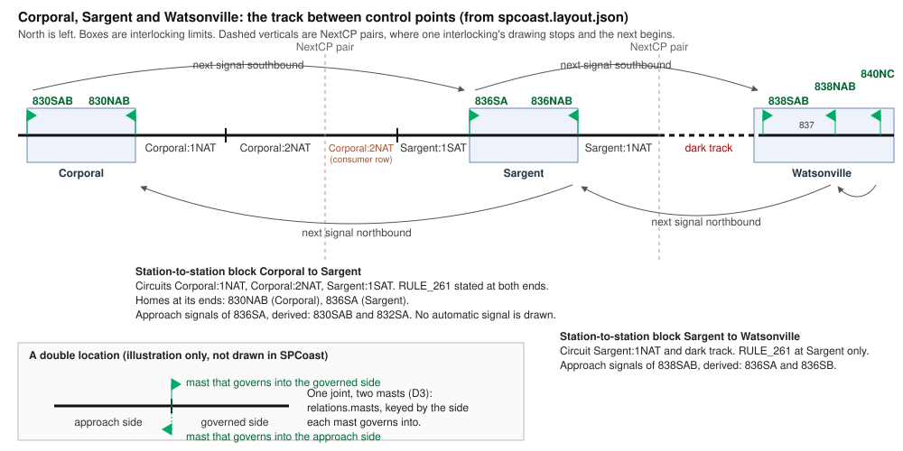

# 0013. Between control points: station-to-station blocks, automatic signals and direction of traffic

- Status: **proposed** 2026-10-31. The ask: rule on the six decisions below, one at a time.
- Amends: ADR 0012 §4 (a signal takes its control point only where one is stated, D2), §5 (the blocks library's scope,
  D1, and the proxy of §5.5, §9.3 here) and §8 (a signal joint carries one mast per side, D3). Schema 3.1.0: the track
  row's `relations.mast` (D3) and the policy sign's fields (D4, D5).
- Builds on: the research note `docs/review/abs-apb-research-2026-10-30.md` with the owner's answers and rulings of
  2026-10-30 (its §5 and §6, branch `docs/abs-apb-research` at `27b66c9`, which govern). The owner's rulings of
  2026-10-27 to 2026-10-30 listed in §3. ADR 0009 §3.12's row "track leaves an interlocking" (in progress on
  `docs/adr-cp-name`). ADR 0011 and ADR 0012.

## Decisions requested

Each line has a default. The sections below argue it. Everything else in this ADR is derived from rules already in
force (§3) and asks for no decision.

1. **A station-to-station block** is a piece of the track graph cut at every controlled signal joint that holds no
   switch or derail and lies under a block signal rule (`RULE_251` or `RULE_261`), joined across paired NextCPs. It
   belongs to the layout, not to an interlocking (§4). Default: yes.
2. **A signal is controlled exactly when it states a control point** (`CP Name` on its joint or its mast). Signals do
   not inherit a control point by propagation. A signal with none is automatic (§5). Default: yes.
3. **A signal joint carries at most one mast per side**: `relations.masts`, keyed by the side each mast governs into.
   The sides keep their names, `approach` and `governed` (§6). Default: yes.
4. **The policy sign names its station-to-station block.** Two ends that name the same block pair their NextCPs. The
   block's occupancy token is the name with `K`, and either end station can report it (§7). Default: yes.
5. **A `RULE_251` sign's `LEFT` or `RIGHT` is the lever direction of the signals that govern with the current of
   traffic.** The block's rule and current are what its signs state, and they agree (§8). Default: yes.
6. **The field unit at each end of a station-to-station block needs the far end's part of it**: the far circuits and
   the far signals that govern onto it. The blocks library derives the list, and a station's indications include it
   (§9). Default: yes.

## 1. Problem

The Layout Data Model File describes each interlocking well and the track between them hardly at all. Four things
are missing:

- No entity holds the track between two control points. A NextCP names a neighbour, and `next_cp.pair` counts them,
  but nothing says which NextCP meets which on double track, which circuits lie between, or which signals govern it.
- Nothing says which signals the dispatcher controls. Every signal joint looks the same. `derive.py`'s own docstring
  says so (`no_lever`: "an automatic signal stands on a signal joint too").
- A signal joint holds one mast. A double location, two masts back to back at one joint, is an import error
  (`joint.masts`). It is normal on single track.
- FieldUnit's relay model (GLOSSARY §10.6) reads the next signal (`DR`) and the block beyond. The model offers neither.

The research note and the owner's answers settle the prototype facts. This ADR turns them into model facts and
derivations. It defines no relay behaviour.

## 2. Picture and example

From `schemas/layout-model/examples/spcoast.layout.json`:

- Corporal's home 830NAB faces the single track to Sargent. Its approach side is `Corporal:1NAT`, then a plain joint,
  then `Corporal:2NAT`, then Corporal's NextCP to Sargent.
- Sargent's drawing starts at its NextCP to Corporal. Its first stretch is a consumer row, `Corporal:2NAT`, whose
  token is `Corporal:2NATK`. A plain joint follows, then `Sargent:1SAT`, then Sargent's home 836SA.
- Cut at the controlled signal joints, Corporal's piece holds `Corporal:1NAT` and `Corporal:2NAT`. Sargent's piece
  holds the consumer row and `Sargent:1SAT`. Neither holds a switch. Both carry `RULE_261`. Joined across the NextCP
  pair, they are one station-to-station block.
- Southbound, 830SAB's route ends at Corporal's NextCP to Sargent. Its next signal is 836SA. So 830SAB is the approach
  signal of 836SA, and so is 832SA. Northbound, 840NC's next signal is 838NAB, whose route ends at
  Watsonville's NextCP to Sargent. Its next signal is 836NAB.
- No automatic signal is drawn anywhere in SPCoast. Every signal joint states a `CP Name`.

## 3. Rules in play

Tags: **model** (what the file states or derives), **representation** (how KiCad draws it, the importer's concern),
**operating** (a rule of the railroad, stated as a designation).

| # | Rule | Source | Tag |
|---|---|---|---|
| R1 | Subdivision owns no vital logic. Field units run FieldUnit's interlocking logic. | AGENTS.md, owner 2026-10-30 | model |
| R2 | A rule that reads a symbol stands for a fact that lives elsewhere. Find the fact. | ADR 0001 D15 | model |
| R3 | Each fact has one source. | AGENTS.md, design rules | model |
| R4 | Where a relationship has an explicit form, it is stated or it is missing. Every derivation stays. | ADR 0012 §4 | model |
| R5 | The functional model is the rules' only vocabulary. | ADR 0012 §2 | model |
| R6 | Domain libraries write nothing into the file. Route-dependent results are computed on demand. | ADR 0012 §5 | model |
| R7 | `derived` holds what the rules compute on an entity. Incomplete is reported at `missing`, never at error. | ADR 0011 §3 and §6, ADR 0012 §5.5 | model |
| R8 | A control point is a place with controlled absolute signals. Control points are declared. | GLOSSARY §4, `docs/archive/spike-cp-membership.md` | model |
| R9 | Interlocking limits are the track between opposing home signals. Cut the track graph at every controlled signal: each piece with a switch or derail is an interlocking. | GLOSSARY §4 | model |
| R10 | A block is one or more track circuits treated as one occupancy for one purpose. A block is not a track circuit. | GLOSSARY §7 | model |
| R11 | `DR` picks up when `HR` is up, the block beyond is clear and the next signal is not at stop. | GLOSSARY §10.6 | model |
| R12 | The approach signal of a home is derived, never drawn: the signal in its rear along the track in the direction of travel. A D-plate distant is drawn only where unsignalled track enters CTC or interlocking limits. Extra heads that repeat route information are an aspect matter, not a kind of signal. | owner, 2026-10-30 (note §6.1) | model, representation |
| R13 | Rule numbers stay out of the drawing and the model. Policy Kinds keep Standard Code numbers. A road's numbers come from a rulebook reference table. | owner 2026-10-30 (note §6.2), ADR 0012 §6 | operating |
| R14 | Relay names never appear in the model. A station-to-station block is occupied, and it reaches the office as one indication. | owner, 2026-10-30 (note §6.3, answers 10, 16) | model |
| R15 | On SP CTC the signal levers and the code button set direction of traffic. There is no traffic lever. | owner, 2026-10-30 (answer 15) | operating |
| R16 | APB was never applied per track on double track. Each track was single-track ABS with traffic locking between controlled points. | owner, 2026-10-30 (answer 9) | operating |
| R17 | SP practice was not uniform. The model derives the general case, and the drawing states exceptions. | owner, 2026-10-30 (note §6) | model |
| R18 | A reference to another interlocking's thing is a one-sided consumer of a code line indication. Each consumer states its token. A station sends the union of what its consumers state. | owner 2026-10-27 and 2026-10-28, schema 3.1.0 migration note | model |
| R19 | A control point and a station are one concept. On a US&S 506 line each house is a station, on an AAR token line the interlocking is. | owner 2026-10-01 and 2026-10-27, `reference.STATION` | model |
| R20 | Track leaves an interlocking only at a NEXT_CP or an END_CTC. | owner 2026-10-28 and 2026-10-29, ADR 0009 §3.12 (in progress) | model |
| R21 | A signal joint's sides are `approach` and `governed`. | ADR 0012 §8 | model |
| R22 | Rule 251: following moves by block signals on designated tracks. Rule 261: opposing and following moves. The time-table designates the tracks. | GLOSSARY §9 [PRR56] | operating |
| R23 | LEFT and RIGHT are the two directions of a signal lever and of a route. | GLOSSARY §7 | model |
| R24 | A mast is its signal (lever and side) and its heads. N and W read LEFT, S and E read RIGHT. | ADR 0003 rules 6, 7 and D1 (frozen), `tools/layout_model/grammar.py` | representation |
| R25 | The code chart decides whether the office sees the circuits, the block, or both. | GLOSSARY §7, aggregation | representation |

Two rules decide most of what follows. R8: a signal in a control point is controlled and absolute. R9: cut the track
graph at every controlled signal. The pieces with a switch are interlocking limits. The pieces without one are the
track between control points. R12 and R14 then say what the model offers about that track: the signals in order, and
one occupancy per station-to-station block.

## 4. The station-to-station block (decision 1)

### 4.1 Definition

Cut the track graph at every controlled signal joint (R9). Keep each piece that holds no switch or derail and carries
a `RULE_251` or `RULE_261` policy sign. Join two pieces whose NextCPs are paired (§7). Each result is one
station-to-station block. It holds:

- its track circuits (consumer rows stand for the circuit they name, as today),
- its automatic signals (§5), in order along it,
- at each end the home signals that face it, and the controlled signals whose routes end on it (the station-leaving
  signals),
- its rule and, under `RULE_251`, its current of traffic (§8),
- its name (§7).

A piece under `RULE_105` or `RULE_93` alone is a siding or station track, not a station-to-station block. A piece
that reaches an END_CTC leads to unsignalled track. A piece that reaches a bumper is a stub. Neither is a
station-to-station block.

It belongs to no interlocking. Its two ends usually sit in two interlockings' drawings. The blocks library computes it
on demand from the derived file (R6) and stores nothing.

### 4.2 SPCoast today

| Station-to-station block | Pieces | Rule stated | Paired today |
|---|---|---|---|
| Corporal to Sargent | `Corporal:1NAT`, `Corporal:2NAT` / consumer row `Corporal:2NAT`, `Sargent:1SAT` | `RULE_261`, both ends | by count |
| Sargent to Watsonville | `Sargent:1NAT` / dark track | `RULE_261`, Sargent only | by count |
| Luchessa to Gilroy Interchange | `Luchessa:1SAT` / `Gilroy Interchange:1NAT` | `RULE_261`, both ends | by count |
| Gilroy Interchange to Gilroy Caltrain | `Gilroy Interchange:1SAT` / `Gilroy Caltrain:1NAT` | `RULE_261`, both ends | by count |
| Christopher to Corporal, two tracks | `Christopher:1NAT`, `Christopher:2NAT` / `Corporal:1SAT`, `Corporal:2SAT` | `RULE_251`, both ends | no |
| Christopher to Luchessa, two tracks | `Christopher:1SAT`, `Christopher:2SAT` / `Luchessa:1NAT`, `Luchessa:2NAT` | `RULE_251`, both ends | no |
| Watsonville, its two ends | `Watsonville:01T`, `Watsonville:02T` (homes 838NCD and 840SA) | `RULE_251`, `RULE_93` | no NextCP |
| Gilroy Caltrain to Lick, Luchessa to Hollister | `Gilroy Caltrain:1SAT`, `Luchessa:3NAT` | `RULE_261` | far end off the layout |

The siding `Gilroy Interchange:01T`, between 778NC and 778SC, is cut the same way. It carries `RULE_105`, so it is no
station-to-station block. The Watsonville row shows why the cut is by controlled signal, not by NextCP: one
interlocking's two ends bound it.

### 4.3 Alternatives

| Option | For | Against |
|---|---|---|
| **A. Cut at controlled signals, under a block signal rule, joined across NextCP pairs** | Follows R9, which already defines interlocking limits the same way. Catches Watsonville's block between its own ends. Uses only stated facts. | Needs NextCP pairing on double track (§7). |
| B. The track between a NextCP pair only (ADR 0012 §5's table: "the track between two interlockings") | Simple. | Misses a block between two ends of one interlocking. Leaves out the circuits between a home and its NextCP, which are part of the block. |
| C. The signal block (between consecutive signals) as the unit | Uniform. | R14 names the station-to-station block as what reaches the office. Signal blocks are FieldUnit's, inside `DR`. |

Recommendation: A. A drawn block entity is no option: the track graph already states it (R2, R3). A stored map is no
option either: the blocks library writes nothing (R6).

## 5. Controlled and automatic, absolute and permissive (decision 2)

### 5.1 Controlled is membership

By R8 a control point is the place of controlled absolute signals. A signal in a control point is controlled. A
signal in none is automatic. The model already holds membership: a signal joint's `derived.controlPoint`. The
question is only how a signal gets it.

Today the propagation of ADR 0012 §4 gives every appliance and joint a control point when an interlocking has one
house, and chains reach signal joints from their masts and circuits. An automatic signal drawn on Corporal's sheet,
between 830NAB and the NextCP, would become a Corporal signal. Decision 2 stops that for signals: a signal joint or a
mast takes its control point only from a `CP Name` on itself or on the other (the mast-joint chain stays). Other
appliances keep every chain.

Evidence: every SPCoast signal joint states a `CP Name`, so no derived result changes.

| Option | For | Against |
|---|---|---|
| **A. Stated `CP Name` on the joint or mast** | Uses a field that exists. Matches R8 directly. No result changes on SPCoast. | Amends ADR 0012 §4 for signals. A home drawn without `CP Name` reads as automatic. |
| B. Controlled when a desk lever serves it | The office knows. | The office is optional, and a field unit must know without it. An identity never comes from a binding (owner, 2026-10-16 to 2026-10-18). Fails for NX and tower work. |
| C. A distinct joint Kind for automatic signals | Explicit. | States again what membership states (R3). A library edit. |
| D. Automatic when outside interlocking limits | No new statement. | Circular: limits are cut at controlled signals (R9). Fails for a control point with no switch (GLOSSARY §4). |

Recommendation: A. No implies B or C. A signal with no `CP Name` whose route passes a switch is reported at info, since
SP did hang automatic dwarfs at hand-throw switches between control points (note §2.E).

### 5.2 Absolute and permissive (derived)

A controlled signal is absolute. Its most restrictive indication is Stop. An automatic signal is permissive. Its most
restrictive indication is Stop and Proceed, and it carries a number plate (note §2.A, [AAR56 p. 54], [SP1960]). This
follows from R8 and needs no decision. It lands as `derived.absolute` on the mast.

By R17 the drawing states exceptions: an automatic signal that is absolute (an APB head block at a hand-throw siding,
SP's "A" plate) or the reverse. An optional mast attribute states the plate and wins over the derivation. Its name
and values are a gap (§11). The reversed number plate is a train order condition and stays out (note §6.4).

### 5.3 Which field unit runs an automatic signal

The one of the interlocking whose drawing holds it. Track leaves an interlocking only at a NextCP (R20), so every
automatic signal sits in one interlocking's namespace, though outside its limits and in no control point.

## 6. Two masts at one signal joint (decision 3)

A double location is two masts at one insulated joint, one for each direction (note §2.F1, [AARTC71 Dwg 8027],
[RS1947]). The relay model pairs them by the shared track circuits, not by a mast. Today the joint's
`relations.mast` holds one, and the KiCad importer reports a second as `joint.masts`.

Model: a mast governs movement across one signal joint, from one side into the other. The joint's relation becomes
`relations.masts`, keyed by the side each mast governs into. The side names stay as ADR 0012 §8 set them, by the
first mast: `governed` is where its route begins. A second mast governs into `approach`.

| Option | For | Against |
|---|---|---|
| **A. `relations.masts` keyed by the side governed into, sides keep `approach` and `governed`** | Smallest change. One joint stays one joint. ADR 0012 §8 holds for the single-mast case, which is every joint on SPCoast. | On a double location the side names fit only the first mast. |
| B. Neutral sides `A` and `B` on every signal joint, each mast keyed by its side, `approach` and `governed` derived per mast | Symmetric. | Reverses ADR 0012 §8, which removed pin names from the model. |
| C. Two signal joints, one per mast | No schema change. | Two joints at one place make a dark sliver between them, a gap in detection that is not on the railroad. |

Recommendation: A. No implies B. Representation, the importer's concern only: which way the second mast faces must
come from a wire, never from coordinates. A second SIGNAL pin on the `IRJ-Signal` symbol is one way (an owner library
edit, not decided here).

## 7. Designated tracks: pairing and the block's indication (decision 4)

### 7.1 Pairing

NextCP pairing is a count today. On single track the count pairs the one NextCP each way. On double track it cannot:
Christopher has two NextCPs to Corporal and Corporal two back. By their names and signs, `Christopher:1NAT` and
`Corporal:1SAT` look like one track, but nothing in the file says so. Reading the track number from a circuit name
fails too: the single track from Corporal to Sargent is `Corporal:2NAT` at one end and `Sargent:1SAT` at the other.

The prototype states it. The time-table designates the track and the rule that applies on it (R22). The policy sign
is that designation in the drawing. Decision 4 adds the block's name to it. Two pieces whose signs state the same name
are one station-to-station block, and their NextCPs pair.

By R4 the name is then the explicit form, and pairing by count retires. A NextCP whose piece carries no named sign is
unpaired, reported at `missing`. On SPCoast every block is missing until the signs carry names, and Watsonville's end
of the block to Sargent needs a sign.

### 7.2 The block's indication

R14: the block reaches the office as one indication. Its token is the block's name with the indications' `K`, the
reference data's track circuit template (`reference.INDICATION_TOKENS`). Either end station can report it, because
each end's field unit knows the whole block (§9). A consumer picks the station by qualifying the token, as for any
indication (R18). The name is unique on the layout and differs from every circuit name in the interlockings at its
ends, because both send `{name}K`.

Whether the office shows the block, its circuits or both is the code chart's, so the panel's (R25). The board's
`TRACK` lamps today show each end's approach circuits (`Christopher:1NATK`, `Corporal:1SATK`). They stay valid.

Suggested names, AAR style: number the block from a signal that governs onto it, as ADR 0003 numbers a circuit
outside interlocking limits from the signal that governs over it. The Corporal to Sargent block would be `830T`,
token `Corporal:830TK` or `Sargent:830TK`. The form on multiple track, where one lever governs onto two tracks (816 at
Christopher), is a gap (§11).

| Option | For | Against |
|---|---|---|
| **A. The policy sign states the block's name: it pairs and it names the token** | One field does both. A sign is on every block by §4.1. It is the time-table's designation. Works for a block inside one interlocking. | A field added to the policy signs and stated at both ends. Every SPCoast block is missing until then. |
| B. The NextCP states a track name, the token is derived from the two ends' levers (`830-836TK`) | No change to the signs. | Watsonville's block has no NextCP. A lever pair still needs a track number on double track. |
| C. No name: pair by count, report each end's approach circuits | No drawing change. | Leaves four double-track blocks unpaired. Not one indication (R14). A count beside an explicit form is a fallback (R4). |

Recommendation: A. No implies B.

## 8. Direction of traffic (decision 5)

### 8.1 What the signs state

| Sign | Kind | `Direction` | What it states |
|---|---|---|---|
| `Rule251-DoT-Left`, `Rule251-DoT-Right` | `RULE_251` | `LEFT`, `RIGHT` | Block signal rules for following moves, and the current of traffic |
| `Rule261-DoT-BiDirectional` | `RULE_261` | `BOTH` | Block signal rules for opposing and following moves |
| `Rule105-RestrictedSpeed`, `Rule93-Yard Limits` | `RULE_105`, `RULE_93` | `BOTH` | No block signal rule |

The Kinds keep Standard Code numbers (R13). `BOTH` on a 261, 105 or 93 sign carries nothing the Kind does not. The
251 sign's `LEFT` or `RIGHT` needs a meaning. As drawn it is an arrow on the sheet.

### 8.2 The meaning

LEFT and RIGHT are the directions of a signal lever and a route (R23). A mast's lever direction is part of its name
(R24). Decision 5 defines the 251 sign's direction as the lever direction of the signals that govern with the current
of traffic. SPCoast agrees: `Christopher:1NAT` and `Corporal:1SAT` both state `RIGHT`, and trains with the current
arrive at Corporal's 830SAB, a RIGHT signal. The blocks library checks that the signs of one block agree, and that
the homes at its ends fit.

Under `RULE_261` the direction of traffic is set at run time by clearing a station-leaving signal (R15). It is field
unit state, not a model fact. Nothing per block is stated beyond the rule. There is no traffic lever (R15), and APB per
track on double track does not occur (R16), so the model needs no per-track traffic designation beyond the Kind.

| Option | For | Against |
|---|---|---|
| **A. `LEFT` or `RIGHT`: the lever direction of the signals that govern with the current** | No drawing change. Uses the glossary's term for both levers and routes. Checkable against the masts. | Rests on the mast's lever direction, which comes from its name letter (ADR 0003 D1, frozen). |
| B. The far end named: the current runs toward a named interlocking | Independent of names and paper. | Fails for Watsonville's block, whose ends are one interlocking. A library edit. |
| C. Derived from the automatic signals, which under 251 face one way | No statement. | SPCoast draws no automatic signals. |

Recommendation: A. No implies B.

## 9. What a control point knows of the block beyond (decision 6)

### 9.1 What a field unit needs

The leaving signal at one end reads the whole block and the far signals (note §2.D): it shows better than Stop only
when the block is clear, and Clear only when the next signal is not at Stop (R11). A cleared station-leaving signal
holds the opposing one at Stop (note §2.C, [RS1942]). FieldUnit implements all of that (R1). The model owes it the
inputs. For each end of each station-to-station block:

- the far end's circuits of the block,
- the far end's station-leaving signals, for the opposing check,
- the next signal of each of its own station-leaving signals (§10.1), for Clear against Approach.

For Sargent's 836NAB, northbound onto the block to Corporal, that is `Corporal:1NAT`, `Corporal:2NAT`, Corporal's
830SAB and 832SA, and 830NAB.

### 9.2 How it gets them

| Option | For | Against |
|---|---|---|
| **A. The blocks library derives the list, and the far station's indications include it** | One source: the block (R3). Works where the far circuit has no track on the near drawing. | The union of R18 widens from "what consumers state" to that plus what the library derives. |
| B. Each need is a drawn consumer row | R18 as it stands. | `Corporal:1NAT` has no track on Sargent's drawing to stand on. States the block a second time. |
| C. A link between field units, outside the code line | Closer to line circuits. | No seam exists for it (ADR 0009). Out of scope here. |

Recommendation: A. No implies B, with the far circuits that have no near track left out. The tokens are the far
station's own: a circuit's `{name}K` and a signal lever's `NGK` and `SGK` (`reference.INDICATION_TOKENS`).

### 9.3 Consumer rows and Watsonville's proxy

- Sargent's consumer row `Corporal:2NAT` stays. It says the stretch drawn on Sargent's sheet is Corporal's circuit, so
  the block holds that circuit there, not dark track. It also consumes `Corporal:2NATK`, which decision 6 derives
  too. The two agree. Consumer rows stop being the way a control point learns about the block, but nothing about them
  changes.
- ADR 0012 §5.5 recorded the owner's ruling of 2026-10-26: Watsonville had no southbound signal into 837T1, and
  Corporal's 830S with the automatic block between stood in for it. On 2026-10-27 the owner drew 838SAB (Railroad
  `253b666`). By R12 no signal stands in for another. The signal in the rear of a home is its approach signal, by
  derivation: for 838SAB that is 836SA and 836SB. What retires: the proxy as a model idea, and §5.5's TBD. What
  stays: the routes library still reports a facing switch at a limit with no entering signal at `missing`.

## 10. Derived, with no decision

### 10.1 The signal chain

Each signal's next signal is where its routes end (ADR 0012 §5.3): the first signal that governs the same way, or a
limit. At a NextCP the chain continues from the paired NextCP's track (§7). A signal with several routes has several
next signals (Watsonville's 840SA, into the yard). The approach signals of a signal are those whose next signal it is
(R12). Both are route results, so the routes library computes them on demand (R6). Mast name letters are not read for
direction: Watsonville's 840SA and 840NA govern the same way of travel.

### 10.2 Home, station-leaving, approach and distant signals

All are roles of a signal, derived:

- home: a controlled signal (§5),
- station-leaving: a home whose route ends on a station-to-station block,
- approach signal: by §10.1,
- distant: an automatic signal whose rear is unsignalled track (an END_CTC without a signal between) and whose next
  signal is a home. It is drawn (R12) and carries the D plate by derivation. SPCoast draws none. Its three END_CTC
  entries (Corporal's 01T, Luchessa's 02T, Sargent's 2SAT) lead from industry track.
- A mast with extra heads is still one signal (R12).

### 10.3 Where each result lives

| Result | Where | Why |
|---|---|---|
| A mast's `controlPoint` (controlled or automatic) | `derived`, as today | A rule on stated facts (R7) |
| A mast's `absolute` | `derived`, new | A rule on stated facts (R7) |
| A signal joint's `relations.masts` | `relations` | Stated by wire (D3) |
| Policy agreement, block name uniqueness, NextCP pairing | `derive.py` checks, through the blocks library | One definition, as `codeline` serves `derive.py` |
| Station-to-station blocks, their circuits, signals, rule and current | blocks library, on demand | R6 |
| Next and approach signals, station-leaving and distant roles | routes library, on demand | Route results (R6) |
| What each end's field unit needs (§9) | blocks library, on demand. The code line library adds it to each station's indications | R6, D6 |

`derived.absolute` and the new checks are MINOR (ADR 0012 §7). Replacing `relations.mast` is a schema change.

## 11. Gaps

1. The glossary has no entries for automatic signal, home signal, station-leaving signal, approach signal, distant
   signal, intermediate signal, double location, absolute and permissive signal, number plate, station-to-station
   block, current of traffic and direction of traffic. This ADR uses the research note's terms (note §3).
2. The name and values of the mast attribute that states a plate exception (§5.2).
3. The block name's form on multiple track (§7.2), and the field's name on the policy sign.
4. Dark track inside a block: Watsonville's end of the block to Sargent has no circuit, so its occupancy is incomplete
   (`missing`). The owner draws a circuit or accepts it.
5. Luchessa's and Watsonville's `NFLK` and `SFLK` are non-vital lamp appliances shown on the board as `TRAFFIC` lamps.
   Nothing ties them to a block. Whether they become a block's direction indication is open.
6. Watsonville's `RULE_251` sign on `03T` lies inside interlocking limits by §4.1 (`03T` joins `3T1` across a plain
   joint). Check the drawing.
7. How the far end's indications reach a field unit when both ends are on one code line is the code line's. A direct
   link between field units has no seam (§9.2 C).
8. The research is thin on two points: what SP labelled the block lamp on the machine, and which station sent it.
   The owner's answer 10 says one combined indication, not from where.
9. APB outside CTC (automatic absolute head blocks at hand-throw sidings) has no instance on SPCoast South (answer 7).
   The plate exception covers its signals. Its direction logic is FieldUnit's and is not modelled here.
10. A mast's lever direction comes from its name letter (R24, ADR 0003 D1, frozen). Decision 5 rests on it.
11. Off-layout ends (Lick, Hollister): a block with one end on the layout is reported at info, as `next_cp.off_layout`
    is today.

## 12. Out of scope

- Run-time behaviour: direction of traffic as set, traffic locking, the tumble-down, stick relays, approach lighting,
  time release, aspects and signal indications. FieldUnit's (R1, ADR 0012 §5.2).
- The contents of the rulebook reference table and a road's own rule numbers (R13).
- Train order conditions: the reversed number plate, Form Z, grade signals.
- How a US&S 506 code chart assigns the block indication to a step.
- How Studio draws blocks.

## 13. Consequences

- ADR 0012 §4: control point propagation stops at signals (D2). §5: the blocks library's row reads "the track between
  control points", not "between two interlockings" (D1). §5.5: the proxy and its TBD retire (§9.3). §8: a signal
  joint's mast relation is per side (D3).
- Schema 3.1.0: `relations.masts` on a signal joint, `derived.absolute` on a mast, the block's name on a policy sign,
  the 251 sign's direction defined.
- The owner's libraries and drawing, when the decisions are ruled: the name field on the policy signs and the names
  stated, a sign at Watsonville's end of the block to Sargent, a second SIGNAL pin on `IRJ-Signal` if D3's
  representation is chosen.
- The KiCad importer: `joint.masts` retires for two masts on opposite sides.
- `derive.py`: `no_lever` can check masts, since a controlled signal is now a stated fact (D2).
- The code line library: a block is a reporter at each end station, and each station's indications include what §9
  derives.
- The glossary gains the terms of gap 1 once this is ruled.
