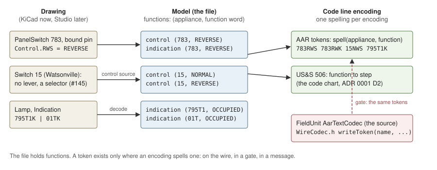

# 0016. Code line content is functions; a token is one encoding's spelling of a function

- Status: **proposed** (drafting approved by the owner 2026-11-14). The ask: ratify decisions 1 to 6 and decide 7.
- Amends (when accepted, in place with a footnote; not edited in this PR): the owner's ruling of 2026-10-28 that
  PANEL symbols state tokens per pin, and its clarification of 2026-10-29 that rejected "Name plus K by rule";
  ADR 0012 §5.1 (the codeline row); ADR 0011's amendment of 2026-10-27, revised 2026-10-28 (cross-interlocking references: "every token an OfficeUnit
  consumes"); ADR 0008 §4.7 (the token-field exception). §5 lists the text.
- Builds on: FieldUnit `docs/GLOSSARY.md` §5 and §10.3; ADR 0001 D2, D3 and D6; ADR 0002 P3; ADR 0012 §2 and §4;
  ADR 0015; issue #145 (ladder and selector). FieldUnit `src/` is cited at `92ebfe4`.
- Name: the file name says "demands", as the drafting request did. GLOSSARY §11 retires "demand (for a control)"
  and "Controls-as-Demands"; this ADR uses the live term, **function**.

## Decisions requested

1. **The model states functions, not tokens.** Code line content in the model and in `tools/railroad/codeline.py` is a
   set of functions: (appliance, function word, control or office indication). *Default: yes.*
2. **The function words are FieldUnit's**, per appliance class, as GLOSSARY §10.3 tabulates them and `WireCodec.h`
   takes them (§3.2). *Default: yes.*
3. **One spelling function per encoding; for AAR tokens it is FieldUnit's `AarTextCodec`.** We check against the
   codec and never restate it: `indicationTokens.json` retires, and a different spelling is a different encoding,
   not a reference row. No token is written into the file. *Default: yes.*
4. **`Control.<pin>` and `Indication.<pin>` bind a pin to a function word** (`Control.RWS = REVERSE`), not to a
   token. An empty field is still a deliberate none; a missing field is still not done. *Default: yes.*
5. **Token notation in the drawing is decoded, not trusted.** A lamp's `Indication` expression and a remote
   consumer's `Indication` keep token notation; the importer decodes each term with the same spelling function
   into a function; a term that decodes to no function the model states is unresolved. *Default: yes.*
6. **The gate runs the codec.** A test builds a small C++ harness against FieldUnit `src/` (the plant host's
   `clang++` form), spells every function of the SPCoast example with `AarTextCodec`, and compares the result with
   the Python spelling. It skips without `clang++` or FieldUnit. *Default: yes.*
7. **Pin kind `indication` (pending, vocabulary).** Keep it, or rename it to `signal_indication`. *Default: keep
   until decided* (§4).

## 1. Problem

`tools/railroad/codeline.py` takes every code line token from a symbol field. A lever's tokens are its bound pins'
`Control.X` and `Indication.X` (`derive.py` `desk()`, lines 1278 to 1298, and `lever_tokens`, from line 1420); an
appliance reports a token only when a field states it, "never because a template filled with its name gives it"
(`codeline.py` lines 93 to 100). The library fills those fields with macros that restate the codec's grammar:
`PanelSwitch` carries `Control.NWS = ${Value}NWS`, `Control.RWS = ${Value}RWS`, `Indication.NWK = ${Value}NWK`,
`Indication.RWK = ${Value}RWK` (Railroad `symbols/Railroad-Office.kicad_sym`, read 2026-11-14).

The cost shows where no symbol carries the fields. Watsonville's ladder switches 15 to 25 and 3 to 13 have no lever;
a selector serves each ladder (#145). In our model switch 15 has no `15RWS`. FieldUnit spells `15RWS` at once from
the switch's name. The spelling is in two places, and ours fails where FieldUnit's does not.

The rule is also not kept today: the importer spells a remote consumer's token from a template when its field is
absent (`tools/layout_compiler/trackplan.py` `_indication`, lines 421 to 432), and `codeline.py` reads the reference
templates backwards for OS circuits (ADR 0012 §5.1, the codeline row).

## 2. Architecture

### 2.1 Cited rules

| # | Rule | Tag | Source |
|---|---|---|---|
| R1 | A function is one named control or office indication; its written form is a token. A token is the written name of one function on an AAR text code line. | model | GLOSSARY §5, "function", "token" |
| R2 | Functions are grouped into field stations. For the AAR token encoding the chart is the identity: each function is sent as its token. | representation | ADR 0001 D2, D3 |
| R3 | The CTC machine and the field unit read one chart. Neither end builds its own. | operating | ADR 0001 D6 |
| R4 | A field records a drawn fact. It does not record a token spelling: that is policy, owned by the generator. | representation | ADR 0002 P3 (frozen ADR; the principle is cited, not its tables) |
| R5 | Each fact has one source. When a fact is both in a schematic and in code, generate or validate one from the other. | model | `AGENTS.md`, Design rules |
| R6 | Where FieldUnit `src/` and a principle differ, the code has a defect; a claim about FieldUnit behaviour needs a `src/` citation. | operating | `AGENTS.md`, order of authority (2) |
| R7 | The model is entities, attributes and typed relationships; nothing in it says how a drawing states them. | model | ADR 0012 §2; ADR 0008 R2 |
| R8 | No fallbacks: a second, implicit way to state a relationship that has an explicit form retires. Derived facts stay. | model | ADR 0012 §4 |
| R9 | The file does not carry tokens. | representation | ADR 0008 §5, "What is not in the file" |
| R10 | AAR text tokens: a control ends in `S`, an office indication in `K`; asserted is `TOKEN`, dropped is `(TOKEN)`. | operating | `WireCodec.h` lines 383 to 385 |

### 2.2 What FieldUnit does (`src/` at `92ebfe4`)

`AarTextCodec` spells each token from an entry's name and its type, one `writeToken(entry.name, suffix, asserted)`
per function (`src/WireCodec.h`):

| Appliance class | Controls (office encodes) | Office indications (field encodes) |
|---|---|---|
| switch | `NWS`, `RWS` from `SwitchDemand::NORMAL`, `REVERSE` (lines 1022 to 1029) | `NWK`, `RWK` from position in correspondence (lines 896 to 903) |
| signal | `SGS`, `NGS`, `HS` from `SignalDemand::RIGHT`, `LEFT`, `STOP` (lines 1036 to 1044) | `SGK`, `NGK`, `TEK` (lines 927 to 929) |
| track circuit | none | name plus `K`, unless the name ends in `K` (lines 908 to 914) |
| electric lock | `WLS` (line 1052) | `WLK` (line 945) |
| maintainer call | name plus `S` (line 1057) | name plus `K`, unless it ends in `K` (lines 948 to 952) |
| mast | none | name plus `K`, asserted when not STOP (lines 932 to 937) |

Both ends use it. The office: `src/cTcMachine.h` holds an `AarTextCodec` (lines 305, 462) and `buildCodec()` gives it
each column's switch by number (`decodeSwitch(swIdx, swNum)`, `encodeSwitch(...)`, lines 327 to 328). The field:
`src/FieldUnit.h` includes `WireCodec.h` (line 19), and the field sketch holds the codec
(`examples/Universal_FieldUnit/Universal_FieldUnit.ino` line 21). The name is cleaned once
(`cleanRailroadId`, `decodeSwitch`, lines 123 to 130). Nothing in FieldUnit reads a spelled token from the model.

### 2.3 Derivation

- From R1 and R2, a function is the model fact and a token is its form on one encoding. The 506 encoding sends the
  same function as a step (ADR 0001 D2), so a token cannot be the model fact (R7).
- From R3 and R5, the spelling has one source. FieldUnit's codec already spells every function from the appliance's
  name (§2.2), at both ends. A `${Value}RWS` field is a second copy of that grammar in the drawing (R4), and a
  missing field makes the copies disagree, as at Watsonville. So the field's token value goes (decisions 3 and 4).
- R8 does not block this. A spelling is not a relationship with an implicit form: the relationship is
  "lever 783 controls switch 783", stated by the lever's `serves`. The spelling is an encoding of a stated fact.
- From R9 and ADR 0015, the file carries what consumers need. FieldUnit needs the functions and the names; its codec
  spells. So the file carries functions (decision 1) and no tokens, and R9 holds again: today a lever's
  `derived.controls` holds tokens (`derive.py` line 1298).
- "Unresolved" keeps its meaning and narrows: the model states no appliance of that name, or the appliance's class
  has no such function (a track circuit has no control). It is never "no field spelled the token". Watsonville 15
  then has its controls from its control source, the selector of #145, and its station from the rules already in
  `codeline.py`.
- Python still needs a spelling: to decode token notation in the drawing (decision 5), for the plant host, and for
  messages. It is one function per encoding beside `codeline.py`. Under R6 it is checked against the codec, not
  maintained beside it (decision 6).

## 3. Decision

### 3.1 Functions

A function is (appliance, word, direction). The appliance is a qualified name (`Corporal:783`); for a signal it is
the signal lever's name, as the codec's signal entry is (§2.2). Direction is `control` or `indication`. The station
that receives or sends it follows the existing rules of `codeline.py` (levers by column, lamps by reporter).

### 3.2 Function words

From GLOSSARY §10.3 and the codec's types:

| Appliance class | Control words | Indication words |
|---|---|---|
| switch | `NORMAL`, `REVERSE` | `NORMAL`, `REVERSE` |
| signal | `LEFT`, `RIGHT`, `STOP` | `LEFT`, `RIGHT`, `TIME` (time locking runs) |
| track circuit | none | `OCCUPIED` |
| electric lock | `RELEASE` | `RELEASED`, `REQUEST` |
| maintainer call | `CALL` | `CALL` |

The table lives once, in the domain library (`tools/layout_model/grammar.py` beside the Style classes), and the gate
checks it with the spelling.

### 3.3 Spelling

`spell(encoding, function)` returns a token for an AAR token line; `decode(encoding, token, model)` matches a token
against the spellings of the functions the model states. For a 506 line the same function goes through the code
chart to a step (`codeLineSteps`, unchanged). `indicationTokens.json` and `reference.indication_tokens` retire; its
provision "until a railroad or an encoding says otherwise" becomes "a new spelling is a new encoding with its own
codec".

### 3.4 Pin bindings

`Control.<pin>` and `Indication.<pin>` stay as contract fields on PANEL symbols, with a function word as value:
`PanelSwitch` `Control.NWS = NORMAL`, `Control.RWS = REVERSE`, `Indication.NWK = NORMAL`, `Indication.RWK = REVERSE`.
The appliance is the one the lever serves. An inverted pin keeps the expression form (`Indication.WLK = !RELEASED`).
The lint (`tools/contract/lint_symbol_fields.py`) checks the word against §3.2 for the lever's Style. The library
edits are the owner's; nothing here edits a symbol.

### 3.5 Token notation in the drawing

A lamp's `Indication` (`795T1K | 01TK`) and a remote consumer's `Indication` (`Corporal:2NATK`) stay readable to the
designer. The importer decodes each term (§3.3). Both directions use one function, so the reverse lookup that
`codeline.py` does today with templates becomes `decode`.

## 4. Pending: the pin kind `indication`

On the code line, "indication" means an office indication, a field-to-office function (GLOSSARY §5). On a signal head
symbol, pin kind `indication` carries a signal indication word, CLEAR, APPROACH or STOP (GLOSSARY §8, "signal
indication"): `Pin.APP = indication` on `Device-Head-H2` and `Device-Lamp-RGB`, and on `Encoder-RGB`
(Railroad-Field). The lint lists it in `VOCABULARY` and as the one `SOURCE_KINDS` word (lines 91 to 92).

| Option | For | Against |
|---|---|---|
| **Keep `indication`** (default until decided) | no library or lint change; the glossary already qualifies the two senses | a bare "indication" in prose or code is ambiguous |
| Rename to `signal_indication` | the term is the glossary's own | edits on every head and encoder symbol, the lint, the importer and the contract features |

Related, for the same decision: pin kind `color` exists (`Railroad-HardwareIO:Driver-GPIO-Pixel`, `Pin.D = color`).
The knob of #145 has an RGB lamp (`Driver-I2C-KnobEncoderRGB`, pins `R`, `G`, `B` of kind `level`); `PanelSelector`
itself has pins `VALUE` and `BUTTON` only. What that lamp shows is not decided: a signal indication word, a colour, or
an office indication function. Its pin kind follows that answer.

## 5. Text this amends (record; not edited here)

| Where | Text now | Change when accepted |
|---|---|---|
| Owner's ruling 2026-10-28, as in `docs/review/handoff-step3-2026-10-28.md` "Tokens" | "PANEL symbols state them per pin, as in `Control.NWS=${Value}NWS`" | per pin, a function word (§3.4) |
| Owner's clarification 2026-10-29 (session record) | "Name+K by rule (no field)" proposed and rejected; per-pin macros so "code never guesses" | reversed: the codec spells from the name; nothing guesses, because the function is stated |
| ADR 0012 §5.1, codeline row | reads "the levers' `Control.X`, the consumers' `Indication`"; "an interim lookup that reads the reference templates backwards" | reads functions; `decode` replaces the backwards lookup |
| ADR 0011, amendment of 2026-10-27, revised 2026-10-28 | "The same check covers every token an OfficeUnit consumes" | "every function" |
| ADR 0008 §4.7 | "except a token field (`Indication`, `Control.<pin>`, `Indication.<pin>`) ... says there is deliberately no token" | "deliberately no function" |
| ADR 0008 §5, "What is not in the file" | lists tokens | no change; this ADR makes the code agree with it |
| ADR 0001 D2, D3, D6; ADR 0002 P3 | functions grouped into stations; one chart; no spelling in a field | no change; cited as rules |
| ADR 0009 | no text states a token spelling (searched) | no change |
| FieldUnit GLOSSARY §5, §10.3 | function, token, tokens by appliance | no change; add the function words of §3.2 to the §10.3 table if the owner wants them named there |
| `schemas/layout-model/rules/features/logical/office/device_lever_station.feature` and `steps/model_steps.py` line 598 | tables of tokens per lever pin | tables of functions; a scenario for a switch with no lever |
| Code | `codeline.py` (lines 93 to 156), `derive.py` `desk()` and `lever_tokens`, `trackplan.py` `_indication`, `reference.py` lines 83 to 97, `reference/indicationTokens.json`, the lint's `PIN_TOKENS` | as §3; implementation tickets after acceptance |

## 6. Record

### 6.1 Options considered

| Option | For | Against |
|---|---|---|
| **Functions in the model; the codec spells** (chosen) | one source (the codec); a switch with no lever is complete; the file agrees with ADR 0008 §5 | the lever and lamp fields change in the library; a new gate needs `clang++` |
| Keep per-pin token fields; add fields to every symbol that can lack a lever | no code change | the grammar stays in two places; every new control source (a selector, an NX button) needs its own token fields |
| Spell in Python from a reference table (`indicationTokens.json` today) | no C++ in the tests | a third copy of the grammar, already inconsistent with the codec (§6.2) |

### 6.2 Differences found between the model and the codec (for FieldUnit or the owner)

- **`WLQK`.** The crew's unlock request (ADR 0004; `indicationTokens.json` "lock") has no `writeToken` in
  `WireCodec.h`: the electric lock entry writes `WLK` only (line 945). Under the order of authority this is a
  FieldUnit gap to file, not a reason to drop `REQUEST`.
- **Mast `K`.** The codec has a `MAST` entry that writes the mast's name plus `K` (lines 932 to 937). The owner ruled
  on 2026-10-28 that a mast reports nothing (`codeline.py` lines 99 to 100). The gate will show this; the owner
  decides whether the mast entry is a function of the model or a FieldUnit extra.
- **Track circuit `K`.** The codec adds `K` only when the name does not already end in `K` (lines 912 to 913).
  `reference.indication_of` does the same; the gate keeps them equal.

### 6.3 Not verified

- That the field sketches other than `Universal_FieldUnit.ino` and the legacy `CP_Corporal.ino` use `AarTextCodec`;
  FieldUnit `src/FieldUnit.h` only includes it.
- How Watsonville 15 gets its station when the selector is on a desk column: #145 does not yet say where a selector
  sits. On the AAR token line Watsonville is one station, so the question does not arise for this example.
