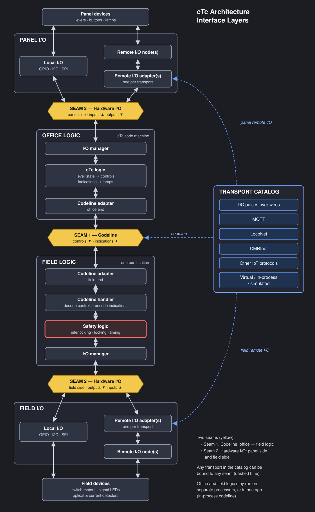

# Appliance drivers: foundation for the architecture decision

- Date: 2026-10-09
- This is a collection, not a proposal. It gathers scope, definitions and principles from existing sources.
- Source keys.
  - `FU/` = `~/Dropbox/Arduino/libraries/FieldUnit`. 
  - `Sub/` = this repo. G = `FU/docs/GLOSSARY.md`, cited by line. 
  - R0 = the owner's text in `FU/docs/adr/0004-driver-seam.md` lines 11–47, and R1–R9 his notes at 49–77. 
  - Survey = `Sub/docs/review/appliance-driver-survey-2026-10-08.md`, and 
  - Brainstorm = the owner's text there, lines 102–143. 
  - Comments = `FU/docs/adr/0005-appliance-driver-architecture.comments`. 
  - Draft 0005 = the rejected `FU/docs/adr/0005-appliance-driver-architecture.md`. 
  - FU 0003 = `FU/docs/adr/0003-field-io-symbols.md`. 
  - Sub 0002 = `Sub/docs/adr/0002-symbol-contract.md` 
  - Sub 0004 = `Sub/docs/adr/0004-lock-request-heads-mileposts.md`. 
  - RK = `Sub/schemas/symbols/role-kind.toml`. 
  - KEYS = `Sub/schemas/context/keys.toml`.

## Order of authority

When sources conflict, RAISE THE DISCREPENCY and seek resolution.
In general, the higher one governs:

1. The relay model of the interlocking logic and AAR practice (G §10.6).
2. FieldUnit `src/` is evidence, with limits and flaws (hardcoded assumptions...).  Where it differs from (1), the code has a defect.
3. KiCad-derived models: symbol libraries and drawings.
4. Legacy sketches and harvested profiles: evidence only.

## Goal
  The driver pattern "needs to be architected and designed". Drivers transform AAR appliance vocabulary into another domain's. All interaction with an appliance goes through a driver. Drivers need an environment. 

The appliances, their dispatcher controls, the field logic and the hardware interconnects are functionally independent and should not be conflated.

This architecture effort covers how a unit (field unit or office unit (aka CTC machine)) logically connects the appliances it governs, and the controls and indications it presents, to the physical devices that realize them. It covers the interface between the unit's logic and a device, how a device decomposes into parts, how parts bind to hardware channels, and which facts come from the drawing. 

## Actors

1. The **Interlocking plant** - A physical / virtual collection objects being monitored and controlled as a unit.
2. An Interlocking Plant may be operated locally by a **Tower Operator**, remotely by a **Dispatcher**, partially by `Train Crews` or maintained by a `Maintainer`:
   
   1. Train Crews may use `fascia controls` to request the dispatcher for permission to operate a `locked switch` as they perform local car-switching operations.
   
   2. A local **Maintainer** can use a `maintenance panel` to take control of an interlocking field unit to test, exercise and debug its operation, including overriding the safety oversight layering.
   
3. The operations within a plant are controlled by **field unit** logic that overlays vital safety `Relay logic` over the plant's appliances (switches, signals...) and may run (directly or indirectly) on a **field processor**  connected to sensors and actuators.
   
4. A remote Dispatcher with a **cTc machine** interacts with the field unit by way of a **codeline** by sending control demands and receiving indication responses.  This interaction is transactional and safety-validated - either the plant accepts the control request and acts on it, or it ignores it and no vital appliances are modified.
   
   1. A cTc machine itself consists of two sections - a model board that shows track plans with lamps that show train positions, and a panel board with levers and lamps that control and show the state of the remote appliances connected to those field units.
   2. Internal to the cTc Machine is a field processor that (like its field unit counterpart) is connected to the sensors (electrical switches) and actuators (lamps, bells...) behind the model- and panel boards.  This controller may also be responsible for creating, sending and receiving codeline control and indication messages.

## cTc Architecture — Interface Layers

The key to taming the combinatorics: **separate the *role* of a link from the *transport* that carries it, and separate *logic* from the *host* it runs on.**

- There are two seams. The codeline (Seam 1) runs between office logic and field logic. Hardware I/O (Seam 2) appears twice: once for the panel and once for each field location.
- Transports come from one shared catalog and can be bound to any seam.
- Office logic and field logic can run on separate processors, or in one host app. In the one-host case the codeline is in-process.

### 1. Layers and seams

### 2. Transport × seam binding matrix

| Transport | Seam 1: Codeline | Seam 2: Local I/O | Seam 2: Remote I/O |
|---|:-:|:-:|:-:|
| DC pulses over wires | ✅ | — | — |
| MQTT | ✅ | — | ✅ |
| LocoNet | ✅ | — | ✅ |
| CMRInet | ✅ | — | ✅ |
| Other IoT | ✅ | — | ✅ |
| Virtual / in-process / simulated | ✅ | ✅ | ✅ |
| GPIO / I2C / SPI | — | ✅ | — |

Seam 2 applies equally to the panel side and the field side. A single I/O seam can use several transports at once, for example CMRInet nodes alongside LocoNet nodes.

### 3. Play-test against use cases

| Element | 1 · Physical I/O with MQTT codeline | 2 · Distributed I/O with CMRInet |
|---|---|---|
| Office logic host | Office processor | One host app |
| Field logic host | Field processor at each location | Same host app |
| Seam 1: codeline | MQTT (or LocoNet) between processors | Virtual / in-process |
| Seam 2: panel side | Local I/O: GPIO / I2C to levers and lamps | Remote I/O: CMRInet nodes in the machine |
| Seam 2: field side | Local I/O: GPIO / I2C to motors, LEDs, detectors | Remote I/O: CMRInet nodes, optionally also LocoNet or MQTT nodes |
| Remote I/O used | No | Yes, possibly mixed transports |

## 1. Scope

In Scope:
- In the diagram above, the boxes labeled "I/O Manager" and their connection to the logic boxes connected to them, the PanelIO box and the Field IO box.
- The `Railroad`, `RailroadPanel`, and `RailroadField` KiCad symbol libraries in `~/Dropbox/KiCad/InterlockingPlant/` and the symbols defined in them, the symbol's attribute names and values, especially `Role` and `Kind`.
- The architecture and design patterns that drive the creation and use of these symbols, including the capture of the layout's schematic intent in `KiCad` representation, in the data model compiler that extracts the `Layout Data Model` from the `KiCad` representation, and (looking ahead) the FieldUnit Code Generator that consumes this `Layout Data Model` in the production of Office and Field unit apps and firmware.
- Everything in the FieldUnit-Subdivision repo.
- The use of `KiCad` electronic design patterns (pins, wires, netlists...), Symbols and Symbol attributes (Value...) to represent and build relationships between railroad appliances and their environment.  Examples include
  - `DEVICE` and `PANEL` pins join to `IODRIVER` pins, Column pins are a notational convenience, the relationships between field units, MAIN HOUSEs and drivers, `KiCad sheets` 
  - `FU/docs/CONTROL_POINT_ARCHITECTURE.md` §3.3 (line 215):  the Device Interface. 
  - §5.2 (line 371): dispatcher panel hardware interface.  Obviously, these refer to the  symbolic representations in the data model and tooling, and not the actual electronic mechanisms.

Out of Scope:
  - The Codeline interface.  `FU/docs/CONTROL_POINT_ARCHITECTURE.md` §3.3 (line 215)
  - The Field Unit and cTc Machine Office Unit code generators.
  - The AAR tokens, token naming and so-called AREMA relay based interlocking logic used by the code generators
  - The hardware itself.
  - A project plan. 

## 2. Principles

"Stated" means a source says it. "Implied" means it follows from cited definitions. "Candidate" means rejected draft 0005, not objected to in the Comments.

1. Vital logic comes from the AAR/AREMA historical best practices, is encapsulated in the FieldUnit Repo's code generator/library. 
2. There are instances of historical code in these repos that does not correctly implement (1). In general, do not treat code as definitive authority.
3. A driver is a transformer between the AAR appliance vocabulary and one other domain's, in both directions. 
4. All interaction with a modeled appliance goes through a driver instance. 
5. A driver runs in an environment that supplies context
6.  Each fact has one source.
7.  Packaging, polarity, bus address and tunables are attributes, never Kind parts. 
8.  Plant designs say what the interlocking may do and know, never how. The trackplan never says how points move, and the field sheet never says who may command them. 
9.  Connectivity comes from the netlist, never coordinates, and where a lever binds is derived, not declared. 
10. Every symbol for a given appliance binds by the appliance name.
11. In KiCad schematics, no wires cross between sheets.
12. Direction is what a device symbol does to its wire, and a bidirectional expander pin needs to be configured as the complement. 
13. An unconnected `DEVICE` or `PANEL` pin is a data model compiler error.
14. A fascia lever is a local client of the same `Switch`, and the dispatcher's LOCK decides whether its inputs are honoured.
    
15. The electric lock on a electrically locked switch is not typically implemented as such on a model layout; instead it is simulated in softwase
16. The maintained mapping is primitives × domains, and appliances are compositions of primitives.
17. A CTC machine lets the operator state an unsafe intent; the field unit is the sole validator of control requests,

## 3. Definitions

### 3.1 Places and hosts

- **Bungalow.** In the prototype, a trackside enclosure for field equipment associated with a control point. On a layout, this is a concept only, and can be considered a synonym for field unit. The `MAIN HOUSE` is used on the schematic to place it. 
- **Control point.** A named place where a dispatcher or operator controls train movements by controlled absolute signals. 
- **CTC machine.** The office equipment from which the dispatcher sends controls and reads office indications: levers, code buttons, lamps. `OfficeUnit` is a functional alias, analogous to its peer on the other end of a Codeline, the Field Unit.

- **Fascia.** also Local Control Panel.  Levers and lamps used by a crew running a train on the layout to interact with the dispatcher and the appliances in an the field.
- **Field.** All places and equipment outside the office. 
- **Field processor.** The microcontroller, computer or process that runs one or more field units. 
- **Field unit.** An interlocking application running on a field processor. It interacts with logical appliances, enforces safety and locking regimes, drives switches and signals, and interacts with the code line.  It can connect to the associated sensors and actuators represented by the appliances, or connect to a remote device that does so.
- **Host** A term used by **CMRInet**, the controlling application for a cluster of distributed I/O interface **nodes**, similar to the role of JMRI's PanelPro.
- **Interlocking.** An arrangement that forces switch and signal movements to follow each other in a safe sequence. Historically, another name for the mechanical locking bed of levers and pipes connected directly to semaphore signals and track switch points.  Now a general name for either the historical mechanical system or newer electro-mechanical or completely digital safety interlocked systems.
- **Interlocking plant.** (in prose, often shortened to just *plant*) The real track, switches, derails, signals and track circuits that are with the physical limits of one interlocking. A plant may be comprised of several control points. 
- **Office.** The counterpart to *Field*, the location where a dispatcher and the CTC machine are.

### 3.2 Architectural Interfaces and deployments

- **Code line**. The path between the CTC machine and the field units. It carries controls and office indications. It itself is not vital. 
- **Seam**  (Preferred term, **Interface**). An intentionally structured connecting point between independent components that allows various instatiations to be interchanged.  In this project, there are seams between
  - **SEAM-1**, the Codeline which sits between the office and field,
  - **SEAM-2**, the hardware `IOBus`, which sits between the office and field logic and the sensors and actuators being manipulated.
  - Either of these can be deployed as a virtual (mocked), local (port and expander I/O) or remote (Serial, MQTT, IoT, ...) entities.

### 3.3 Appliances and their parts

- **Appliance**: Any physical, trackside mechanical or electrical device interconnected into the signal system to govern and protect train movements ("signal appliances" in GCOR): switches and their machines, wayside signals, electric switch locks, movable-point frogs, derails. 
Each appliance has an associated AAR/AREMA vocabulary that is used to interact and manipulate it.
- **Vital** (or safety-critical) refers to any system, circuit, component, or function whose failure could directly lead to an unsafe condition, collision, derailment, or endangerment of life. Vital equipment is built on fail-safe principles, meaning that if a component breaks, loses power, or malfunctions, the system automatically defaults to the most restrictive (safest) state—such as dropping a signal to red or applying the brakes.
- **Non-Vital** items support operations, convenience, or information display, but a failure will not compromise physical safety or cause an accident.
- **Maintainer call.**  A physical switch or command operated by a train dispatcher to signal a trackside employee to contact the dispatch office. When a dispatcher activates the "maintainer call" function for a specific location, it illuminates a physical white light on the side of the local instrument house or bungalow.  Before the widespread adoption of two-way radios, if a dispatcher needed to reach a field employee working near the tracks, they would flip this switch. When the worker or a passing train crew saw the light illuminated, they knew they needed to stop and use the wayside telephone box in the bungalow to call the dispatcher immediately. 
- **Signal**.  A visual or electronic device used to convey real-time instructions and authority to train crews. Operating much like a dynamic traffic light, signals dictate how fast a train can travel, whether it must stop, and which route it should take.  There is a difference between what a crew sees and what they must do:
    - **Aspect**: This is the physical appearance of the signal. Examples include showing a specific color, a combination of colors, a position of a mechanical arm, or a flashing light.
    - **Indication**: This is the legal operating rule or meaning behind the aspect. It tells the engineer exactly what action to take (e.g., "Proceed at authorized speed," "Approach the next signal prepared to stop," or "Stop").
    - **Mast**: A signal controls all the routes throuch a controlled point by placing **signal masts** at the beginning of each route.  
    - **Head**: These masts may display the signal's aspects through the use of multiple heads, each conveying rulebook information that varies by railroad and era.
- **Switch**. A mechanical installation that guides a train from one track to another without stopping. When in the "Normal" position, the points usually keep the train on the primary/main line, while "Reverse" ir "Diverging" routes it onto a siding,  crossover, or branch. A train approaches a **facing point** switch from the narrow, movable end of the points. The switch position dictates whether the train continues straight or diverts.  Going the other way, it approaches a **Trailing-Point** switch from the wide/merged end and passes through the points onto the single track. If the switch is set the "wrong" way, the train's wheels will physically push (force) the blades open.  On a **spring switch**, this is a normal and safe operation, while on others, it may derail the train and/or damage the switch.
- The key components of a Track Switch are:
   - Switch Rails (Points): A pair of movable, tapered rails that shift side-to-side to direct the train onto either a straight path or a diverging branch.
   - Stock Rails: The stationary, fixed outer rails that provide continuous stability and support for the track.
   - The Frog (Crossing): A rigid, V-shaped steel structure where two rails intersect, allowing the wheel flanges to cross over gaps safely.
   - Guard Rails (Check Rails): Short rails placed opposite the frog that keep the wheelsets aligned and prevent derailments.
   - Switch Stand or Switch Machine: The operating mechanism—either a manual hand-throw lever by a crew member or a remote electric, pneumatic, or hydraulic motor—that moves the point.
- **Types of Track Switches**. 
  - **Power-Operated Switches** (Remote Switches): Switches moved by an electric, pneumatic, or electro-pneumatic switch machine controlled directly by the train dispatcher from the Centralized traffic control console. These are the primary main-line switches (such as passing siding entrances/exits or mainline crossovers). They are fully interlocked with signal logic so a conflicting signal cannot clear while a switch is moving or misaligned
  - **Hand-Operated Switches** (Normal/Unpowered): What they are: Switches thrown physically by hand using a lever or switch stand on the ground. Typically found on minor industrial spurs, secondary sidings, or yard leads branching off the main line.
  - **Hand-Operated Electrically-Locked Turnouts**: Hand-throw switches equipped with an electric lock controlled by the CTC dispatcher. A train crew cannot unlock or open the switch to leave the main track without first requesting and receiving permission/time from the dispatcher. The lock prevents a crew from throwing the switch in the face of an oncoming train.
  - **Spring Switches**: Switches with a self-returning spring mechanism that holds the points in a designated "normal" position. Often used at the exit end of a passing siding where trains regularly exit trailing-point style (forcing the switch open with their wheels and having it spring back behind them), reducing the need to throw the switch for every movement.
  - **Derail.** A switch-like appliance that derails a car before it fouls another track. NORMAL derails, REVERSE is clear. A dependent derail follows its switch, while an independent one is controlled as if it was simply another track switch.
- **Track circuit.** The section of track one track relay (`TR`) detects. It is the unit of detection and of what the office can see. 
  - **Detector** is a model term that describes a sensor that measures/detects a train's presence on a particular section of track.  Main types are optical (photodetector) and current sensing.

### 3.4 Operator interface
- **Codeline**.  A specialized communication circuit used in Centralized Traffic Control (CTC) systems to transmit control and indication signals between a central dispatcher's office and field locations.   Historically strung on crossarms along wooden or metal pole lines parallel to the tracks, these wires are now largely replaced by microwave, radio, or data networks.
  - **Codeline Controls**: Commands or instructions initiated by a train dispatcher (via levers, pushbuttons, or computer consoles) and sent out to the field to direct equipment—such as throwing a track switch, clearing or setting a signal, or operating a derail.  
  - **Codeline Indications**: Status messages and telemetry sent back from the field location to the dispatcher's control machine—such as actual switch positions, signal aspects displayed, and track-circuit occupancy (showing whether a train is physically occupying a block or OS section)
  - **Nomenclature**.  To ensure signaling engineers across different North American railroads design consistently, the AAR standardized alphanumeric naming conventions for the relays that tie into these controls and indications:
    - First-Numerical Prefix: Indicates the asset identifier or location number (e.g., 10).
    - Functional Alphabetic Term: Defines what the control or indication does. For example:
      - NWS / RWS: Normal/Reverse Switch Control Relays (Commands received via codeline)
      - NWK / RWK: Normal/Reverse Switch Indication Relays (Indications sent back up the codeline)
- **Lever** is a physical control switch on the dispatcher's panel used to select and queue desired track alignments and signal states for a remote field location.
Unlike older mechanical interlocking machines where physical levers directly pulled heavy rods or wires connected to switches, a CTC machine lever acts as a human-machine interface component that sends electrical code pulses (via a code button) to remote field equipment.  This term is used in preference to the ambiguous electrical term *switch*.
- **Lamp.** A small, illuminated bulb or LED mounted on the dispatcher's desk console or track diagram. It visually repeats or displays the real-time status of field hardware and control circuits.
- **Plate.** A decal or emblem behind a particular lever on a cTc machine panel or fascia control panel that identifies the name of the specific item.
- **Token.** The written name of one function on an AAR text code line. 
- **Panel column.** One vertical part of the CTC machine face: levers, lamps, a code button.

### 3.5 Hardware

- **Device.** a Symbol that represents one physical electromechanical sensor that is  wired to a host.  A device may be a conglomerate of devices.  Possible examples:
  - **Primitive Devices**.  
    2. Toggle (on/off)
    3. Level (aka speed or brightness, 0.00% to 100.00%), 
    4. Position (aka angle: a servo), 
    5. Contact (sampled: lever, point contact, detector). 
  - **Conglomerate Devices**
    1. Lamp (Toggle plus Level plus blinking),
    2. Panel signal lever (3 Lights and 3 Contacts)
- **Physical Device** - Physical electro-mechanical sensors and actuators connected to a field processor.
- **Driver.** a logic function, represented by a symbol, that acts as a transformer from one vocabulary to another. In a field unit, a driver converts the AAR appliance vocabulary used by the unit's logic into or out of another's behavior and requirements.
  - Example: a Lamp Driver that controls a Model Board Lamp based on the MC1K AAR Indication token's value.  One might have a Lamp driver that can drive either a digital output or a PWM output depending on what IODRIVER it is conencted to.
- **Driver Environment.** The runtime scope that a driver has available when it executes.  It contains contextual data, utility functions and lifecycle support.
- **Encoder.** A Driver.
  NOTE: We used to think that this was a special case that interposed between named lights and named channels, a pure transform in the symbolic realm (2:4 mux, 74HC595 chains, NeoPixel chains, charlieplexing), but that was caused by our inability to express the use case and relationships chain:
    - 3 Toggle outputs (for example, R, Y and G from a CPL signal head)
    - connects to a 3To2 Driver Symbol whose logic function maps
        <table>
        <tr><th>R</th><th>Y</th><th>G</th><th></th><th>S0</th><th>S1</th><th>Aspect</th></tr>
        <tr><td>0</td><td>0</td><td>0</td><td></td><td>1</td><td>1</td><td>DARK</td></tr>
        <tr><td>0</td><td>0</td><td>1</td><td></td><td>0</td><td>0</td><td>GREEN</td></tr>
        <tr><td>0</td><td>1</td><td>0</td><td></td><td>1</td><td>0</td><td>YELLOW</td></tr>
        <tr><td>0</td><td>1</td><td>1</td><td></td><td>1</td><td>1</td><td>DARK</td></tr>
        <tr><td>1</td><td>0</td><td>0</td><td></td><td>0</td><td>1</td><td>RED</td></tr>
        <tr><td>1</td><td>0</td><td>1</td><td></td><td>1</td><td>1</td><td>DARK</td></tr>
        <tr><td>1</td><td>1</td><td>0</td><td></td><td>1</td><td>1</td><td>DARK</td></tr>
        <tr><td>1</td><td>1</td><td>1</td><td></td><td>1</td><td>1</td><td>DARK</td></tr>
        </table>
    - and that connects to 2 IO Expander input pins
  This **could** also be realized as a cpl signal head that exposes only 2 outputs instead of an encoder that maps 3 to 2...

## 4. Broken or in dispute or half baked ideas - in scope for revision, abandonment or adoption
### Concepts
- **Driver Shape.** Drivers follow shape patterns by role, kind and domain. A shape is defined by the state, commands and notifications used to interact with the driver. 
- A shape is a driver's internal state, commands and notifications. 
- OVERLY PRECISE: The driver owns every behaviour the appliance context changes, such as polarity and direction, and configures its channels in `begin()`. Partly stated: R4. The owner marked its "asserted / not-asserted" clause NO DECISION.

- **Channel.** Every `IODRIVER` has a channel type (BIT, PWM12, ...), and each `Driver` has a list of supported channel types.  The data model compiler (needs to) check that the symbol's pins are connected to a matching type.
- **Bus.** G 126 names `IOBus` under "device interface". Brainstorm B: `IODRIVER` symbols are the bus instances. Sub 0004 D8: Kind `I2C-<chip>`, pins `A1..A8` and `B1..B8`, pin N is bit N-1. Status: glossary, owner direction, accepted ADR (naming).
- **Domain.** R0 12–15: "some other domain", for example local digital I/O or local 12-bit PWM I/O. Brainstorm table: bit, PWM, pixel, servo, bit in. Comments 60: used, not defined. Status: owner ruling (used), GAP (definition).
- **Composition.** Switch machine = Level + 2 Contacts, or Position + 2 Contacts, or Position alone (sim). Head = Lights, or Position + Light. Lock plate = Contact + Lights. The mast → head → domain tree is derivable from the netlist and emitted as a report, not drawn. Source: Brainstorm A and C. Status: owner direction.
- **Name, identity (`appliance.pin`).** Parts take the appliance name plus the device pin name (`2NA.Y`). Every primitive is addressable by a stable name with no interlocking involved. Source: Brainstorm 129–137. R7: the identity is an opaque handle for library calls that need device details. Status: owner direction, and R7 owner ruling.
- **Packaging.** Pins a symbol may add without changing the logic block (a Turtle's `OCC`), never in a Kind name. Source: FU 0003 D2 and axiom 3, RK 19–20. Status: proposed ADR.
  
### Symbols
- **Polarity (`~{X}`).** `X` is asserted-high, `~{X}` asserted-low. Asserted-low is the norm on every BIT pin. `NormalIs` is direction of travel, not polarity. Source: FU 0003 D6, Sub 0004 D9 (a select code has no asserted state). Status: accepted ADR (D9) over proposed (D6).
-  Polarity is in the pin name, asserted-low is the norm, and the override is a visible per-pin attribute. Stated: FU 0003 D6, Sub 0004 D9.

- **Pin type and direction.** Type: what a pin carries (RK 35–40). Direction: what the symbol does to its wire as KiCad types it. Out drives (contact, detector), in is driven (lamp, head, motor, servo), bidir is either (expander pin), configured as the complement. Source: RK 41–45, R6, `Sub/tools/contract/lint_libraries.py` docstring. Status: owner ruling (R6).

- **Role.** The namespace of a Kind: `APPLIANCE` (plant), `PANEL` (people), `DEVICE` (hardware), `IODRIVER` (channels), plus `TRACK`, `POLICY`, `STRUCTURE`, `COLUMN`, `MACHINE`, `CODELINE_*`. Source: FU 0003 D1 and axiom 4. Status: proposed ADR. Sub 0004 D6 and D9 (accepted) put heads in `APPLIANCE` and `PanelAuxiliary` in `PANEL`.
- **Kind.** Unique within its Role. A repeat across Roles means the same family. Name `FAMILY_IMPLEMENTATION[_FEEDBACK]`. Source: FU 0003 D1, D2, axiom 2. It is read from the library by `lib_id`, never from a symbol name (Sub 0002 D2). Status: proposed ADR.
- **(Role, Kind) row, logic block.** 1:1 with one logic block (a driver class or a row one consumes). The table is one row per block and the one source for symbols, pin types and attributes. Source: FU 0003 D1 and axiom 1, RK 1–4. Status: proposed ADR. The table is on branch `feat/role-kind-table`.
- **Symbol name.** It mirrors the Kind plus an optional packaging suffix. A `Panel-` or `Local-` prefix is a hint. References, sheet, project and library names carry no meaning. Source: FU 0003 axioms 3 and 7, Sub 0002 P4. Status: proposed ADR.
- **Interlocking model.** The data that describes one interlocking plant. Source: G 143. Nothing from the field library enters it (FU 0003 rule 9, `goals.md` 57). Status: glossary, design principle.
- Every part is addressable as `appliance.pin` without the interlocking. Owner direction: Brainstorm 129–137. Candidate: axiom 7.
- Encoders are symbols wired between device and expander. Owner ruling: Brainstorm 141.
- Values stay symbolic until the last hardware step: INDICATION → ASPECT → device domain → colour or angle → PWM or 1/0. Owner direction: Brainstorm C, and the owner's NOTE in draft 0005 lines 44–45.

###  Contexts

- **Appliance context.** R2: identity, activity record, desired state, the instance's attributes. RK 26–30: `context = "appliance"` is a device setting whose meaning the Kind's driver owns, `binding` is addressing or display, `model` is plant or code line data. KEYS 7–10: a device's own settings come from its row, not the registry. Status: owner ruling (R2). Headers on branch (commit `9f12397`).
- **Layout context.** R9: geographic location, era, railroad details. KEYS 1–5: layout-wide settings any driver may read. Static keys resolve plant → layout → era profile → library default. Runtime keys come from the field unit. Namespaces: era, rulebook, timing, motion, color, light, clock, mode. Status: owner ruling (R9), registry on branch.
- **Rulebook.** A rule number belongs to one rulebook and one era. SPCoast uses Standard Code numbers (G 335–336, `FU/docs/CTC_SUBDIVISION_AND_PLANT_DESIGN.md` §1.1). KEYS `rulebook.name`: the rulebook whose charts map signal indications to aspects. Status: glossary, registry.
- **Era.** SPCoast models 1942 to 1985 (G 336). KEYS `era.name` is set at layout and plant levels. Flag: `Sub/docs/design/ontology.md` line 17 says "Era is not a model input." Conflict. The registry is newer and tied to R9.
- **Flash regime.** In no file. KEYS `timing.flash_ms`: one shared phase per field unit. Survey §6 item 14 is open (per-lamp rate versus one phase), and R0's lamp example has `flash(rate)`. Ruling: several flash-rate regimes per unit (signal heads, crossing gates, staccato or asymmetric patterns). All lamps in a regime use one synchronized flasher source. A single source per unit is wrong. Source: Survey, "Rulings on the rejected ADR 0005 draft" (owner, 2026-10-09). Status: owner ruling. The term "flash regime" itself is still undefined.

### Unclassified
- Appliance context and layout context stay apart. The device type owns the meaning of its settings, and the registry is shared and read-only to drivers. Stated: KEYS 7–10, RK 26–30, commit `9f12397`. Candidate: axiom 10.
- Layers below the vital objects are identical across deployments A, B and C, and only the bus differs. Candidate: axiom 8. Support: `goals.md` 12–15, `layout-model.md` §5.
- Not grounded (no definition or ruling yet): one flasher per unit with no per-lamp rate. `Switch` takes raw contacts (follows principle 2, not ruled). The optical hold moves to the detector. `PanelHardware` retired. `MqttApplianceBus` becomes a bit bus. Matter/Zigbee cluster vocabulary (Survey 3, its brief, not R0). Rulebook charts as TOML. Constexpr codegen output (the form is open).

### Gaps and conflicts

Terms with no definition (GAP): fascia, host and unit, lamp, head appearance (used in G, no entry), shape (draft definition rejected), domain (used by the owner, undefined), primitive (no axiom), flash regime (in no file), lock plate (behaviour decided, term undefined), device (proposed only), driver (R0 and R1 give the function, not a definition).

Terms defined two ways:

- appliance: G 115 versus the owner's GCOR text. The owner ranks higher.
- vital: G senses (a) and (b) versus an appliance property. FU ADR 0002 "vital by kind" supports the property.
- head: G "unit of lamps" versus Sub 0004 D6 semaphore heads.
- mast and signal: G lets a signal span masts, D6 says "the mast stays the signal".
- control and indication: G code line functions versus the proposed operator-interface senses. "Indication (alone)" is retired.
- driver: the R0 software translator versus the `IODRIVER` symbol (FU 0003 D10, Sub 0004 D8).
- detector: G 262 not a model term versus a `DEVICE` Kind.
- seam: one seam in G versus SEAM-0/1/2.
- host: retired for the computer versus the proposed host of drivers.
- plant: retired alone versus the proposed scope.
- era: `ontology.md` 17 documentation only versus a KEYS key.
- desk hardware: `CONTROL_POINT_ARCHITECTURE.md` §5.2 out of scope versus Brainstorm 127 and the proposed scope.

Principles without definitional support: 9 and 36 rest on candidates and implication. Principle 8's second clause is NO DECISION. Principle 27 is direction, not a ruling.

Glossary amendments the owner's GCOR text implies: (1) rewrite "appliance" from the GCOR definition and drop "device" from it. (2) Add a sense of "vital" as an appliance property, or rule that sense (a) covers it. (3) Extend "maintainer call" with the owner's description (light and/or horn on the bungalow, governs employee actions, not interlocked) and state that it is an appliance and not vital. (4) Add "fascia", "device", "driver", "lamp" and "head appearance". (5) Amend "head" to cover semaphore heads. (6) Note under "detector" that it is a hardware-binding term outside the interlocking model.

Could not verify: the Matter/Zigbee framing is in the survey's brief line, not in R0. (The flash-regime and 74HC595 rulings were appended to the survey on 2026-10-09 from the owner's words in conversation, after this collection ran.)
